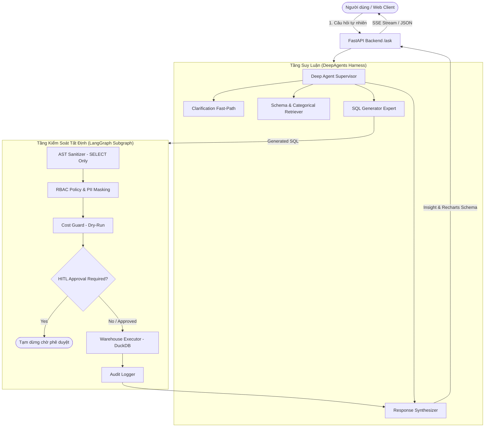

# AI Agent Text-to-SQL Self-Service Analytics

> **Enterprise Text-to-SQL Assistant**: Hệ thống trợ lý AI phân tích dữ liệu doanh nghiệp tự phục vụ (Self-Service Analytics) dựa trên chuẩn công nghiệp **TPC-H Benchmark (8 bảng quan hệ)**, kết hợp kiến trúc lai **DeepAgents Reasoning** và **LangGraph Deterministic Control Pipeline**.

---

## 🌟 Điểm Nổi Bật Của Hệ Thống

1. **Kho Dữ Liệu Chuỗi Cung Ứng & Phân Phối TPC-H (8 Bảng)**:
   - **Giao Dịch & Đơn Hàng (Transactions)**: `orders`, `lineitem`.
   - **Sản Phẩm & Tồn Kho (Products & Inventory)**: `part`, `partsupp`.
   - **Đối Tác & Khách Hàng (Partners & Customers)**: `customer`, `supplier`.
   - **Phân Cấp Địa Lý (Geography)**: `nation`, `region`.
2. **Kiến Trúc Lai (Hybrid Architecture)**:
   - **Tầng Suy Luận (DeepAgents Harness)**: Supervisor lập kế hoạch với `TodoListMiddleware`, phối hợp các chuyên gia phụ trách: *Question Clarification*, *Schema & Categorical Retriever*, *SQL Generator*, *Response Synthesizer*.
   - **Tầng Kiểm Soát Tất Định (LangGraph Control Pipeline Subgraph)**: Hàng rào bảo vệ vững chắc qua 5 chốt chặn cứng:
     - 🛡️ **AST Sanitizer (`sqlglot`)**: Chặn 100% câu lệnh ghi (`INSERT`, `UPDATE`, `DROP`, etc.) và SQL Injection.
     - 🔐 **RBAC & PII Enforcer**: Tự động áp dụng phân quyền theo vai trò (`admin`, `analyst`, `business_user`) và bảo vệ các cột nhạy cảm (`c_phone`, `c_address`, `s_phone`, `c_acctbal`).
     - 💰 **Dry-run Cost Guard**: Ước tính chi phí quét dữ liệu và tự động kích hoạt phê duyệt khi vượt ngưỡng an toàn.
     - 👤 **Human-in-the-Loop (HITL Approval)**: Tạm dừng (`interrupt`) an toàn để người dùng xác nhận các thao tác chi phí cao hoặc nhạy cảm.
     - 📝 **Audit Logger**: Ghi vết kiểm toán toàn diện mọi truy vấn vào cơ sở dữ liệu governance.
3. **Giao Diện Trực Quan Hiện Đại (Next.js & Recharts)**:
   - Schema Explorer hiển thị 8 bảng TPC-H, phân loại 4 nhóm nghiệp vụ trực quan kèm từ điển cột song ngữ.
   - Thẻ câu hỏi mẫu TPC-H chuẩn mực (Top khách hàng theo doanh thu, Thống kê đơn trễ hạn, Doanh thu phân khúc thị trường).
   - Hiển thị timeline suy luận đa tác nhân, xem câu lệnh SQL với cú pháp tô màu và biểu đồ động tự động chọn loại trực quan hóa.

---

## 🏛️ Sơ Đồ Kiến Trúc Hệ Thống



---

## 🚀 Hướng Dẫn Cài Đặt & Khởi Chạy

### 1. Yêu cầu Tiên quyết
- **Python**: 3.11+
- **Node.js**: 18+ & npm
- **Hệ điều hành**: Windows, macOS hoặc Linux

### 2. Thiết lập Môi trường Python
```powershell
# Kích hoạt virtual environment
.venv\Scripts\Activate.ps1

# Cài đặt các thư viện phụ thuộc
pip install -r requirements.txt
```

#### 3. Cấu hình Biến Môi Trường
Tạo tệp `.env` từ `.env.example`:
```ini
LLM_PROVIDER=gemini # hoặc ollama
GEMINI_API_KEY=your_gemini_api_key_here
DUCKDB_PATH=data/tpch.duckdb
ENVIRONMENT=development
```

### 4. Khởi tạo Cơ sở dữ liệu TPC-H
```powershell
# Nạp dữ liệu TPC-H vào DuckDB (8 bảng chuỗi cung ứng, SF=0.1)
python -c "from src.utils.tpch_seeder import seed_tpch_data; seed_tpch_data('data/tpch.duckdb', 0.1)"
```

### 5. Khởi chạy Ứng dụng

**Backend FastAPI**:
```powershell
uvicorn src.api.main:app --reload --host 0.0.0.0 --port 8000
```
*Tài liệu API Swagger hiển thị tại:* `http://localhost:8000/docs`

**Frontend Next.js**:
```powershell
npm --prefix src/frontend run dev
```
*Truy cập giao diện Web tại:* `http://localhost:3000`

---

## 🧪 Kiểm Thử & Đánh Giá (Testing & Evals)

### Chạy Toàn Bộ Test Suite Python
```powershell
# Chạy hơn 290 unit tests và integration tests
pytest tests/ -v
```

### Chạy Frontend Vitest Suite
```powershell
# Chạy toàn bộ 26 test files (94 tests) giao diện người dùng
npm --prefix src/frontend run test
```

### Chạy Bộ Benchmark Độ Chính Xác SQL (Spider-like Benchmark)
Bộ dataset 50 câu hỏi tiếng Việt bao phủ 4 cấp độ khó (Easy, Medium, Hard, Extra Hard) trên cơ sở dữ liệu TPC-H:
```powershell
# Chạy đánh giá trực tiếp cùng Agent LLM
python -m evals.benchmark_runner --dataset evals/datasets/benchmark_vi.json
```

---

## 📂 Cấu Trúc Thư Mục Chính

```
text2sql-agent/
├── AGENTS.md                  # Hướng dẫn cố định và 3 Golden Rules cho AI Agent
├── README.md                  # Giới thiệu dự án và hướng dẫn vận hành
├── requirements.txt           # Danh mục thư viện Python
├── data/
│   └── tpch.duckdb            # Kho dữ liệu chuẩn TPC-H 8 bảng chuỗi cung ứng
├── docs/                      # Tài liệu kỹ thuật kiến trúc & lược đồ dữ liệu
│   ├── DATABASE_SCHEMA.md     # Từ điển dữ liệu chi tiết 8 bảng TPC-H
│   ├── agent-architecture-v2.md
│   └── migrate_to_tpch/       # Kế hoạch chuyển đổi toàn diện sang TPC-H
├── evals/                     # Bộ benchmark đánh giá độ chính xác (VSR & EX)
│   ├── datasets/benchmark_vi.json # 50 câu hỏi TPC-H tiếng Việt + SQL Ground-truth
│   └── benchmark_runner.py    # Runner đo lường VSR, EX và Latency
├── src/
│   ├── agents/                # Tầng điều phối & các chuyên gia DeepAgents
│   ├── api/                   # FastAPI endpoints & HITL WebSocket/REST
│   ├── models/                # Pydantic schemas, RBAC & State models
│   ├── utils/                 # AST sanitizer, DB connector, Schema context
│   └── frontend/              # Giao diện Next.js, Schema Explorer & Recharts
└── tests/                     # Hệ thống kiểm thử tự động toàn diện
```