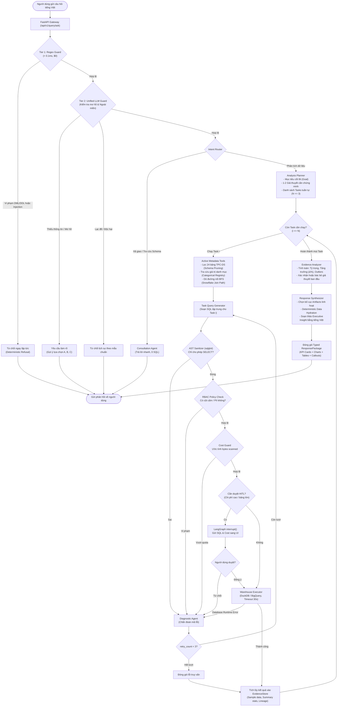
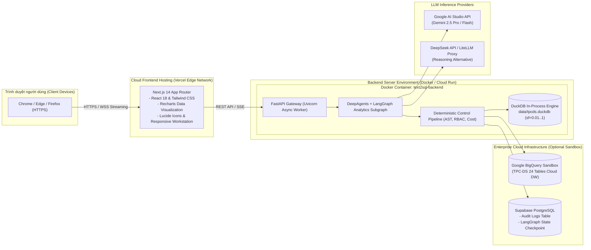

# ARCHITECTURE.md — System Architecture & Design Specification

> **Dự án**: AI Agent Text-to-SQL Self-Service Analytics cho dữ liệu doanh nghiệp  
> **Phiên bản**: 4.0 (Three-Tier Architecture + Hybrid Agentic Governance Engine)  
> **Bộ dữ liệu chuẩn**: **TPC-H Benchmark (Supply Chain & Distribution Enterprise Data Warehouse - 8 Bảng)**  
> **Trọng tâm tài liệu**: Trả lời câu hỏi *"Hệ thống này được tổ chức như thế nào, các tầng thành phần giao tiếp ra sao, và dữ liệu chuyển hóa theo luồng nào?"*

---

## 1. TỔNG QUAN KIẾN TRÚC HỆ THỐNG (SYSTEM OVERVIEW)

Hệ thống được thiết kế theo mô hình **Kiến trúc 3 tầng (Three-Tier Architecture)** kết hợp với **Mô hình Tác tử Lai (Hybrid Agentic Architecture)** nhằm phân định ranh giới tuyệt đối giữa:
1. **Tương tác người dùng (Frontend Workstation)**: Trình diễn dữ liệu trực quan, điều hành phân tích, duyệt lệnh an toàn.
2. **Cổng dịch vụ doanh nghiệp (Backend Gateway)**: Tiếp nhận yêu cầu, quản lý phiên làm việc đa luồng (`thread_id`), xác thực và điều phối.
3. **Bộ não suy luận phân cấp (AI Reasoning Engine)**: Mô phỏng phương pháp luận của Senior Data Analyst — tiếp nhận bài toán, làm rõ mơ hồ, lập kế hoạch phân rã giả thuyết, thu thập bằng chứng và tổng hợp báo cáo.
4. **Hàng rào an ninh tất định (Deterministic Governance Pipeline)**: Dùng mã nguồn Python thuần túy (AST parser `sqlglot`, RBAC policy, Cost Guard, HITL `interrupt`, Timeout & Limit) để bảo đảm an toàn dữ liệu 100%, không trao quyền an ninh cho LLM.
5. **Kho dữ liệu chuẩn công nghiệp (Enterprise Data Warehouse)**: Vận hành trên lược đồ quan hệ 8 bảng TPC-H, kết hợp công cụ dò đường khóa ngoại BFS và các thước đo chuẩn dbt.

### Bốn nguyên tắc thiết kế cốt lõi:
1. **Separation of Concerns (Tách biệt trách nhiệm)**: Frontend chỉ đảm nhiệm hiển thị & tương tác; Backend lo xác thực và quản lý phiên; Agent lo suy luận logic; Control Pipeline lo bảo mật; Warehouse lo lưu trữ và xử lý truy vấn OLAP.
2. **Hybrid Reasoning & Deterministic Control**: LLM chỉ được dùng ở các khâu đòi hỏi tư duy ngôn ngữ linh hoạt (hiểu ý định, phân rã giả thuyết, viết SQL, diễn giải insight). Toàn bộ các bước kiểm tra an toàn (chặn DDL/DML, lọc cột PII, đo bytes quét, phê duyệt con người, log kiểm toán) bắt buộc thực thi bằng **Code tất định (0 token LLM)**.
3. **Multi-Query Evidence Collection over Monolithic SQL**: Thay vì ép LLM sinh một câu lệnh SQL phức tạp dài hàng trăm dòng, hệ thống phân rã thành tối đa 3 nhiệm vụ truy vấn tập trung ($N \le 3$), tích lũy kết quả vào `EvidenceStore` rồi mới phân tích tương quan.
4. **Typed Contract Delivery (Zero Regex Scraping)**: Toàn bộ dữ liệu trao đổi giữa Backend và Frontend đóng gói trong các mô hình định kiểu mạnh (Pydantic V2 `ResponsePackage` và `ArtifactBundle`), triệt tiêu hoàn toàn rủi ro vỡ giao diện do regex parsing chuỗi Markdown.

---

## 2. BA SƠ ĐỒ KIẾN TRÚC CỐT LÕI (THE 3 CORE DIAGRAMS)

---

### Diagram 1: System Overview Diagram (Bức tranh toàn cảnh hệ thống)

```mermaid
graph TB
    subgraph ClientLayer ["1. Tầng Trình duyệt & Người dùng (Client Layer)"]
        UserAnalyst["Analyst (Hỏi kinh doanh, khám phá dữ liệu)"]
        UserAdmin["Admin (Quản trị chính sách, kiểm soát chi phí & audit)"]
    end

    subgraph FrontendLayer ["2. Tầng Giao diện Điều hành (Next.js Workstation UI)"]
        Launchpad["Executive Launchpad (Khởi tạo câu hỏi, mẫu TPC-DS)"]
        ChatUI["Chat Interface (Hỏi đáp tiếng Việt, SSE Streaming)"]
        InspectorDrawer["Inspector Drawer (Theo dõi tiến trình & Reasoning Traces)"]
        SchemaDrawer["TPC-DS Schema Explorer (24 bảng & Danh bạ chỉ mục)"]
        HITLModal["HITL Approval Modal (Xem trước SQL, Cost & Phê duyệt)"]
        ComposableViz["Composable Visualizer (KPI Cards, Recharts, Data Table)"]
    end

    subgraph BackendLayer ["3. Tầng Dịch vụ Cổng (FastAPI Gateway)"]
        APIRouter["API Router (/ask, /approve, /history, /metrics)"]
        AuthMiddleware["RBAC & Security Context Middleware"]
        SessionMgr["Session Checkpointer (LangGraph MemorySaver / SQLite)"]
        AuditService["Audit Logger Service (JSON Lines / Postgres)"]
    end

    subgraph AgentLayer ["4. Tầng Trí tuệ Tác tử (Hybrid Agent Engine v4.0)"]
        Gatekeeper["Pre-flight Gatekeeper (Regex Guard + Unified LLM Clarification)"]
        Supervisor["Master DeepAgents Supervisor (Pure Orchestrator)"]
        
        subgraph AnalyticsGraph ["Analytics LangGraph Subgraph (v4.0)"]
            Planner["Analysis Planner (Goal + Hypotheses + Task DAG <= 3)"]
            TaskExecutor["Sequential Task Executor (Task SQL Gen + Schema Tools)"]
            EvidenceStore[("Evidence Store: Tích lũy kết quả truy vấn")]
            EvidenceAnalyzer["Evidence Analyzer (Tính toán toán học & Kiểm chứng giả thuyết)"]
            Synthesizer["Response Synthesizer (Composable Spec + Data Hydration)"]
        end

        subgraph ControlGraph ["Deterministic Control Pipeline Subgraph"]
            ASTCheck["AST Sanitizer (sqlglot - SELECT only)"]
            RBACCheck["RBAC Policy (Chặn PII: Họ tên, Email, Địa chỉ)"]
            CostGuard["Cost Guard (DuckDB explain / BigQuery dryRun)"]
            HITLGate["HITL Gate (LangGraph interrupt)"]
            Executor["Warehouse Executor (Timeout 30s + LIMIT 1000)"]
            DiagAgent["Error Diagnostic Agent (Self-correction <= 3 lần)"]
            AuditNode["Audit Logger Node"]
        end
    end

    subgraph StorageLayer ["5. Tầng Dữ liệu & Kho Phân tích (TPC-DS Warehouse)"]
        WarehouseDuckDB[("DuckDB: data/tpcds.duckdb (Local OLAP 24 bảng)")]
        WarehouseCloud[("Google BigQuery / Supabase Sandbox (Cloud DW)")]
        CategoricalIndex[("Categorical Registry & Inverted Keyword Map")]
        AuditDB[("SQLite / PostgreSQL (Sessions & Audit Logs)")]
    end

    subgraph ExternalLLM ["6. Dịch vụ Mô hình Ngôn ngữ Lớn"]
        LLMTier1["Tier 1 (Reasoning): Google Gemini 2.5 Pro / Claude 3.5 Sonnet"]
        LLMTier2["Tier 2 (Fast/Utility): Google Gemini 2.5 Flash / Haiku"]
    end

    %% Client -> Frontend
    UserAnalyst --> Launchpad
    UserAnalyst --> ChatUI
    UserAnalyst --> HITLModal
    UserAdmin --> InspectorDrawer
    UserAdmin --> SchemaDrawer

    %% Frontend -> Backend
    ChatUI -->|HTTP POST /api/v1/query/ask| APIRouter
    HITLModal -->|HTTP POST /api/v1/query/approve| APIRouter
    InspectorDrawer -->|HTTP GET /api/v1/query/history| APIRouter

    %% Backend internal
    APIRouter --> AuthMiddleware
    APIRouter --> SessionMgr
    APIRouter --> Gatekeeper

    %% Gatekeeper -> Branches
    Gatekeeper -->|Bị chặn an toàn| APIRouter
    Gatekeeper -->|Cần làm rõ| ChatUI
    Gatekeeper -->|Hợp lệ| Supervisor

    %% Supervisor -> Analytics
    Supervisor --> Planner
    Planner --> TaskExecutor
    TaskExecutor <--> CategoricalIndex
    TaskExecutor --> ASTCheck

    %% Control Pipeline Flow
    ASTCheck --> RBACCheck
    RBACCheck --> CostGuard
    CostGuard --> HITLGate
    HITLGate -->|interrupt payload| HITLModal
    HITLGate -->|Duyệt| Executor
    Executor --> WarehouseDuckDB
    Executor --> WarehouseCloud
    Executor --> EvidenceStore
    Executor -.->|Lỗi thực thi| DiagAgent
    DiagAgent -.->|Sửa truy vấn (<=3 lần)| TaskExecutor
    Executor --> AuditNode
    AuditNode --> AuditService
    AuditService --> AuditDB

    %% Evidence -> Analyzer -> Synthesizer
    EvidenceStore --> EvidenceAnalyzer
    EvidenceAnalyzer --> Synthesizer
    Synthesizer --> ComposableViz

    %% LLM connections
    Planner --> LLMTier1
    TaskExecutor --> LLMTier1
    EvidenceAnalyzer --> LLMTier1
    Synthesizer --> LLMTier2
    Gatekeeper --> LLMTier2
    DiagAgent --> LLMTier2
```

---

### Diagram 2: Agent Flow Diagram (Luồng hoạt động v4.0 chi tiết)



---

### Diagram 3: Deployment & Infrastructure Topology (Mô hình triển khai)



---

## 3. CHI TIẾT CÁC THÀNH PHẦN (COMPONENTS BREAKDOWN)

### 3.1. Tầng Giao diện Điều hành (Next.js Workstation)
- **Executive Launchpad ([`ExecutiveLaunchpad.tsx`](file:///d:/Text2SQL-AI-Agent/src/frontend/components/chat/ExecutiveLaunchpad.tsx))**: Khung gợi ý ngữ cảnh thông minh, phân chia theo 3 miền kinh doanh chính của TPC-DS (Doanh số Đa kênh, Quản trị Tồn kho, Hiệu quả Khuyến mãi).
- **TPC-DS Schema Explorer ([`tpcdsSchema.ts`](file:///d:/Text2SQL-AI-Agent/src/frontend/data/tpcdsSchema.ts), [`SchemaDrawer.tsx`](file:///d:/Text2SQL-AI-Agent/src/frontend/components/layout/SchemaDrawer.tsx))**: Bảng danh mục 24 bảng dữ liệu, cấu trúc cột, khóa ngoại và các chỉ số nghiệp vụ chuẩn (Semantic Metrics).
- **Inspector Drawer ([`InspectorDrawer.tsx`](file:///d:/Text2SQL-AI-Agent/src/frontend/components/layout/InspectorDrawer.tsx))**: Cửa sổ chuyên dụng hiển thị vết suy luận (Reasoning Traces), kế hoạch nhiệm vụ (`AnalysisPlan`), câu lệnh SQL đã sinh và số bytes quét.
- **HITL Approval Modal**: Khung xem trước câu lệnh SQL kèm chi phí ước tính, chặn tiến trình thực thi cho đến khi người dùng bấm xác nhận.
- **Composable Visualizer**: Hiển thị linh hoạt các khối Artifact: KPI Summary Cards, Biểu đồ đa dạng (Bar, Line, Area, Composed) và Data Table có tính năng xuất CSV.

### 3.2. Tầng Cổng dịch vụ (Backend FastAPI Gateway)
- **API Endpoints ([`src/api/routes/query.py`](file:///d:/Text2SQL-AI-Agent/src/api/routes/query.py))**:
  - `POST /api/v1/query/ask`: Tiếp nhận câu hỏi, điều phối qua Gatekeeper và kích hoạt quy trình phân tích v4.0.
  - `POST /api/v1/query/approve`: Tiếp nhận phản hồi duyệt lệnh HITL của người dùng để tiếp tục (resume) đồ thị LangGraph.
  - `GET /api/v1/query/history/{thread_id}`: Truy xuất lịch sử các gói Artifact và câu hỏi theo phiên.
  - `GET /api/v1/query/metrics`: Báo cáo các chỉ số hiệu năng (Latency, Tỷ lệ thành công, Token tiêu thụ).
- **Lifespan Warmup & Database Dependency ([`src/api/main.py`](file:///d:/Text2SQL-AI-Agent/src/api/main.py), [`src/api/dependencies.py`](file:///d:/Text2SQL-AI-Agent/src/api/dependencies.py))**: Tự động kiểm tra và khởi tạo dữ liệu mẫu TPC-DS (24 bảng) vào DuckDB thông qua [`tpcds_seeder.py`](file:///d:/Text2SQL-AI-Agent/src/utils/tpcds_seeder.py) ngay khi máy chủ khởi động.

### 3.3. Tầng Trí tuệ Tác tử (AI Agent Engine v4.0)
- **Pre-flight Gatekeeper ([`preflight_gatekeeper.py`](file:///d:/Text2SQL-AI-Agent/src/agents/preflight_gatekeeper.py))**:
  - *Tier 1*: Chốt chặn Regex cực nhanh (< 0.1ms) ngăn chặn các từ khóa can thiệp dữ liệu (`DROP`, `DELETE`, `UPDATE`, `ALTER`, `TRUNCATE`) và các mẫu SQL Injection kinh điển.
  - *Tier 2*: Mô hình LLM phân tích nhanh độ mơ hồ (Ambiguity Check) và phạm vi bài toán. Nếu câu hỏi thiếu điều kiện mốc thời gian hoặc kênh bán $\to$ trả về danh sách gợi ý A, B, C để người dùng chọn nhanh.
- **Analysis Planner ([`planner.py`](file:///d:/Text2SQL-AI-Agent/src/agents/analytics/planner.py))**:
  - Phân rã câu hỏi lớn thành mục tiêu tổng quan, 1-2 giả thuyết và chuỗi nhiệm vụ truy vấn độc lập ($N \le 3$ tasks).
- **Sequential Task Executor ([`task_executor.py`](file:///d:/Text2SQL-AI-Agent/src/agents/analytics/task_executor.py))**:
  - Sử dụng các công cụ Active Metadata (`search_tables_and_columns`, `find_join_path` bằng thuật toán BFS, `get_column_samples_and_values`) để cung cấp chính xác ngữ cảnh cho LLM viết SQL.
  - Đóng gói từng kết quả thực thi vào cấu trúc `QueryArtifact` và lưu vào `EvidenceStore`.
- **Hàng rào Kiểm duyệt Tất định (Deterministic Control Pipeline - [`builder.py`](file:///d:/Text2SQL-AI-Agent/src/agents/control_pipeline/builder.py))**:
  - *AST Sanitizer*: Kiểm tra cây cú pháp trừu tượng, bắt buộc Root Node là `exp.Select`, quét đệ quy triệt tiêu mọi node ghi dữ liệu. Tự động chèn `LIMIT 1000`.
  - *RBAC Enforcer*: Kiểm tra danh sách bảng và cột với vai trò người dùng (`Analyst` vs `Admin`), chặn đứng các cột PII của khách hàng (`c_first_name`, `c_last_name`, `c_email_address`, `c_birth_country`).
  - *Cost Guard*: Ước lượng dung lượng quét bytes trước khi thực thi bằng `EXPLAIN` (DuckDB) hoặc `dryRun` (BigQuery).
  - *HITL Gate*: Tạm dừng luồng bằng `interrupt()` khi truy vấn tác động bảng lớn hoặc chi phí vượt hạn mức.
  - *Error Diagnostic Agent*: Phân tích thông báo lỗi cú pháp hoặc lỗi cơ sở dữ liệu để đưa ra chỉ dẫn khắc phục chính xác cho lần retry tiếp theo (khống chế tối đa 3 lần).
- **Evidence Analyzer ([`evidence_analyzer.py`](file:///d:/Text2SQL-AI-Agent/src/agents/analytics/evidence_analyzer.py))**:
  - Thực hiện các phép tính toán học tất định: tỷ lệ tăng trưởng ($\Delta\%$), tỷ trọng đóng góp, tìm giá trị cực đại/cực tiểu. Kiểm chứng xem giả thuyết ban đầu là ĐÚNG hay SAI dựa trên bằng chứng thu thập được.
- **Response Synthesizer ([`response_synthesizer.py`](file:///d:/Text2SQL-AI-Agent/src/agents/analytics/response_synthesizer.py))**:
  - Cơ chế One-Shot Spec Selection + Deterministic Data Hydration: Chọn bố cục Artifacts phù hợp nhất (Cards, Charts, Tables, Callouts) và đưa dữ liệu thật vào cấu trúc mà không để LLM tự bịa số liệu.

---

## 4. HỢP ĐỒNG DỮ LIỆU ĐỊNH KIỂU MẠNH (TYPED DATA CONTRACTS)

Thay thế hoàn toàn cơ chế trích xuất regex từ văn bản thô, hệ thống chuẩn hóa toàn bộ cấu trúc dữ liệu bằng **Pydantic V2 Models** ([`src/models/artifacts.py`](file:///d:/Text2SQL-AI-Agent/src/models/artifacts.py)):

### 4.1. Kế hoạch phân tích (`AnalysisPlan`)
```python
class AnalysisPlan(BaseModel):
    plan_id: str = Field(default_factory=lambda: str(uuid.uuid4()))
    original_question: str
    goal: str  # Mục tiêu phân tích cốt lõi
    hypotheses: list[str]  # 1-2 giả thuyết kinh doanh cần kiểm chứng
    tasks: list[AnalysisTask]  # Danh sách tối đa 3 nhiệm vụ truy vấn
    created_at: datetime = Field(default_factory=datetime.utcnow)
```

### 4.2. Bằng chứng truy vấn (`QueryArtifact`)
```python
class QueryArtifact(BaseModel):
    artifact_id: str = Field(default_factory=lambda: str(uuid.uuid4()))
    task_id: str
    sql: str
    dialect: Literal["duckdb", "bigquery"] = "duckdb"
    explanation: str
    tables_used: list[str]  # Danh sách bảng TPC-DS tham gia truy vấn
    columns_used: list[str]
    status: Literal[
        "SUCCESS",
        "BLOCKED_AST",
        "BLOCKED_RBAC",
        "BLOCKED_COST",
        "BLOCKED_HITL",
        "DB_ERROR",
        "TIMEOUT",
    ]
    row_count: int = 0
    data_sample: list[dict[str, Any]] = Field(default_factory=list)
    summary_stats: dict[str, Any] = Field(default_factory=dict)
    bytes_scanned: int = 0
    execution_time_ms: float = 0.0
```

### 4.3. Gói phản hồi hoàn chỉnh (`ResponsePackage`)
```python
class ResponsePackage(BaseModel):
    package_id: str = Field(default_factory=lambda: str(uuid.uuid4()))
    thread_id: str
    executive_summary: str  # Đoạn tóm tắt điều hành bằng tiếng Việt
    artifacts: list[PresentationArtifact]  # Danh sách KPI Cards, Charts, Tables
    plan_summary: PlanSummaryArtifact
    query_lineage: list[QueryLineageItem]  # Minh chứng nguồn gốc dữ liệu
    total_execution_time_ms: float
    total_bytes_scanned: int
```

---

## 5. BẢN GHI QUYẾT ĐỊNH KIẾN TRÚC (ARCHITECTURE DECISION RECORDS - ADR)

### ADR-0001: Kiến trúc Tác tử Lai (Hybrid Agentic Governance)
- **Quyết định**: Kết hợp DeepAgents làm khung điều phối tư duy (Outer Harness) và đóng gói toàn bộ quy trình kiểm duyệt an toàn bằng một Subgraph LangGraph tất định (`CompiledSubAgent`).
- **Lý do**: Không bao giờ giao quyền kiểm soát an ninh cho LLM. AST check, RBAC, Cost check và Audit log phải chạy bằng mã nguồn Python tất định với độ tin cậy 100%.

### ADR-0002: Chuyển đổi toàn diện sang Chuẩn TPC-DS Benchmark (24 Bảng)
- **Quyết định**: Nâng cấp từ bộ dữ liệu TPC-H (8 bảng đơn kênh) lên TPC-DS (24 bảng bán lẻ đa kênh: Store, Web, Catalog, Returns, Inventory).
- **Lý do**: TPC-DS phản ánh chính xác cấu trúc Enterprise Data Warehouse hiện đại (Snowflake Schema), đặt ra các thách thức kỹ thuật có giá trị học thuật cao (tìm đường nối BFS, liên kết bảng thời gian `date_dim`, phân định doanh thu thuần Net Paid).

### ADR-0003: Kiến trúc Phân tích Đa Nhiệm v4.0 (AnalysisPlan & Evidence Collection)
- **Quyết định**: Thay thế mô hình "1 câu hỏi $\to$ 1 câu SQL" bằng quy trình phân rã kế hoạch đa bước tuần tự, tích lũy bằng chứng vào `EvidenceStore` trước khi tổng hợp.
- **Lý do**: Các câu hỏi phân tích kinh doanh thực tế luôn có tính chất tìm kiếm nguyên nhân gốc rễ (Root Cause Analysis), không thể giải quyết bằng một câu SELECT đơn lẻ mà không làm bùng nổ độ phức tạp và lỗi của SQL.

### ADR-0004: Định kiểu dữ liệu mạnh và Cơ chế Composable Hydration (Zero Regex Scraping)
- **Quyết định**: Khai tử hoàn toàn việc parse JSON/SQL từ chuỗi Markdown bằng Regular Expression; chuẩn hóa 100% qua Pydantic V2 `ResponsePackage`.
- **Lý do**: Loại bỏ hoàn toàn lỗi crash giao diện người dùng khi văn phong của LLM thay đổi; đảm bảo khả năng mở rộng và kiểm thử tự động của hệ thống.
