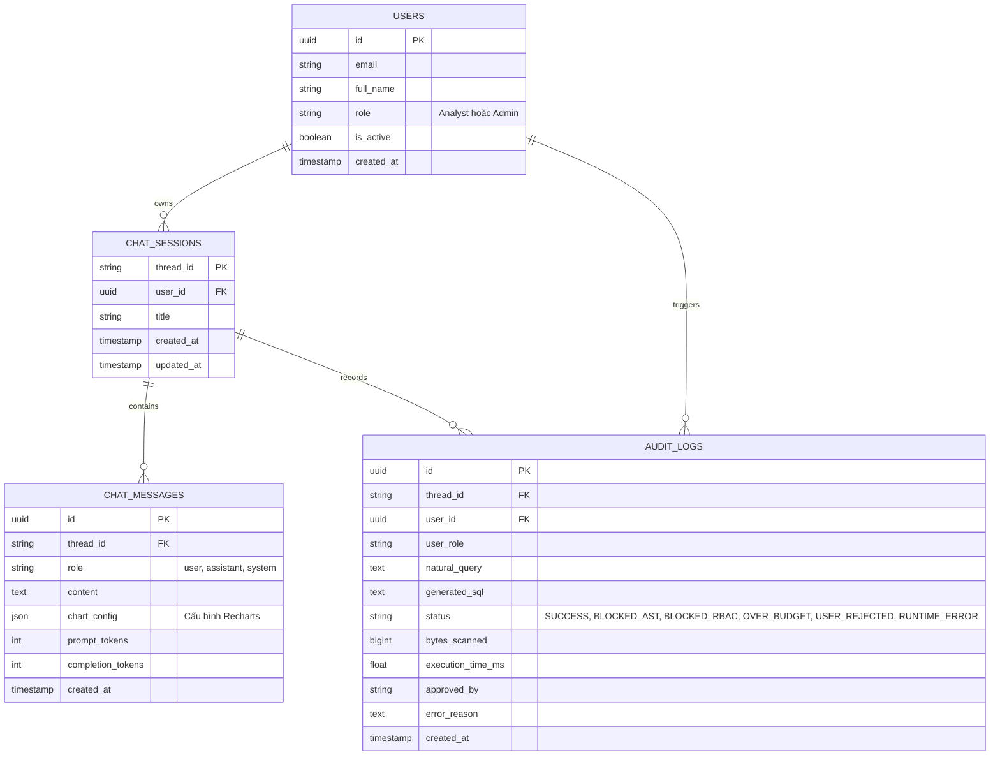

# DATABASE_SCHEMA.md — Database Architecture & Data Dictionary

> **Dự án**: AI Agent Text-to-SQL Self-Service Analytics cho dữ liệu doanh nghiệp  
> **Phiên bản**: 3.0 (Chuẩn hóa theo TPC-DS Benchmark Omnichannel Retail Schema - 24 Bảng)  
> **Phạm vi**: 
> 1. **Application & Governance Database**: Quản lý người dùng, phiên hội thoại, phân quyền và Audit Log.
> 2. **Business Analytics Warehouse (TPC-DS Benchmark)**: Kho dữ liệu bán lẻ đa kênh chuẩn quốc tế (24 bảng: Store, Web, Catalog, Returns, Inventory, Dimensions) phục vụ AI Agent chuyển đổi Text-to-SQL.
> 3. **Legacy Warehouse Compatibility (TPC-H)**: Hỗ trợ chuyển đổi tuần tự (Strangler Fig pattern).

---

## 1. TỔNG QUAN HAI LỚP CƠ SỞ DỮ LIỆU

Hệ thống phân định rạch ròi giữa 2 lớp cơ sở dữ liệu:
- **Lớp 1: Operational & Governance Database (PostgreSQL / SQLite)**: Phục vụ Backend FastAPI, quản lý Session, Checkpointer LangGraph, lưu trữ vết kiểm định Audit Log và các Few-shot Examples.
- **Lớp 2: Enterprise Analytics Warehouse (DuckDB / BigQuery Sandbox - TPC-DS Schema 24 Bảng)**: Kho dữ liệu kinh doanh chuẩn công nghiệp mô phỏng chuỗi phân phối đa kênh (Omnichannel: Cửa hàng thực tế, Catalog đặt hàng qua thư tín, và Kênh thương mại điện tử Web). Nơi AI Agent thực thi các câu lệnh `SELECT` để trả số liệu cho người dùng.

---

## 2. LỚP 1: APPLICATION & GOVERNANCE DATABASE

Lớp này quản lý người dùng, trạng thái hội thoại và vết an toàn.

### 2.1. Sơ đồ thực thể ERD (Application Layer)

### 2.2. Chi tiết Từ điển Dữ liệu (Governance Tables)

#### Bảng `users`
| Cột | Kiểu | Nullable | Khóa | Mô tả |
|---|---|---|---|---|
| `id` | UUID | No | PK | Định danh người dùng duy nhất |
| `email` | VARCHAR(255) | No | Unique | Email đăng nhập |
| `full_name` | VARCHAR(100) | No | | Tên hiển thị của nhân sự |
| `role` | VARCHAR(50) | No | | Quyền hạn: `analyst`, `admin`, `viewer` |
| `is_active` | BOOLEAN | No | | Cờ trạng thái tài khoản |
| `created_at` | TIMESTAMP | No | | Thời gian tạo tài khoản |

#### Bảng `chat_sessions`
| Cột | Kiểu | Nullable | Khóa | Mô tả |
|---|---|---|---|---|
| `thread_id` | VARCHAR(100) | No | PK | ID phiên hội thoại (gắn với LangGraph thread) |
| `user_id` | UUID | No | FK | Khóa ngoại tham chiếu tới `users(id)` |
| `title` | VARCHAR(255) | Yes | | Tiêu đề tóm tắt chủ đề trò chuyện |
| `created_at` | TIMESTAMP | No | | Thời gian bắt đầu phiên |
| `updated_at` | TIMESTAMP | No | | Thời gian tin nhắn cuối cùng |

#### Bảng `chat_messages`
| Cột | Kiểu | Nullable | Khóa | Mô tả |
|---|---|---|---|---|
| `id` | UUID | No | PK | Định danh tin nhắn |
| `thread_id` | VARCHAR(100) | No | FK | Khóa ngoại tham chiếu tới `chat_sessions(thread_id)` |
| `role` | VARCHAR(20) | No | | Vai trò: `user` hoặc `assistant` |
| `content` | TEXT | No | | Nội dung câu hỏi hoặc lời diễn giải insight |
| `chart_config` | JSONB / TEXT | Yes | | Cấu hình biểu đồ Recharts (nếu có) |
| `prompt_tokens`| INT | Yes | | Số lượng token input LLM |
| `completion_tokens` | INT | Yes | | Số lượng token output LLM |
| `created_at` | TIMESTAMP | No | | Thời gian gửi tin |

#### Bảng `audit_logs` (Chốt chặn thanh tra & chi phí)
| Cột | Kiểu | Nullable | Khóa | Mô tả |
|---|---|---|---|---|
| `id` | UUID | No | PK | Mã định danh bản ghi audit |
| `thread_id` | VARCHAR(100) | No | FK | Phiên trò chuyện phát sinh truy vấn |
| `user_id` | UUID | No | FK | Người yêu cầu chạy truy vấn |
| `user_role` | VARCHAR(50) | No | | Vai trò người dùng tại thời điểm chạy |
| `natural_query`| TEXT | No | | Câu hỏi tiếng Việt ban đầu |
| `generated_sql`| TEXT | No | | Câu lệnh SQL được sinh ra |
| `status` | VARCHAR(50) | No | | `SUCCESS`, `BLOCKED_AST`, `BLOCKED_RBAC`, `OVER_BUDGET`, `USER_REJECTED`, `RUNTIME_ERROR` |
| `bytes_scanned`| BIGINT | Yes | | Dung lượng dữ liệu đã quét trên warehouse |
| `execution_time_ms` | FLOAT | Yes | | Thời gian truy vấn warehouse thực tế |
| `approved_by` | VARCHAR(100)| Yes | | Tên/ID người xác nhận HITL (hoặc `AUTO`) |
| `error_reason` | TEXT | Yes | | Chi tiết nguyên nhân nếu truy vấn bị từ chối/thất bại |
| `created_at` | TIMESTAMP | No | | Thời điểm ghi nhận |

---

## 3. LỚP 2: ENTERPRISE ANALYTICS WAREHOUSE (CHUẨN TPC-DS 24 BẢNG)

Mô hình TPC-DS tổ chức theo mô hình **Constellation Schema (Nhiều Fact chia sẻ Dimensions)** gồm **24 bảng quan hệ**:
- **3 Fact Sales**: `store_sales`, `catalog_sales`, `web_sales`
- **3 Fact Returns**: `store_returns`, `catalog_returns`, `web_returns`
- **1 Fact Inventory**: `inventory`
- **17 Dimensions**: `date_dim`, `time_dim`, `item`, `customer`, `customer_address`, `customer_demographics`, `household_demographics`, `income_band`, `store`, `call_center`, `catalog_page`, `web_site`, `web_page`, `warehouse`, `ship_mode`, `promotion`, `reason`.

### 3.1. Sơ đồ thực thể ERD Tổng quan (TPC-DS Constellation)

```mermaid
erDiagram
    DATE_DIM ||--o{ STORE_SALES : sold_date
    DATE_DIM ||--o{ CATALOG_SALES : sold_date
    DATE_DIM ||--o{ WEB_SALES : sold_date
    DATE_DIM ||--o{ STORE_RETURNS : returned_date
    DATE_DIM ||--o{ CATALOG_RETURNS : returned_date
    DATE_DIM ||--o{ WEB_RETURNS : returned_date
    DATE_DIM ||--o{ INVENTORY : date

    ITEM ||--o{ STORE_SALES : item
    ITEM ||--o{ CATALOG_SALES : item
    ITEM ||--o{ WEB_SALES : item
    ITEM ||--o{ STORE_RETURNS : item
    ITEM ||--o{ INVENTORY : item

    CUSTOMER ||--o{ STORE_SALES : customer
    CUSTOMER ||--o{ CATALOG_SALES : customer
    CUSTOMER ||--o{ WEB_SALES : customer
    CUSTOMER ||--o{ STORE_RETURNS : customer

    CUSTOMER ||--o{ CUSTOMER_ADDRESS : current_addr
    CUSTOMER ||--o{ CUSTOMER_DEMOGRAPHICS : demographics

    STORE ||--o{ STORE_SALES : store
    STORE ||--o{ STORE_RETURNS : store

    WAREHOUSE ||--o{ INVENTORY : warehouse
    PROMOTION ||--o{ STORE_SALES : promo
    REASON ||--o{ STORE_RETURNS : return_reason
    SHIP_MODE ||--o{ CATALOG_SALES : ship_mode
```

---

### 3.2. Ba Quy Tắc Vàng Khi Truy Vấn TPC-DS (Golden Rules)

1. **Quy tắc ngày tháng (Date Dimension Join)**:
   - Các bảng Fact (`store_sales`, `web_sales`, etc.) không chứa cột ngày dạng DATE hay TIMESTAMP trực tiếp.
   - Luôn sử dụng surrogate key (ví dụ: `ss_sold_date_sk = date_dim.d_date_sk`) để lọc theo `d_year`, `d_moy` (tháng), `d_qoy` (quý).
2. **Quy tắc doanh thu thuần (Net Paid Metrics)**:
   - Luôn sử dụng các metric doanh thu thực tế sau chiết khấu: `ss_net_paid` (Store), `cs_net_paid` (Catalog), `ws_net_paid` (Web).
   - Lợi nhuận ròng tương ứng: `ss_net_profit`, `cs_net_profit`, `ws_net_profit`.
3. **Quy tắc bảo vệ PII & RBAC**:
   - Các cột: `c_first_name`, `c_last_name`, `c_email_address`, `c_birth_day`, `ca_street_name`, `ca_street_number` chứa thông tin định danh cá nhân nhạy cảm (PII).
   - Truy vấn người dùng thuộc vai trò bị hạn chế sẽ tự động bị chặn hoặc áp dụng mặt nạ (masking).

---

### 3.3. Danh mục 24 Bảng TPC-DS Chi tiết

| Tên Bảng | Phân Loại | Khóa Chính / Surrogate | Mô tả Nghiệp vụ | Cột Nhạy Cảm (PII) |
|---|---|---|---|---|
| `store_sales` | Fact Bán hàng | `ss_item_sk`, `ss_ticket_number` | Giao dịch bán lẻ tại chuỗi cửa hàng vật lý | Không |
| `catalog_sales` | Fact Bán hàng | `cs_item_sk`, `cs_order_number` | Giao dịch bán hàng qua danh mục Catalog / Bưu điện | Không |
| `web_sales` | Fact Bán hàng | `ws_item_sk`, `ws_order_number` | Giao dịch bán lẻ qua trang thương mại điện tử | Không |
| `store_returns` | Fact Trả hàng | `sr_item_sk`, `sr_ticket_number` | Đổi trả và hoàn tiền tại cửa hàng vật lý | Không |
| `catalog_returns`| Fact Trả hàng | `cr_item_sk`, `cr_order_number` | Đổi trả hàng qua kênh bưu chính Catalog | Không |
| `web_returns` | Fact Trả hàng | `wr_item_sk`, `wr_order_number` | Đổi trả hàng mua trực tuyến qua kênh Web | Không |
| `inventory` | Fact Tồn kho | `inv_date_sk`, `inv_item_sk`, `inv_warehouse_sk` | Số lượng tồn kho theo mặt hàng và kho hàng | Không |
| `customer` | Dimension | `c_customer_sk` | Thông tin hồ sơ khách hàng | `c_first_name`, `c_last_name`, `c_email_address` |
| `customer_address` | Dimension | `ca_address_sk` | Địa chỉ cư trú và giao hàng của khách hàng | `ca_street_number`, `ca_street_name` |
| `customer_demographics` | Dimension | `cd_demo_sk` | Nhân khẩu học (giới tính, hôn nhân, học vấn) | Không |
| `date_dim` | Dimension | `d_date_sk` | Lịch kinh doanh (ngày, tuần, tháng, quý, năm) | Không |
| `time_dim` | Dimension | `t_time_sk` | Chi tiết thời gian (giờ, phút, giây, ca bán) | Không |
| `item` | Dimension | `i_item_sk` | Danh mục hàng hóa, thương hiệu, ngành hàng | Không |
| `store` | Dimension | `s_store_sk` | Thông tin cửa hàng, diện tích, bang, quản lý | Không |
| `warehouse` | Dimension | `w_warehouse_sk` | Thông tin kho bãi và trung tâm phân phối | Không |
| `ship_mode` | Dimension | `sm_ship_mode_sk` | Phương thức vận chuyển (AIR, TRUCK, SHIP) | Không |
| `promotion` | Dimension | `p_promo_sk` | Chương trình ưu đãi, giảm giá tiếp thị | Không |
| `reason` | Dimension | `r_reason_sk` | Danh mục lý do đổi trả hàng | Không |
| `call_center` | Dimension | `cc_call_center_sk`| Trung tâm chăm sóc khách hàng & tiếp nhận đơn | `cc_name`, `cc_manager` |
| `catalog_page` | Dimension | `cp_catalog_page_sk`| Trang danh mục ấn phẩm phát hành | Không |
| `web_site` | Dimension | `web_site_sk` | Cổng thông tin website bán hàng | Không |
| `web_page` | Dimension | `wp_web_page_sk` | Trang đích, giỏ hàng, trang sản phẩm web | Không |
| `household_demographics`| Dimension | `hd_demo_sk` | Quy mô hộ gia đình và phương tiện đi lại | Không |
| `income_band` | Dimension | `ib_income_band_sk`| Bậc thu nhập của khách hàng | Không |

---

## 4. BẢO MẬT & PHÂN QUYỀN (RBAC & PII POLICY)

| Vai trò (Role) | Bảng Fact được truy cập | Xem Cột PII (`c_first_name`, `email`) | Xem Doanh thu thuần |
|---|---|---|---|
| **Admin** | Toàn quyền (7 Fact + 17 Dim) | Được phép toàn quyền | Toàn quyền |
| **Analyst** | Toàn quyền (7 Fact + 17 Dim) | Được phép (cho phân tích khách hàng) | Toàn quyền |
| **Business User** | Store / Catalog / Web Sales | Bị hạn chế / Ẩn cột PII | Toàn quyền |
| **Viewer** | Chỉ xem thống kê tổng hợp | Bị chặn tuyệt đối | Số liệu tổng hợp |

---

## 5. PHỤ LỤC: LƯỢC ĐỒ TPC-H (LEGACY COMPATIBILITY)

Nhằm duy trì tính tương thích chuyển đổi tuần tự (Strangler Fig Pattern), hệ thống vẫn hỗ trợ các kết nối tới kho dữ liệu TPC-H 8 bảng khi được chỉ định:
- `customer`, `orders`, `lineitem`, `part`, `partsupp`, `supplier`, `nation`, `region`.
- Database file mặc định: `data/tpcds.duckdb` (TPC-DS) và tùy chọn dự phòng `data/tpch.duckdb` (TPC-H).
