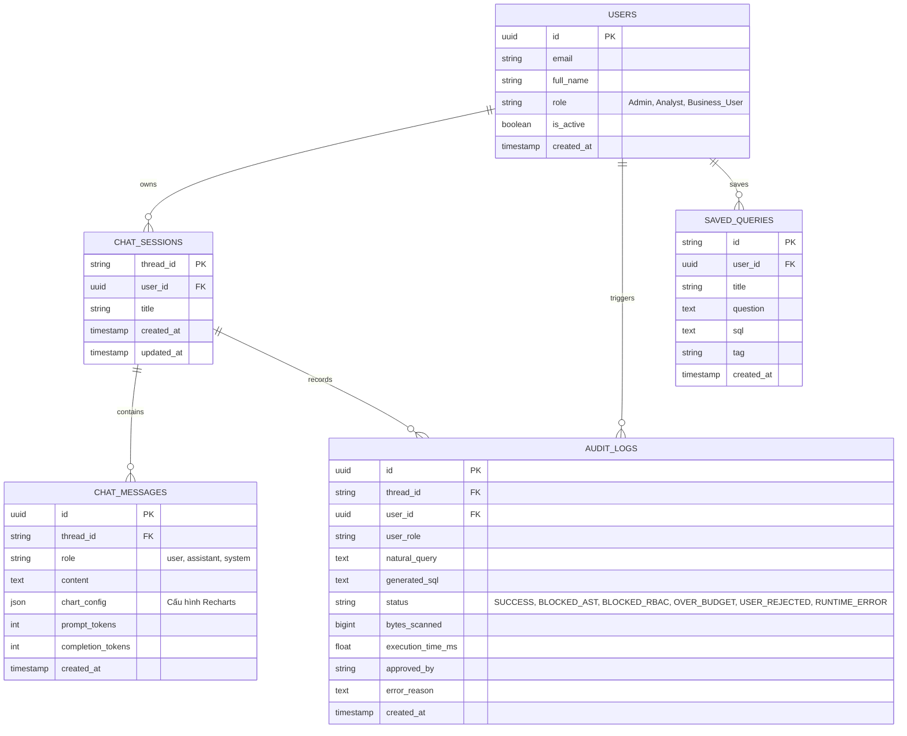
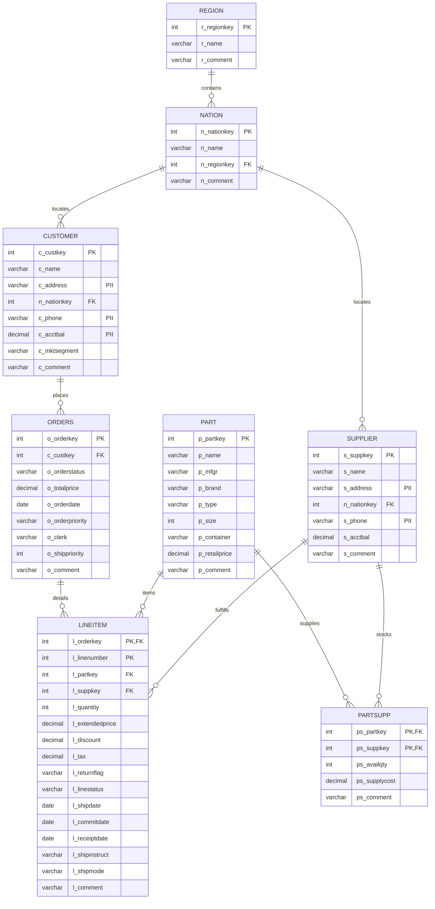

# DATABASE_SCHEMA.md — Database Architecture & Data Dictionary

> **Dự án**: AI Agent Text-to-SQL Self-Service Analytics cho dữ liệu doanh nghiệp  
> **Phiên bản**: 4.0 (Chuẩn hóa theo TPC-H Benchmark Supply Chain & Distribution Schema - 8 Bảng)  
> **Phạm vi**: 
> 1. **Application & Governance Database**: Quản lý người dùng, phiên hội thoại, phân quyền RBAC và vết kiểm toán Audit Log.
> 2. **Business Analytics Warehouse (TPC-H Benchmark)**: Kho dữ liệu chuỗi cung ứng, thương mại B2B/B2C chuẩn quốc tế (8 bảng: `orders`, `lineitem`, `part`, `partsupp`, `customer`, `supplier`, `nation`, `region`) phục vụ AI Agent chuyển đổi Text-to-SQL và phân tích kinh doanh tự phục vụ.

---

## 1. TỔNG QUAN HAI LỚP CƠ SỞ DỮ LIỆU

Hệ thống phân định rạch ròi giữa 2 lớp cơ sở dữ liệu:
- **Lớp 1: Operational & Governance Database (PostgreSQL / SQLite)**: Phục vụ Backend FastAPI, quản lý Session, Checkpointer LangGraph, lưu trữ vết kiểm định Audit Log và các truy vấn đã lưu (Saved Queries).
- **Lớp 2: Enterprise Analytics Warehouse (DuckDB - TPC-H Schema 8 Bảng)**: Kho dữ liệu kinh doanh chuẩn công nghiệp mô phỏng chuỗi cung ứng thương mại quốc tế (Đơn đặt hàng, Chi tiết mặt hàng, Khách hàng, Nhà cung cấp, Linh kiện, Kho linh kiện, Quốc gia, Khu vực). Nơi AI Agent thực thi các câu lệnh `SELECT` kiểm duyệt AST để trả số liệu cho người dùng.

---

## 2. LỚP 1: APPLICATION & GOVERNANCE DATABASE

Lớp này quản lý tài khoản người dùng, phiên hội thoại đa lượt và vết kiểm toán an toàn.

### 2.1. Sơ đồ thực thể ERD (Application Layer)

### 2.2. Chi tiết Từ điển Dữ liệu (Governance Tables)

#### Bảng `users`
| Cột | Kiểu | Nullable | Khóa | Mô tả |
|---|---|---|---|---|
| `id` | UUID | No | PK | Định danh người dùng duy nhất |
| `email` | VARCHAR(255) | No | Unique | Email đăng nhập công việc |
| `full_name` | VARCHAR(100) | No | | Tên hiển thị của nhân sự |
| `role` | VARCHAR(50) | No | | Quyền hạn: `Admin`, `Analyst`, `Business_User` |
| `is_active` | BOOLEAN | No | | Cờ trạng thái tài khoản hoạt động |
| `created_at` | TIMESTAMP | No | | Thời gian tạo tài khoản |

#### Bảng `chat_sessions`
| Cột | Kiểu | Nullable | Khóa | Mô tả |
|---|---|---|---|---|
| `thread_id` | VARCHAR(100) | No | PK | ID phiên hội thoại (gắn với LangGraph thread) |
| `user_id` | UUID | No | FK | Khóa ngoại tham chiếu tới `users(id)` |
| `title` | VARCHAR(255) | Yes | | Tiêu đề tóm tắt chủ đề hội thoại |
| `created_at` | TIMESTAMP | No | | Thời gian bắt đầu phiên |
| `updated_at` | TIMESTAMP | No | | Thời gian cập nhật tin nhắn cuối cùng |

#### Bảng `chat_messages`
| Cột | Kiểu | Nullable | Khóa | Mô tả |
|---|---|---|---|---|
| `id` | UUID | No | PK | Định danh tin nhắn |
| `thread_id` | VARCHAR(100) | No | FK | Khóa ngoại tham chiếu tới `chat_sessions(thread_id)` |
| `role` | VARCHAR(20) | No | | Vai trò: `user` hoặc `assistant` |
| `content` | TEXT | No | | Nội dung câu hỏi hoặc lời giải thích insight |
| `chart_config` | JSONB / TEXT | Yes | | Cấu hình biểu đồ Recharts (nếu có) |
| `prompt_tokens`| INT | Yes | | Số lượng token input LLM |
| `completion_tokens` | INT | Yes | | Số lượng token output LLM |
| `created_at` | TIMESTAMP | No | | Thời gian gửi tin |

#### Bảng `audit_logs` (Chốt chặn thanh tra & chi phí)
| Cột | Kiểu | Nullable | Khóa | Mô tả |
|---|---|---|---|---|
| `id` | UUID | No | PK | Mã định danh bản ghi audit |
| `thread_id` | VARCHAR(100) | No | FK | Phiên hội thoại phát sinh truy vấn |
| `user_id` | UUID | No | FK | Người yêu cầu chạy truy vấn |
| `user_role` | VARCHAR(50) | No | | Vai trò người dùng tại thời điểm chạy |
| `natural_query`| TEXT | No | | Câu hỏi tiếng Việt ban đầu |
| `generated_sql`| TEXT | No | | Câu lệnh SQL được sinh ra |
| `status` | VARCHAR(50) | No | | `SUCCESS`, `BLOCKED_AST`, `BLOCKED_RBAC`, `OVER_BUDGET`, `USER_REJECTED`, `RUNTIME_ERROR` |
| `bytes_scanned`| BIGINT | Yes | | Dung lượng dữ liệu đã quét trên warehouse |
| `execution_time_ms` | FLOAT | Yes | | Thời gian truy vấn warehouse thực tế |
| `approved_by` | VARCHAR(100)| Yes | | Tên/ID người xác nhận HITL (hoặc `AUTO`) |
| `error_reason` | TEXT | Yes | | Chi tiết nguyên nhân nếu truy vấn bị từ chối/thất bại |
| `created_at` | TIMESTAMP | No | | Thời điểm ghi nhận |

---

## 3. LỚP 2: ENTERPRISE ANALYTICS WAREHOUSE (CHUẨN TPC-H 8 BẢNG)

Kho dữ liệu phân tích doanh nghiệp sử dụng chuẩn **TPC-H Benchmark (Transaction Processing Performance Council - Decision Support Benchmark H)** gồm **8 bảng quan hệ chuẩn hóa**:
- **Transactions & Orders**: `orders`, `lineitem`
- **Products & Inventory**: `part`, `partsupp`
- **Partners & Customers**: `customer`, `supplier`
- **Geography & Hierarchy**: `nation`, `region`

### 3.1. Sơ đồ thực thể ERD Tổng quan (TPC-H Relational Schema)

---

### 3.2. Ba Quy Tắc Vàng Khi Truy Vấn TPC-H (Golden Rules)

1. **Quy tắc ngày tháng (Natural DATE Columns)**:
   - Các bảng Fact và Transaction trong TPC-H sử dụng cột ngày tự nhiên (`o_orderdate`, `l_shipdate`, `l_commitdate`, `l_receiptdate`) có kiểu dữ liệu `DATE`.
   - **Tuyệt đối KHÔNG tìm kiếm hoặc JOIN bảng `date_dim`** (bảng này không tồn tại trong TPC-H).
   - Lọc năm/tháng/quý bằng hàm SQL chuẩn DuckDB:
     - Lọc năm: `EXTRACT(year FROM o_orderdate) = 1995` hoặc `o_orderdate BETWEEN '1995-01-01' AND '1995-12-31'`.
     - Lọc tháng: `EXTRACT(month FROM o_orderdate) = 3`.
     - Khoảng thời gian: `l_shipdate >= DATE '1994-01-01' AND l_shipdate < DATE '1995-01-01'`.
2. **Quy tắc tính toán doanh thu thuần & tồn kho (dbt Business Metrics)**:
   - **Doanh thu thuần (Net Paid / Net Revenue)**: `SUM(l_extendedprice * (1 - l_discount))` — luôn áp dụng chiết khấu để ra doanh thu thực tế.
   - **Doanh thu sau thuế (Gross Revenue with Tax)**: `SUM(l_extendedprice * (1 - l_discount) * (1 + l_tax))`.
   - **Tổng tiền chiết khấu (Discount Amount)**: `SUM(l_extendedprice * l_discount)`.
   - **Giá trị hàng tồn kho (Inventory Valuation)**: `SUM(ps_availqty * ps_supplycost)`.
   - **Lợi nhuận gộp ước tính (Estimated Gross Profit)**: `SUM(l_extendedprice * (1 - l_discount) - (l_quantity * ps_supplycost))` (khi join với `partsupp`).
3. **Quy tắc bảo vệ PII & RBAC (Privacy & Column Masking)**:
   - Các cột định danh cá nhân nhạy cảm (`c_phone`, `c_address`, `s_phone`, `c_acctbal`) thuộc diện quản lý PII.
   - Khi người dùng vai trò `Business_User` hoặc `Analyst` truy vấn, hệ thống tự động che mờ số điện thoại (`***-***-1234`) và địa chỉ, hoặc chặn câu lệnh nếu cố tình giải mã thông tin tài khoản cá nhân.

---

### 3.3. Từ Điển Chi Tiết 8 Bảng TPC-H

#### 1. Bảng `orders` (Đơn đặt hàng)
- **Danh mục**: `transactions`
- **Khóa chính**: `o_orderkey`
- **Khóa ngoại**: `c_custkey` $\to$ `customer(c_custkey)`
- **Số dòng ước tính**: ~150,000 (SF=0.1) / ~1,500,000 (SF=1.0)

| Cột | Kiểu DuckDB | Nullable | Khóa | Ý nghĩa nghiệp vụ & Giá trị mẫu |
|---|---|---|---|---|
| `o_orderkey` | INTEGER | No | PK | Mã định danh đơn hàng duy nhất |
| `o_custkey` | INTEGER | No | FK | Khách hàng đặt mua |
| `o_orderstatus` | VARCHAR(1) | No | | Trạng thái: `O` (Mở/Open), `F` (Hoàn tất/Fulfilled), `P` (Đang xử lý/Pending) |
| `o_totalprice` | DECIMAL(15,2) | No | | Tổng giá trị đơn hàng tính theo hóa đơn |
| `o_orderdate` | DATE | No | | Ngày tạo đơn đặt hàng (1992-01-01 đến 1998-08-02) |
| `o_orderpriority` | VARCHAR(15) | No | | Mức ưu tiên: `1-URGENT`, `2-HIGH`, `3-MEDIUM`, `4-NOT SPECIFIED`, `5-LOW` |
| `o_clerk` | VARCHAR(15) | No | | Mã nhân viên phụ trách lập đơn |
| `o_shippriority` | INTEGER | No | | Thứ tự ưu tiên giao vận (thường là 0) |
| `o_comment` | VARCHAR(79) | No | | Ghi chú đơn hàng |

#### 2. Bảng `lineitem` (Chi tiết mặt hàng trong đơn hàng)
- **Danh mục**: `transactions`
- **Khóa chính**: Composite `(l_orderkey, l_linenumber)`
- **Khóa ngoại**: `l_orderkey` $\to$ `orders(o_orderkey)`, `l_partkey` $\to$ `part(p_partkey)`, `l_suppkey` $\to$ `supplier(s_suppkey)`
- **Số dòng ước tính**: ~600,000 (SF=0.1) / ~6,000,000 (SF=1.0)

| Cột | Kiểu DuckDB | Nullable | Khóa | Ý nghĩa nghiệp vụ & Giá trị mẫu |
|---|---|---|---|---|
| `l_orderkey` | INTEGER | No | PK, FK | Mã đơn hàng cha |
| `l_linenumber` | INTEGER | No | PK | Số thứ tự dòng sản phẩm trong đơn hàng (1, 2, 3...) |
| `l_partkey` | INTEGER | No | FK | Mã linh kiện đặt mua |
| `l_suppkey` | INTEGER | No | FK | Mã nhà cung cấp cung ứng mặt hàng |
| `l_quantity` | DECIMAL(15,2) | No | | Số lượng đặt mua |
| `l_extendedprice` | DECIMAL(15,2) | No | | Tổng giá niêm yết chưa chiết khấu (`l_quantity * p_retailprice`) |
| `l_discount` | DECIMAL(15,2) | No | | Tỷ lệ chiết khấu (VD: 0.05 tương đương 5%) |
| `l_tax` | DECIMAL(15,2) | No | | Tỷ lệ thuế áp dụng (VD: 0.08 tương đương 8%) |
| `l_returnflag` | VARCHAR(1) | No | | Cờ trả hàng: `R` (Đã trả hàng/Returned), `A` (Chấp nhận/Accepted), `N` (Bình thường/None) |
| `l_linestatus` | VARCHAR(1) | No | | Trạng thái dòng: `O` (Mở), `F` (Hoàn thành) |
| `l_shipdate` | DATE | No | | Ngày thực tế xuất kho giao hàng |
| `l_commitdate` | DATE | No | | Ngày cam kết giao hàng với khách hàng |
| `l_receiptdate` | DATE | No | | Ngày khách hàng ký nhận hàng thành công |
| `l_shipinstruct` | VARCHAR(25) | No | | Chỉ dẫn giao hàng: `DELIVER IN PERSON`, `TAKE BACK RETURN`, `NONE` |
| `l_shipmode` | VARCHAR(10) | No | | Phương thức vận chuyển: `AIR`, `REG AIR`, `MAIL`, `SHIP`, `RAIL`, `TRUCK`, `FOB` |
| `l_comment` | VARCHAR(44) | No | | Ghi chú dòng đơn hàng |

#### 3. Bảng `part` (Danh mục linh kiện & sản phẩm)
- **Danh mục**: `products_inventory`
- **Khóa chính**: `p_partkey`
- **Số dòng ước tính**: ~20,000 (SF=0.1) / ~200,000 (SF=1.0)

| Cột | Kiểu DuckDB | Nullable | Khóa | Ý nghĩa nghiệp vụ & Giá trị mẫu |
|---|---|---|---|---|
| `p_partkey` | INTEGER | No | PK | Mã định danh linh kiện |
| `p_name` | VARCHAR(55) | No | | Tên mặt hàng / linh kiện |
| `p_mfgr` | VARCHAR(25) | No | | Mã nhà sản xuất (VD: `Manufacturer#1`, `Manufacturer#2`) |
| `p_brand` | VARCHAR(10) | No | | Thương hiệu sản phẩm (VD: `Brand#11`, `Brand#23`) |
| `p_type` | VARCHAR(25) | No | | Phân loại kỹ thuật (VD: `PROMO BURNISHED COPPER`, `STANDARD POLISHED BRASS`) |
| `p_size` | INTEGER | No | | Kích cỡ quy cách sản phẩm (1 đến 50) |
| `p_container` | VARCHAR(10) | No | | Quy cách đóng gói (VD: `SM CASE`, `MED BAG`, `JUMBO BOX`, `WRAP`) |
| `p_retailprice` | DECIMAL(15,2) | No | | Giá bán lẻ niêm yết chuẩn |
| `p_comment` | VARCHAR(23) | No | | Ghi chú linh kiện |

#### 4. Bảng `partsupp` (Tồn kho & giá cung ứng linh kiện)
- **Danh mục**: `products_inventory`
- **Khóa chính**: Composite `(ps_partkey, ps_suppkey)`
- **Khóa ngoại**: `ps_partkey` $\to$ `part(p_partkey)`, `ps_suppkey` $\to$ `supplier(s_suppkey)`
- **Số dòng ước tính**: ~80,000 (SF=0.1) / ~800,000 (SF=1.0)

| Cột | Kiểu DuckDB | Nullable | Khóa | Ý nghĩa nghiệp vụ & Giá trị mẫu |
|---|---|---|---|---|
| `ps_partkey` | INTEGER | No | PK, FK | Mã linh kiện |
| `ps_suppkey` | INTEGER | No | PK, FK | Mã nhà cung cấp cung ứng |
| `ps_availqty` | INTEGER | No | | Số lượng tồn kho sẵn sàng cung ứng |
| `ps_supplycost` | DECIMAL(15,2) | No | | Giá vốn nhập hàng từ nhà cung cấp |
| `ps_comment` | VARCHAR(199) | No | | Ghi chú tồn kho |

#### 5. Bảng `customer` (Hồ sơ khách hàng)
- **Danh mục**: `partners_customers`
- **Khóa chính**: `c_custkey`
- **Khóa ngoại**: `c_nationkey` $\to$ `nation(n_nationkey)`
- **Số dòng ước tính**: ~15,000 (SF=0.1) / ~150,000 (SF=1.0)

| Cột | Kiểu DuckDB | Nullable | Khóa | Ý nghĩa nghiệp vụ & Giá trị mẫu |
|---|---|---|---|---|
| `c_custkey` | INTEGER | No | PK | Mã khách hàng duy nhất |
| `c_name` | VARCHAR(25) | No | | Tên khách hàng (Mã hóa dạng `Customer#000000001`) |
| `c_address` | VARCHAR(40) | No | PII | Địa chỉ trụ sở khách hàng |
| `c_nationkey` | INTEGER | No | FK | Quốc gia cư trú |
| `c_phone` | VARCHAR(15) | No | PII | Số điện thoại liên hệ |
| `c_acctbal` | DECIMAL(15,2) | No | PII | Số dư tài khoản thanh toán |
| `c_mktsegment` | VARCHAR(10) | No | | Phân khúc thị trường: `AUTOMOBILE`, `BUILDING`, `FURNITURE`, `HOUSEHOLD`, `MACHINERY` |
| `c_comment` | VARCHAR(117) | No | | Ghi chú khách hàng |

#### 6. Bảng `supplier` (Nhà cung cấp)
- **Danh mục**: `partners_customers`
- **Khóa chính**: `s_suppkey`
- **Khóa ngoại**: `s_nationkey` $\to$ `nation(n_nationkey)`
- **Số dòng ước tính**: ~1,000 (SF=0.1) / ~10,000 (SF=1.0)

| Cột | Kiểu DuckDB | Nullable | Khóa | Ý nghĩa nghiệp vụ & Giá trị mẫu |
|---|---|---|---|---|
| `s_suppkey` | INTEGER | No | PK | Mã nhà cung cấp |
| `s_name` | VARCHAR(25) | No | | Tên nhà cung cấp (Dạng `Supplier#000000001`) |
| `s_address` | VARCHAR(40) | No | PII | Địa chỉ trụ sở nhà cung cấp |
| `s_nationkey` | INTEGER | No | FK | Quốc gia đặt cơ sở nhà cung cấp |
| `s_phone` | VARCHAR(15) | No | PII | Số điện thoại nhà cung cấp |
| `s_acctbal` | DECIMAL(15,2) | No | | Số dư tài khoản công nợ nhà cung cấp |
| `s_comment` | VARCHAR(101) | No | | Ghi chú đánh giá nhà cung cấp |

#### 7. Bảng `nation` (Quốc gia)
- **Danh mục**: `geography`
- **Khóa chính**: `n_nationkey`
- **Khóa ngoại**: `n_regionkey` $\to$ `region(r_regionkey)`
- **Số dòng**: 25 quốc gia cố định

| Cột | Kiểu DuckDB | Nullable | Khóa | Ý nghĩa nghiệp vụ & Giá trị mẫu |
|---|---|---|---|---|
| `n_nationkey` | INTEGER | No | PK | Mã quốc gia (0 đến 24) |
| `n_name` | VARCHAR(25) | No | | Tên quốc gia (VD: `VIETNAM`, `JAPAN`, `UNITED STATES`, `GERMANY`) |
| `n_regionkey` | INTEGER | No | FK | Châu lục / Khu vực trực thuộc |
| `n_comment` | VARCHAR(152) | No | | Ghi chú thông tin quốc gia |

#### 8. Bảng `region` (Châu lục / Khu vực địa lý)
- **Danh mục**: `geography`
- **Khóa chính**: `r_regionkey`
- **Số dòng**: 5 khu vực cố định (`AFRICA`, `AMERICA`, `ASIA`, `EUROPE`, `MIDDLE EAST`)

| Cột | Kiểu DuckDB | Nullable | Khóa | Ý nghĩa nghiệp vụ & Giá trị mẫu |
|---|---|---|---|---|
| `r_regionkey` | INTEGER | No | PK | Mã khu vực (0 đến 4) |
| `r_name` | VARCHAR(25) | No | | Tên châu lục: `AFRICA`, `AMERICA`, `ASIA`, `EUROPE`, `MIDDLE EAST` |
| `r_comment` | VARCHAR(152) | No | | Ghi chú khu vực địa lý |

---

## 4. BẢO MẬT & PHÂN QUYỀN (RBAC & PII POLICY CHO TPC-H)

| Vai trò (Role) | Bảng được phép truy cập | Cột PII (`c_phone`, `c_address`, `s_phone`, `c_acctbal`) | Xem Doanh thu thuần (`l_extendedprice * (1 - l_discount)`) | Quyền HITL Approval (> 100MB scan) |
|---|---|---|---|---|
| **Admin** | Toàn bộ 8 bảng | Xem rõ 100% không che mờ | Toàn quyền | Có quyền duyệt |
| **Analyst** | Toàn bộ 8 bảng | Che mờ số điện thoại & địa chỉ (`***-***-1234`) | Toàn quyền | Cần Admin duyệt |
| **Business User** | `orders`, `lineitem`, `part`, `nation`, `region` | Bị chặn tuyệt đối các cột PII | Toàn quyền | Cần Admin duyệt |

---

## 5. QUY TẮC LIÊN KẾT JOIN CHUẨN (STANDARD JOIN PATHS)

Hệ thống cung cấp sẵn đồ thị đường dẫn JOIN ngắn nhất (BFS Shortest Path) nhằm đảm bảo SQL Generator sinh câu lệnh chính xác 100%:

1. **Khách hàng và Đơn hàng**:
   `customer c JOIN orders o ON c.c_custkey = o.o_custkey`
2. **Đơn hàng và Chi tiết dòng**:
   `orders o JOIN lineitem l ON o.o_orderkey = l.l_orderkey`
3. **Chi tiết đơn hàng và Linh kiện**:
   `lineitem l JOIN part p ON l.l_partkey = p.p_partkey`
4. **Chi tiết đơn hàng và Nhà cung cấp**:
   `lineitem l JOIN supplier s ON l.l_suppkey = s.s_suppkey`
5. **Linh kiện và Tồn kho Nhà cung cấp**:
   `part p JOIN partsupp ps ON p.p_partkey = ps.ps_partkey JOIN supplier s ON ps.ps_suppkey = s.s_suppkey`
6. **Khách hàng theo Quốc gia & Châu lục**:
   `customer c JOIN nation n ON c.c_nationkey = n.n_nationkey JOIN region r ON n.n_regionkey = r.r_regionkey`
7. **Nhà cung cấp theo Quốc gia & Châu lục**:
   `supplier s JOIN nation n ON s.s_nationkey = n.n_nationkey JOIN region r ON n.n_regionkey = r.r_regionkey`
