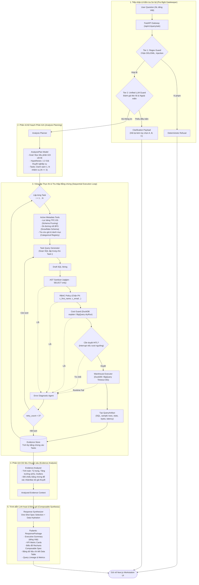

# DATA_FLOW.md — End-to-End Data Flow & State Specification

> **Dự án**: AI Agent Text-to-SQL Self-Service Analytics cho dữ liệu doanh nghiệp  
> **Phiên bản**: 2.0 (Multi-Task Analysis Flow & Typed Artifact Contracts)  
> **Bộ dữ liệu chuẩn**: **TPC-DS Benchmark (Omnichannel Retail - 24 Bảng)**  
> **Mục đích**: Đặc tả chi tiết vòng đời chuyển hóa dữ liệu từ lúc người dùng đặt câu hỏi tự nhiên bằng tiếng Việt đến khi nhận về báo cáo phân tích hoàn chỉnh kèm biểu đồ trực quan; quy định tường minh: **Input, Output, Phép biến đổi (Transformation), Cấu trúc State, và Định dạng dữ liệu (Data Contract)** tại từng mắt xích.

---

## 1. SƠ ĐỒ DÒNG CHẢY DỮ LIỆU TỔNG THỂ (END-TO-END PIPELINE MAP)



---

## 2. CHI TIẾT TỪNG BƯỚC CHUYỂN HÓA DỮ LIỆU (STEP-BY-STEP DATA TRANSFORMATION)

---

### Giai đoạn 1: Tiếp nhận Yêu cầu & Kiểm tra Sơ bộ (Pre-flight Gatekeeper)

| Thuộc tính | Chi tiết |
|---|---|
| **Mắt xích gọi** | Client $\rightarrow$ `POST /api/v1/query/ask` $\rightarrow$ [`PreflightGatekeeper`](file:///d:/Text2SQL-AI-Agent/src/agents/preflight_gatekeeper.py) |
| **Input Data** | JSON Payload từ người dùng |
| **Input Format** | `AskRequest(question=str, thread_id=str, role=str, dry_run=bool)` |
| **Transformation** | 1. **Tier 1 (Regex Guard)**: Quét chuỗi tìm các mẫu SQL Injection (`--`, `;`, `UNION SELECT`) và từ khóa can thiệp cấu trúc (`DROP`, `ALTER`, `TRUNCATE`, `DELETE`, `UPDATE`). Xử lý $< 0.1$ms.<br/>2. **Tier 2 (Unified LLM Guard)**: Gọi model phân loại có cấu trúc (Structured Output). Kiểm tra xem câu hỏi có thuộc phạm vi phân tích kho dữ liệu bán lẻ TPC-DS hay không, và có thiếu các điều kiện quan trọng (mốc thời gian, kênh bán hàng) hay không. |
| **Rẽ nhánh** | - **BLOCKED**: Trả về `RefusalResponse` giải thích lý do bảo mật.<br/>- **CLARIFICATION**: Trả về `ClarificationResponse` gồm câu hỏi làm rõ và 2-4 tùy chọn gợi ý.<br/>- **ALLOWED**: Chuyển tiếp câu hỏi vào `AnalysisPlanner`. |
| **Output Format** | `GatekeeperDecision(is_safe=bool, needs_clarification=bool, clarification_prompt=str, suggested_options=list[str])` |

#### Mẫu JSON Yêu cầu Làm rõ (Clarification Response):
```json
{
  "status": "CLARIFICATION_REQUIRED",
  "thread_id": "thr_20261001_01",
  "clarification_prompt": "Bạn muốn xem doanh thu bán hàng theo kênh nào trong hệ thống bán lẻ đa kênh?",
  "suggested_options": [
    "Kênh bán lẻ tại quầy (Store Sales)",
    "Kênh thương mại điện tử (Web Sales)",
    "Kênh bán qua danh mục thư tín (Catalog Sales)",
    "Tổng hợp toàn bộ cả 3 kênh bán hàng"
  ]
}
```

---

### Giai đoạn 2: Phân rã Kế hoạch Phân tích (Analysis Planning)

| Thuộc tính | Chi tiết |
|---|---|
| **Mắt xích gọi** | [`PreflightGatekeeper`](file:///d:/Text2SQL-AI-Agent/src/agents/preflight_gatekeeper.py) $\rightarrow$ [`AnalysisPlanner`](file:///d:/Text2SQL-AI-Agent/src/agents/analytics/planner.py) |
| **Input Data** | `question: str`, `user_role: str`, `context: UserContext` |
| **Transformation** | 1. Phân tích bài toán kinh doanh, đặt ra 1 **mục tiêu tổng thể** (`goal`).<br/>2. Đặt ra 1-2 **giả thuyết cần kiểm chứng** (`hypotheses`) (ví dụ: *"Doanh thu giảm có thể do kênh Web sụt giảm hoặc do tỷ lệ hoàn hàng tăng"*).<br/>3. Phân rã thành chuỗi $N$ nhiệm vụ truy vấn độc lập ($1 \le N \le 3$), mỗi nhiệm vụ có định danh `task_id`, mô tả `description`, mục đích `purpose`, và chỉ dẫn truy vấn `query_hint`. |
| **Output Data** | Mô hình dữ liệu Pydantic `AnalysisPlan` |

#### Mẫu dữ liệu `AnalysisPlan`:
```json
{
  "plan_id": "plan_7a8b9c",
  "original_question": "Tại sao doanh thu quý 3 năm 2001 bị sụt giảm?",
  "goal": "Phân tích nguyên nhân biến động doanh số quý 3/2001 trên 3 kênh bán và tỷ lệ đổi trả",
  "hypotheses": [
    "Doanh thu kênh bán hàng tại quầy (Store Sales) có thể sụt giảm nghiêm trọng trong quý 3",
    "Tỷ lệ hoàn trả hàng (Returns) trong quý 3 tăng đột biến làm giảm doanh thu thuần"
  ],
  "tasks": [
    {
      "task_id": "task_1",
      "order": 1,
      "description": "Lấy tổng doanh thu thuần theo từng kênh bán (Store, Web, Catalog) trong các quý năm 2001",
      "purpose": "Xác định kênh bán hàng nào chịu trách nhiệm cho sự sụt giảm quý 3",
      "query_hint": "JOIN store_sales, web_sales, catalog_sales với date_dim lọc d_year = 2001"
    },
    {
      "task_id": "task_2",
      "order": 2,
      "description": "Tính tổng giá trị hoàn trả hàng theo quý trong năm 2001",
      "purpose": "Kiểm tra xem tỷ lệ hàng trả về có tăng đột biến trong quý 3 hay không",
      "query_hint": "JOIN store_returns, web_returns, catalog_returns với date_dim"
    }
  ]
}
```

---

### Giai đoạn 3: Vòng lặp Thực thi & Thu thập Bằng chứng (Sequential Execution Loop)

Quy trình xử lý tuần tự cho từng task $i \in [1..N]$:

#### Bước 3.1: Active Schema Retrieval & Dò đường nối BFS
- Gọi [`table_keywords.py`](file:///d:/Text2SQL-AI-Agent/src/utils/table_keywords.py) và từ điển vector để chọn các bảng Fact và Dimension liên quan trong 24 bảng TPC-DS.
- Sử dụng thuật toán tìm kiếm theo chiều rộng (BFS) trong [`schema_context.py`](file:///d:/Text2SQL-AI-Agent/src/utils/schema_context.py) để tự động sinh điều kiện JOIN qua các khóa thay thế (`_sk`).
- Gọi [`categorical_search.py`](file:///d:/Text2SQL-AI-Agent/src/utils/categorical_search.py) để ánh xạ các giá trị văn bản sang hằng số chuẩn trong DB (VD: ngành hàng `i_category = 'Electronics'`).
- Tự động áp dụng **Quy tắc ngày tháng TPC-DS**: Mọi điều kiện năm/quý/tháng bắt buộc JOIN với `date_dim.d_date_sk`.

#### Bước 3.2: Soạn thảo SQL & Hàng rào An ninh Tất định
- [`TaskQueryGenerator`](file:///d:/Text2SQL-AI-Agent/src/agents/sql_generator.py) viết câu lệnh SQL tập trung giải quyết mục tiêu của task $i$.
- Đưa câu lệnh qua **LangGraph Control Pipeline**:
  1. `AST Sanitizer`: Phân tích cú pháp với `sqlglot`, ép buộc chỉ dùng `SELECT`, tự động chèn `LIMIT 1000`.
  2. `RBAC Policy`: Kiểm tra bảng và cột với vai trò người dùng, chặn truy cập trường PII (`c_first_name`, `c_email_address`, `c_birth_country`).
  3. `Cost Guard`: Chạy `EXPLAIN` trên DuckDB hoặc `dryRun` trên BigQuery tính `bytes_scanned`.
  4. `HITL Approval`: Nếu chi phí vượt hạn mức, phát tín hiệu `interrupt()` tạm dừng phiên chờ người dùng duyệt qua API `/api/v1/query/approve`.
  5. `Warehouse Executor`: Thực thi trên DuckDB/BigQuery với thời gian chờ tối đa 30s.

#### Bước 3.3: Chẩn đoán & Tự sửa lỗi (Self-Correction)
- Nếu gặp lỗi cú pháp AST, vi phạm RBAC hoặc lỗi thực thi Database, [`ErrorDiagnosticAgent`](file:///d:/Text2SQL-AI-Agent/src/agents/self_correction.py) phân tích log lỗi để chỉ dẫn Generator sửa câu SQL.
- Vòng lặp sửa lỗi được khống chế nghiêm ngặt tối đa 3 lần (`max_retries = 3`).

#### Bước 3.4: Đóng gói Bằng chứng vào `EvidenceStore`
Kết quả thực thi của từng task được chuẩn hóa thành `QueryArtifact` và đưa vào `EvidenceStore`:

```json
{
  "artifact_id": "art_991823",
  "task_id": "task_1",
  "sql": "SELECT d.d_qoy AS quarter, SUM(ss.ss_net_paid) AS store_sales, SUM(ws.ws_net_paid) AS web_sales, SUM(cs.cs_net_paid) AS catalog_sales FROM date_dim d LEFT JOIN store_sales ss ON d.d_date_sk = ss.ss_sold_date_sk LEFT JOIN web_sales ws ON d.d_date_sk = ws.ws_sold_date_sk LEFT JOIN catalog_sales cs ON d.d_date_sk = cs.cs_sold_date_sk WHERE d.d_year = 2001 GROUP BY d.d_qoy ORDER BY quarter LIMIT 1000;",
  "dialect": "duckdb",
  "explanation": "Tổng hợp doanh thu thuần 3 kênh bán lẻ theo từng quý năm 2001",
  "tables_used": ["date_dim", "store_sales", "web_sales", "catalog_sales"],
  "columns_used": ["d_year", "d_qoy", "ss_net_paid", "ws_net_paid", "cs_net_paid"],
  "status": "SUCCESS",
  "row_count": 4,
  "data_sample": [
    {"quarter": 1, "store_sales": 1420500.0, "web_sales": 810200.0, "catalog_sales": 520100.0},
    {"quarter": 2, "store_sales": 1510200.0, "web_sales": 890400.0, "catalog_sales": 540300.0},
    {"quarter": 3, "store_sales": 980100.0, "web_sales": 870100.0, "catalog_sales": 510000.0},
    {"quarter": 4, "store_sales": 1620000.0, "web_sales": 950000.0, "catalog_sales": 610000.0}
  ],
  "summary_stats": {
    "store_sales_q3_drop": -35.1,
    "web_sales_q3_change": -2.3
  },
  "bytes_scanned": 15200000,
  "execution_time_ms": 112.4
}
```

---

### Giai đoạn 4: Phân tích Dữ liệu Chuyên sâu (Evidence Analysis)

| Thuộc tính | Chi tiết |
|---|---|
| **Mắt xích gọi** | [`EvidenceStore`](file:///d:/Text2SQL-AI-Agent/src/models/artifacts.py) $\rightarrow$ [`EvidenceAnalyzer`](file:///d:/Text2SQL-AI-Agent/src/agents/analytics/evidence_analyzer.py) |
| **Input Data** | Toàn bộ các `QueryArtifact` trong `EvidenceStore` + `AnalysisPlan` |
| **Transformation** | 1. **Phép tính toán học**: Tính toán độ biến thiên theo thời gian ($\Delta\%$), tỷ trọng đóng góp của từng kênh, phát hiện điểm bất thường (Outliers).<br/>2. **Kiểm chứng giả thuyết**: Đối chiếu số liệu thực tế với các giả thuyết trong kế hoạch (VD: Xác nhận Giả thuyết 1 là **ĐÚNG** vì kênh Store Sales giảm 35.1% trong quý 3, trong khi kênh Web chỉ giảm 2.3%). Bác bỏ Giả thuyết 2 nếu tỷ lệ đổi trả không tăng đáng kể. |
| **Output Data** | Cấu trúc dữ liệu phân tích `EvidenceAnalysisSummary` |

---

### Giai đoạn 5: Trình diễn Linh hoạt & Đóng gói (Composable Response Synthesis)

| Thuộc tính | Chi tiết |
|---|---|
| **Mắt xích gọi** | [`EvidenceAnalyzer`](file:///d:/Text2SQL-AI-Agent/src/agents/analytics/evidence_analyzer.py) $\rightarrow$ [`ResponseSynthesizer`](file:///d:/Text2SQL-AI-Agent/src/agents/analytics/response_synthesizer.py) |
| **Input Data** | `EvidenceAnalysisSummary` + `EvidenceStore` + câu hỏi gốc |
| **Transformation** | 1. **Spec Selection (One-Shot LLM)**: Lựa chọn bố cục Artifact trực quan phù hợp nhất (2-3 KPI cards, 1 biểu đồ đường xu hướng Line Chart kết hợp cột Bar Chart, 1 bảng dữ liệu).<br/>2. **Deterministic Data Hydration**: Rót dữ liệu thật từ `EvidenceStore` vào các trường dữ liệu của Spec mà không cho phép LLM tự sinh số liệu ảo.<br/>3. **Executive Narrative**: Viết đoạn tóm tắt điều hành bằng tiếng Việt tự nhiên, nêu bật các con số then chốt và khuyến nghị hành động. |
| **Output Data** | Mô hình dữ liệu hoàn chỉnh `ResponsePackage` |

#### Mẫu JSON Gói Kết Quả Hoàn Chỉnh (`ResponsePackage`):
```json
{
  "package_id": "pkg_882194",
  "thread_id": "thr_20261001_01",
  "executive_summary": "Doanh thu quý 3/2001 sụt giảm chủ yếu do kênh bán hàng tại quầy (Store Sales) giảm mạnh 35.1% so với quý 2 (từ 1.51 triệu USD xuống còn 980 nghìn USD). Trong khi đó, các kênh trực tuyến (Web) và đặt hàng qua danh mục (Catalog) vẫn duy trì ổn định. Phân tích tỷ lệ hoàn hàng cho thấy không có dấu hiệu tăng đột biến, loại trừ nguyên nhân do chất lượng sản phẩm.",
  "artifacts": [
    {
      "artifact_type": "kpi_grid",
      "title": "Chỉ Số Hiệu Suất Bán Hàng Q3/2001",
      "kpi_cards": [
        {"label": "Doanh thu Store Sales Q3", "value": "$980,100", "delta": "-35.1%", "status": "danger"},
        {"label": "Doanh thu Web Sales Q3", "value": "$870,100", "delta": "-2.3%", "status": "neutral"},
        {"label": "Tỷ lệ Hoàn hàng Toàn hệ thống", "value": "4.2%", "delta": "+0.1%", "status": "safe"}
      ]
    },
    {
      "artifact_type": "chart",
      "title": "Xu hướng Doanh thu Bán hàng Đa Kênh theo Quý (Năm 2001)",
      "chart_spec": {
        "chart_type": "bar",
        "x_axis": "quarter",
        "series": [
          {"key": "store_sales", "name": "Bán lẻ tại quầy (Store)", "color": "#3b82f6"},
          {"key": "web_sales", "name": "Thương mại điện tử (Web)", "color": "#10b981"},
          {"key": "catalog_sales", "name": "Bán qua thư (Catalog)", "color": "#f59e0b"}
        ]
      },
      "data": [
        {"quarter": "Q1", "store_sales": 1420500, "web_sales": 810200, "catalog_sales": 520100},
        {"quarter": "Q2", "store_sales": 1510200, "web_sales": 890400, "catalog_sales": 540300},
        {"quarter": "Q3", "store_sales": 980100, "web_sales": 870100, "catalog_sales": 510000},
        {"quarter": "Q4", "store_sales": 1620000, "web_sales": 950000, "catalog_sales": 610000}
      ]
    },
    {
      "artifact_type": "table",
      "title": "Bảng Dữ liệu Doanh thu Chi tiết 2001",
      "columns": ["Quý", "Store Sales ($)", "Web Sales ($)", "Catalog Sales ($)"],
      "rows": [
        ["Q1", "1,420,500", "810,200", "520,100"],
        ["Q2", "1,510,200", "890,400", "540,300"],
        ["Q3", "980,100", "870,100", "510,000"],
        ["Q4", "1,620,000", "950,000", "610,000"]
      ]
    }
  ],
  "query_lineage": [
    {
      "task_id": "task_1",
      "tables": ["date_dim", "store_sales", "web_sales", "catalog_sales"],
      "sql": "SELECT d.d_qoy AS quarter, SUM(ss.ss_net_paid) ... LIMIT 1000;",
      "bytes_scanned": 15200000,
      "latency_ms": 112.4
    }
  ],
  "total_execution_time_ms": 3250.0,
  "total_bytes_scanned": 15200000
}
```

---

## 3. TỔNG KẾT BẢNG GIAO TIẾP TÁC TỬ (AGENT-TO-AGENT COMMUNICATION MATRIX)

| Giai đoạn | Tác tử khởi tạo | Tác tử tiếp nhận | Kênh giao tiếp | Cấu trúc dữ liệu bàn giao |
|:---:|---|---|---|---|
| **1** | User Browser | FastAPI Gateway | HTTP POST `/query/ask` | `AskRequest(question, thread_id, role)` |
| **2** | FastAPI Gateway | Preflight Gatekeeper | Direct Function Call | Regex pattern check & LLM classification |
| **3** | Gatekeeper | Client (UI) | HTTP Response | `ClarificationResponse` hoặc `RefusalResponse` |
| **4** | Gatekeeper | Analysis Planner | LangGraph Edge | Clarified Question + User Context |
| **5** | Analysis Planner | Task Executor | LangGraph Edge | `AnalysisPlan(goal, hypotheses, tasks)` |
| **6** | Task Executor | Active Metadata Tools | Tool Call | Table names, BFS join paths, Categorical values |
| **7** | Task Executor | Control Pipeline | Subgraph Call | `draft_sql`, dialect, user_role, task_id |
| **8** | Control Pipeline | Client (UI) | LangGraph `interrupt` | Payload Duyệt SQL + Cost estimate (HITL) |
| **9** | Client (UI) | Control Pipeline | HTTP POST `/query/approve` | `ApproveRequest(approved=True/False)` |
| **10**| Control Pipeline | DuckDB / BigQuery | Database Driver | SQL Query $\rightarrow$ Result DataFrame / Cursor |
| **11**| Control Pipeline | Error Diagnostic | Exception Branch | Technical Error Message $\rightarrow$ Actionable Hint |
| **12**| Control Pipeline | Task Executor | Subgraph Return | `QueryArtifact(status, sample, stats)` |
| **13**| Task Executor | Evidence Store | In-Memory Accumulator | Danh sách các `QueryArtifact` |
| **14**| Evidence Store | Evidence Analyzer | Function Call | Math Analysis & Hypothesis Validation |
| **15**| Evidence Analyzer | Response Synthesizer | Function Call | Analysis Summary $\rightarrow$ Composable Package |
| **16**| Response Synthesizer| Client (UI) | HTTP SSE / JSON Stream | `ResponsePackage` hoàn chỉnh (Zero Regex) |
