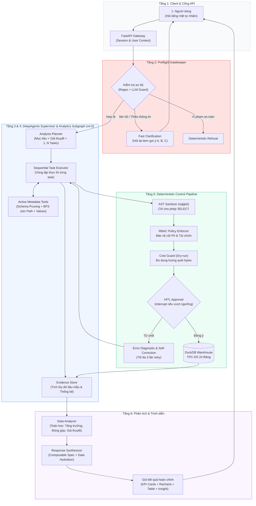

# BẢN TÓM TẮT ĐỀ TÀI ĐỒ ÁN TỐT NGHIỆP / NGHIÊN CỨU

**Tên đề tài**: **Xây dựng AI Agent Text-to-SQL Self-Service Analytics cho Dữ liệu Doanh nghiệp (Chuẩn TPC-DS Benchmark 24 Bảng)**  
**Lĩnh vực**: Trí tuệ nhân tạo ứng dụng (Applied AI), Kho dữ liệu & Phân tích tự phục vụ (Enterprise Data Warehouse & Self-Service Analytics)  
**Học viên / Sinh viên thực hiện**: [Họ và tên] — MSSV: [Mã số SV]  
**Giảng viên hướng dẫn**: [Học hàm, học vị, Họ và tên GVHD]  

---

### 1. TÍNH CẤP THIẾT & ĐẶT VẤN ĐỀ
- **Thực trạng**: Tại các doanh nghiệp thương mại và bán lẻ đa kênh (Omnichannel Retail), nhân viên nghiệp vụ (Kinh doanh, Tiếp thị, Vận hành chuỗi cung ứng, Quản lý kho) liên tục cần số liệu phân tích đa chiều nhưng phụ thuộc hoàn toàn vào đội ngũ Data Analyst (DA) để viết truy vấn SQL. Thời gian chờ nhận kết quả thường kéo dài 2–5 ngày, làm chậm trễ các quyết định chiến lược và vận hành.
- **Thách thức kỹ thuật**:
  - Các công cụ Text-to-SQL truyền thống tiếp cận theo mô hình thô sơ *"1 câu hỏi $\to$ 1 câu SQL $\to$ 1 kết quả"*, hoàn toàn bất lực trước các câu hỏi phân tích kinh doanh đa biến (ví dụ: *"Tại sao doanh thu quý 3 giảm và do kênh bán lẻ nào hay do tỷ lệ hoàn hàng tăng?"*).
  - Kho dữ liệu doanh nghiệp quy mô lớn (chuẩn Snowflake Schema như TPC-DS 24 bảng, 429 cột) có quan hệ phức tạp, liên kết bắc cầu qua bảng thời gian (`date_dim`), đòi hỏi cơ chế định tuyến lược đồ động (Schema Pruning & BFS Join Path) và tìm kiếm giá trị danh mục (Categorical Search).
  - Nguy cơ ảo giác (Hallucination), rủi ro an toàn dữ liệu (SQL Injection, biến đổi dữ liệu DDL/DML, vi phạm dữ liệu cá nhân nhạy cảm PII) và bùng nổ chi phí quét dữ liệu trên Cloud Warehouse.
- **Giải pháp**: Xây dựng hệ thống **Agentic Self-Service Analytics Engine (Kiến trúc v4.0)** kết hợp **Mô hình tác tử suy luận đa nhiệm (DeepAgents)** và **Đường ống kiểm soát an toàn tất định (LangGraph Control Pipeline)** trên kho dữ liệu phân tích chuẩn hóa **TPC-DS Benchmark**.

---

### 2. MỤC TIÊU VÀ PHẠM VI ĐỀ TÀI
- **Mục tiêu tổng quát**: Xây dựng nền tảng phân tích tự phục vụ tự động hóa toàn diện quy trình: từ tiếp nhận câu hỏi tiếng Việt, làm rõ ý định, lập kế hoạch phân tích nhiều bước, thực thi truy vấn an toàn tuyệt đối, chẩn đoán tự sửa lỗi, đến tổng hợp báo cáo trực quan có căn cứ số liệu.
- **Mục tiêu cụ thể**:
  1. *Độ chính xác và Năng lực phân tích*: Đạt tỷ lệ Valid SQL Rate (VSR) $\ge 92\%$ và Execution Accuracy (EX) $\ge 78\%$ trên tập benchmark kiểm thử TPC-DS tiếng Việt; hỗ trợ giải quyết các câu hỏi phân tích phức tạp thông qua kế hoạch phân rã ($N \le 3$ truy vấn).
  2. *An toàn dữ liệu tuyệt đối (Zero Trust on LLM for Security)*: Ngăn chặn 100% rủi ro SQL Injection / DDL / DML phá hoại bằng bộ phân tích cây cú pháp trừu tượng (AST với `sqlglot`); thực thi chính sách phân quyền theo vai trò (RBAC) che chắn các trường PII và tài chính nhạy cảm.
  3. *Kiểm soát chi phí & Tương tác con người (Cost Guard & HITL)*: Ước tính dung lượng quét (bytes scanned) trước khi chạy; tự động kích hoạt chốt chặn duyệt lệnh Human-In-The-Loop khi truy vấn chạm ngưỡng rủi ro cao.
  4. *Tự động chẩn đoán và sửa lỗi (Self-Correction)*: Đạt tỷ lệ sửa lỗi tự động $\ge 65\%$ thông qua chẩn đoán lỗi có ngữ cảnh của `DiagnosticAgent` (khống chế tối đa 3 lần retry).
  5. *Trải nghiệm người dùng chuyên nghiệp (Executive Workstation)*: Giao diện web hiện đại với Executive Launchpad, Inspector Drawer kiểm tra tiến trình Agent, và hệ thống biểu đồ trực quan hóa linh hoạt (Recharts Composable Artifacts).
- **Phạm vi nghiên cứu & thử nghiệm**:
  - *Dữ liệu*: Bộ dữ liệu chuẩn quốc tế **TPC-DS Benchmark (24 bảng quan hệ)** mô phỏng bán lẻ đa kênh: Store, Web, Catalog, Returns và Quản lý Tồn kho (Inventory).
  - *Hạ tầng lưu trữ*: DuckDB (phân tích in-process OLAP cục bộ tốc độ cao) và Google BigQuery Sandbox / Supabase PostgreSQL.
  - *Đối tượng phục vụ*: Người dùng nghiệp vụ (`Analyst`) và Quản trị viên hệ thống (`Admin`).

---

### 3. ĐỊNH HƯỚNG GIẢI PHÁP & KIẾN TRÚC AGENT (V4.0)
Hệ thống áp dụng kiến trúc **Hybrid Agentic Governance 6 tầng**, kết hợp linh hoạt giữa LLM (cho tư duy ngôn ngữ, lập kế hoạch và diễn giải) với Code tất định (cho an ninh, kiểm duyệt và tính toán số học):

**Các trụ cột kỹ thuật nổi bật**:
1. **Phân rã kế hoạch đa nhiệm (`AnalysisPlan`)**: Không ép LLM viết 1 câu SQL khổng lồ; chia nhỏ bài toán thành chuỗi truy vấn thăm dò có định hướng.
2. **Hợp đồng dữ liệu định kiểu mạnh (Typed Artifacts)**: Thay thế hoàn toàn cơ chế regex parsing chuỗi Markdown bằng các Pydantic V2 Models (`QueryArtifact`, `EvidenceStore`, `ResponsePackage`), loại bỏ triệt để lỗi crash giao diện.
3. **Active Metadata & BFS Join Path**: Tự động tìm đường nối ngắn nhất trong đồ thị Snowflake 24 bảng TPC-DS, tự động gắn bảng thời gian `date_dim`.
4. **Hàng rào an toàn đa lớp**: Kiểm soát tất định 100% bằng code Python (AST, RBAC, Cost Guard, HITL, Audit Log).

---

### 4. BỐ CỤC ĐỒ ÁN (5 CHƯƠNG)
- **Chương 1: Mở đầu** — Giới thiệu bối cảnh chuyển đổi số, nút thắt cổ chai phân tích dữ liệu giữa BA và DA, thách thức Text-to-SQL trên quy mô Enterprise Warehouse, mục tiêu, phạm vi TPC-DS 24 bảng và đóng góp của đề tài.
- **Chương 2: Cơ sở lý thuyết và Công nghệ nền tảng** — Tổng quan về Text-to-SQL và mô hình ngôn ngữ lớn (LLMs), kiến trúc đa tác nhân (Multi-Agent Systems), kỹ thuật Schema Linking & Categorical Search, phân tích cú pháp trừu tượng (AST với `sqlglot`), và chuẩn cơ sở dữ liệu TPC-DS Benchmark.
- **Chương 3: Phân tích yêu cầu và Thiết kế hệ thống** — Đặc tả yêu cầu chức năng và phi chức năng, thiết kế kiến trúc 6 tầng (Hybrid Agentic Governance v4.0), thiết kế chi tiết các Agent (Gatekeeper, Planner, Task Executor, Evidence Analyzer, Synthesizer), thiết kế đường ống kiểm soát an toàn và thiết kế giao diện Workstation.
- **Chương 4: Hiện thực hóa và Thử nghiệm đánh giá** — Chi tiết cài đặt mã nguồn (FastAPI, LangGraph, DuckDB, Next.js), xây dựng tập benchmark 50 câu hỏi tiếng Việt chuẩn TPC-DS, đánh giá định lượng (VSR, EX, Self-Correction, Latency, An toàn dữ liệu) và phân tích các ca thử nghiệm điển hình (Case Studies).
- **Chương 5: Kết luận và Hướng phát triển** — Đánh giá kết quả đạt được so với mục tiêu đặt ra, phân tích các hạn chế còn tồn tại và đề xuất hướng mở rộng (tích hợp hệ thống ERP thực tế, hỗ trợ hội thoại phức hợp đa lượt).
