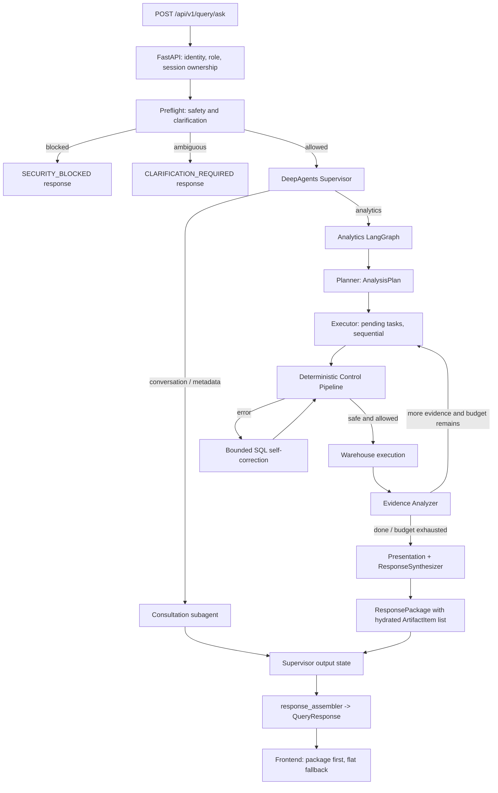

# Agent Architecture, Workflow va Output Schema Review

Ngay review: 2026-10-05  
Pham vi: doc code va tai lieu; khong chay agent, test, benchmark hay lenh build.

## Tom tat danh gia

Workflow dang duoc chay la kien truc v4: FastAPI -> Preflight -> DeepAgents Supervisor -> consultation hoac Analytics LangGraph Subgraph. Analytics subgraph lap plan, chay cac query tuan tu qua deterministic Control Pipeline, danh gia bang chung va tong hop thanh `ResponsePackage`. Cach phan lop nay hop ly; phan roi nam o hop dong output: contract v1-v3 con song song voi v4, cung mot ket qua bi copy qua nhieu field.

Khuyen nghi chon mot output chinh cho UI: `ResponsePackage` voi `artifacts` la noi duy nhat chua chart/table/KPI/callout. Cac truong flat chi nen con lai nhung thong tin can cho trang thai giao tiep va governance (clarification, HITL, refusal, error). Khong nen tra dong thoi `response_package`, `output_artifacts`, `visualization`, `recharts_config`, `insight`, `final_answer`, `data`, `columns` va `sql` cho cung mot ket qua thanh cong.

## Workflow hien tai theo code



### Ghi chu ve implementation

- `src/api/routes/query.py::ask_query` tao context/kiem tra quyen so huu session, goi `arun_supervisor`, roi chuyen ket qua qua `assemble_query_response`.
- `src/agents/supervisor.py::get_supervisor_subagents` mac dinh chi dang ky `consultation-agent` va `analytics-subagent`. Bon agent cu chi duoc them neu bat `include_legacy_subagents=True`.
- Analytics graph tai `src/agents/analytics/graph.py` chay `planner -> executor -> evidence`, co the quay lai executor, sau do `presentation`. Executor xu ly pending tasks tuan tu va moi task chay schema retrieval -> SQL generation -> Control Pipeline. SQL retries duoc clamp toi da 3 lan tai `task_executor.py`.
- Safety/RBAC/cost/HITL/execution nam trong Control Pipeline deterministic; LLM chi lap ke hoach, sinh SQL, danh gia bang chung va chon cach trinh bay.
- `src/agents/analytics/nodes.py::presentation_node` trich chart dau tien tu package thanh `visualization` de tuong thich cu. `analytics/graph.py` lai copy danh sach package artifacts thanh `output_artifacts` va expose first successful query thanh `sql/data/columns`.
- `src/utils/response_assembler.py` tiep tuc lap them cac field cu, fallback parse Markdown/ToolMessage, va map ket qua thanh `QueryResponse`.
- Frontend `artifactAdapter.ts` uu tien `response_package`; neu khong co thi dung `output_artifacts`; cuoi cung moi dung `recharts_config + data + columns`. Do do luong chinh v4 da co mot contract tot, nhung payload van mang theo cac representation cu.

## Review output schema hien tai

### Cac nhom field dang trung/chong lan

| Nhom y nghia | Field hien tai | Danh gia va huong xu ly |
|---|---|---|
| Cau tra loi | `final_answer`, `insight`, `response_package.direct_answer` | Trong luong v4, `insight` duoc gan tu `direct_answer`; `final_answer` thuong lai la text message cuoi cua Supervisor. Chon `response_package.direct_answer` lam cau tra loi thanh cong chinh. Giu `final_answer` tam thoi cho client legacy, roi bo trong versioned API tiep theo. |
| Chart | `recharts_config`, `visualization`, `response_package.artifacts[*]` voi `type="chart"` | `visualization` duoc lay tu chart dau tien trong package; assembler gan `recharts_config=visualization` va `visualization=...`, nen hai field flat thuong trung nhau. Chart trong package lai la representation day du hon va frontend da uu tien no. Chon `ChartArtifact` trong package lam nguon duy nhat; de `recharts_config`/`visualization` chi trong compatibility adapter tam thoi. |
| Artifacts | `response_package.artifacts`, `output_artifacts`, `artifacts` | `output_artifacts` la ban copy cua `response_package.artifacts`; `artifacts` la QueryArtifact evidence (SQL/data/lineage), khac loai. Doi ten ro `query_artifacts` neu can phoi bay evidence; bo `output_artifacts` sau khi het client cu. |
| Query data | `sql`, `data`, `columns` o root; `artifacts` (QueryArtifact); `response_package.executed_queries`; `TableArtifact.rows` | Root values la query dau tien thanh cong va khong dai dien cho toan bo multi-query result. `TableArtifact` la data trinh bay; `QueryArtifact` la evidence; `executed_queries` la SQL lineage. Dung package artifacts cho UI, con `executed_queries` hoac evidence chi tra khi client can explainability/debug. Khong copy data len root trong output v4. |
| Trang thai | `status`, `is_safe`, `safety_category`, `refusal_reason`, `is_ambiguous`, `clarification_question`, `suggested_options`, `requires_hitl`, `estimated_cost_bytes`, `error` | Nhieu field la co dieu kien, khong phai field rac. Giu governance/interaction fields, nhung gom theo object discriminated `pending`, `clarification`, `refusal`, `error` se ro rang hon va tranh gia tri vo nghia o trang thai khac. |
| Telemetry | `execution_time_ms`, `metadata.execution_time_ms`, `metadata.query_count`, `ResponsePackage.total_execution_time_ms` | Thoi gian tong bi lap. Chon mot `execution` object; neu can query count thi tinh tu executed queries thay vi serialize them metadata song song. |
| Ke hoach | `tasks` root va `plan` noi bo | API chi serialize task_id/description/status, nhung `QueryResponse` khong xuat `plan` day du. Neu UI khong hien tien trinh task thi bo `tasks`; neu can thi tra `tasks` gon va khong tra ca plan noi bo. |
| Tinh tuong thich cu | `artifact_bundle`, `intent`, `metadata` | `artifact_bundle` khong duoc gan trong assembler hien tai; `intent` cung khong duoc populate tu code output thay duoc. Xac nhan khong co client nao can roi bo khoi response contract. |

### Nen tach “ket qua cho UI” khoi “evidence thuc thi”

`ResponsePackage` hien da gom cau tra loi, insights, layout, artifact UI, danh sach SQL da chay va execution time. Trong khi `QueryArtifact` lai chua ca SQL, data, columns, schema lineage, status va loi; root `QueryResponse` lai copy mot phan cua ca hai. Dieu nay lam response phinh va mo ho ve nguon chinh thong.

De xuat phan ranh:

- `answer`: direct answer va detailed insights.
- `artifacts`: tagged union cho UI (`kpi | chart | table | callout | evidence | file`). Moi chart co mot config va data trong chinh `ChartArtifact`.
- `execution`: tong thoi gian, query count; danh sach query/evidence chi khi can cho SQL viewer/history.
- `state`: mot trong cac trang thai `completed | clarification_required | pending_approval | security_blocked | error`, kem payload chi danh cho trang thai do.
- `session`: session id va token; token chi tra neu API dang co chu truong cap lai token trong response.

Khong can dua cac truong noi bo nhu `retry_count`, `diagnostic_result`, `bytes_scanned` cua tung task vao response thanh cong mac dinh. Chung thuoc audit/debug endpoint hoac error payload co chon loc.

## Output schema dich goi y

Day la huong don gian hoa cho API v5, khong phai yeu cau doi ten ngay trong review nay:

```json
{
  "session_id": "...",
  "status": "COMPLETED",
  "question": "...",
  "answer": {
    "text": "...",
    "insights": ["..."]
  },
  "artifacts": [
    {"type": "chart", "chart_type": "bar", "title": "...", "x_key": "...", "y_keys": ["..."], "data": []},
    {"type": "table", "title": "...", "columns": [], "rows": [], "total_row_count": 0}
  ],
  "execution": {"query_count": 1, "execution_time_ms": 0},
  "session_token": "..."
}
```

Cho trang thai dac biet, chi them mot object co dieu kien, vi du `clarification: {question, options}`, `pending_approval: {sql, estimated_cost_bytes}`, `refusal: {category, message}` hoac `error: {code, message}`. Neu can duy tri schema cu trong giai doan chuyen doi, assembler nen la diem duy nhat lam adapter tu state cu sang contract moi; khong de cac node tiep tuc tu tao cac alias chart/insight.

## Loi va rui ro phat hien trong code

1. **[P1 - sai nguon du lieu chart] ArtifactSpec co target_task_id khong ton tai bi gan ngam sang query thanh cong dau tien.** Tai `src/agents/analytics/response_synthesizer.py::_hydrate_artifacts`, `task_map.get(spec.target_task_id, default_artifact)` silently fallback sang `default_artifact`. Neu LLM tra task_id sai/khong ton tai, chart/KPI/table van tao nhung co the trinh bay du lieu cua task khac nhu the la nguon duoc yeu cau. Nen reject spec sai (hoac tao callout), chi dung fallback khi spec khong yeu cau task cu the.

2. **[P2 - co the render chart sai cot] Hydrator khong kiem tra x/y columns co trong result columns hay khong.** Cung ham tren chap nhan `x_axis_column` va `y_axis_columns` tu structured output va dua thang vao `ChartArtifact`; neu ten cot sai/khac hoa-thuong, frontend nhan chart khong co series hop le. Nen validate keys theo columns cua QueryArtifact, loc spec khong hop le hoac fallback deterministic.

3. **[P2 - contract bi phinh va client co the hien ket qua khong nhat quan] Multi-query response expose query dau tien o root nhung tat ca artifacts trong package.** `analytics/graph.py` chon artifact SUCCESS dau tien cho `sql/data/columns`, trong khi package co the chua nhieu query/artifact. `ChatMessageItem` hien uu tien package nen UI chinh tranh duoc mot so nham lan; client khac dung flat fields co the nghi data root la toan bo ket qua. Loai root copies trong contract v4 moi, hoac danh dau ro `primary_result`.

4. **[P3 - fallback parser fragile con ton tai] Response assembler van regex parse Markdown va ToolMessage de tim SQL/data/chart.** Dieu nay trai voi ADR v4 ghi “Zero-Regex Contract”, va co the cat sai JSON array neu data chua ky tu/bracket phuc tap. Duong v4 typed package nen la nguon; legacy parse nen duoc tach, co metric de xoa sau migration, khong nen la fallback mac dinh.

5. **[P3 - model legacy mo ta chart hai lan] `SynthesizerResult` trong `src/models/state.py` chua ca `chart_type` va `recharts_config.chart_type`.** Legacy synthesizer khong nam trong active default subagents, nhung co the duoc bat bang `include_legacy_subagents=True`. Nen xoa/deprecate ca schema cu hoac gom thanh mot chart config typed, tranh hai field co the mau thuan.

## Thu tu sua doi de nghi

1. Chot API response v4: package artifacts la nguon chart/table/KPI duy nhat; dung `visualization` va `recharts_config` o boundary adapter cu.
2. Them validation nguon task va chart keys trong deterministic hydration; khong de spec sai im lang map sang query khac.
3. Chuan hoa state dac biet (clarification/HITL/refusal/error), tach tung payload khoi completed response.
4. Sau khi frontend va client khac chuyen sang contract chinh, xoa aliases/root copies va legacy synthesizer schema; cap nhat API TypeScript/Pydantic cung luc.
5. Rut bo Markdown/ToolMessage scraping sau khi khong con caller legacy; giu audit/debug evidence o endpoint rieng.

Review nay chi dua tren static code/document inspection. Chua chay test, lint, benchmark hoac agent theo yeu cau.
