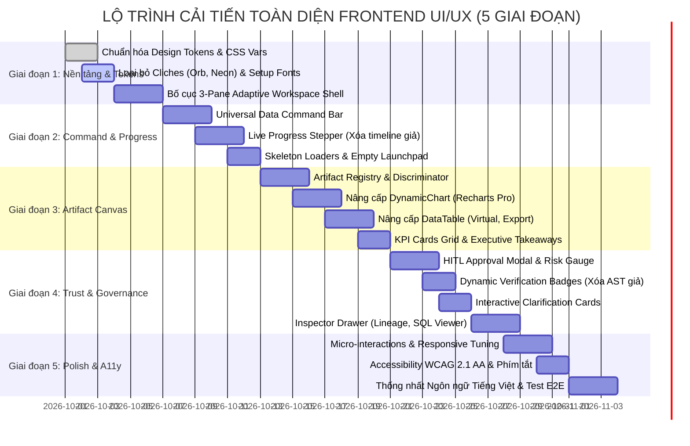

# ĐẶC TẢ CẢI TIẾN THIẾT KẾ UI/UX & FRONTEND REDESIGN
## AI Agent Text-to-SQL Self-Service Analytics (TPC-DS 24 Bảng)
### *Từ "AI-Generated Toy" Đến "Modern Enterprise Data Analytics Platform"*

> **Tài liệu tham chiếu:**
> - Kế hoạch rà soát kỹ thuật frontend: [`docs/frontend/frontend-review-and-improvement-plan-2026-09-30.md`](file:///d:/Text2SQL-AI-Agent/docs/frontend/frontend-review-and-improvement-plan-2026-09-30.md)
> - Thiết kế kiến trúc Agent v2.0/v4.0: [`docs/agent-architecture-v2.md`](file:///d:/Text2SQL-AI-Agent/docs/agent-architecture-v2.md)
> - Thiết kế hệ thống 3 tầng: [`docs/ARCHITECTURE.md`](file:///d:/Text2SQL-AI-Agent/docs/ARCHITECTURE.md)
> - Từ điển dữ liệu TPC-DS 24 bảng: [`docs/DATABASE_SCHEMA.md`](file:///d:/Text2SQL-AI-Agent/docs/DATABASE_SCHEMA.md)
> - Skills áp dụng: `ui-ux-pro-max` (Enterprise Data-Dense & Accessibility) & `ui-styling` (shadcn/ui + Tailwind CSS tokens)

---

## 1. BỐI CẢNH & PHÂN TÍCH TỬ HUYỆT "AI-GENERATED" HIỆN TẠI

### 1.1. Hiện trạng: Tại sao Frontend trông như "AI-Generated Template"?
Qua rà soát giao diện hiện hành trong `src/frontend/`, ứng dụng đang bộc lộ 6 điểm yếu điển hình của các template sinh tự động bằng AI, khiến người dùng doanh nghiệp (Data Analyst, Business Manager) cảm thấy như đang dùng một "đồ chơi thử nghiệm" (toy prototype) thay vì một công cụ phân tích dữ liệu chuyên nghiệp:

| STT | Vấn đề hiện tại (AI-Generated Cliche) | Biểu hiện trong Code & Giao diện | Tác động tiêu cực đến trải nghiệm |
|:---:|:---|:---|:---|
| **1** | **Quả cầu phát sáng 3D vô nghĩa (Orb Gimmick)** | Component `IridescentOrb.tsx` với bóng gradient cầu vồng 3D lơ lửng, phát sáng neon ở giữa trang chủ. | Gây phân tâm, đậm chất chatbot tiêu dùng giá rẻ, chiếm diện tích quý giá của màn hình phân tích. |
| **2** | **Dark Mode tím neon loang lổ (Crypto/Gaming Vibe)** | Nền tối đen `#090d16` kết hợp với gradient tím/indigo rực (`#6366f1`, `#818cf8`, `shadow-glow`), hiệu ứng phản chiếu gắt. | Mỏi mắt sau 10 phút làm việc; thiếu độ tương phản tiêu chuẩn cho bảng biểu; không phù hợp phong cách Enterprise B2B. |
| **3** | **Bong bóng chat nhồi nhét (Cramped Chat Bubbles)** | Mọi kết quả (bảng dữ liệu 50 dòng, biểu đồ phân tích, truy vấn SQL) đều bị ép chặt trong bubble chat hẹp (`max-w-3xl`). | Bảng số liệu bị cụt cột, phải cuộn ngang mệt mỏi; biểu đồ bị bóp méo tỷ lệ; không gian phân tích bị tù túng. |
| **4** | **Timeline suy luận giả tạo (Fake CoT Stepper)** | `ReasoningTimeline.tsx` hardcode cố định 4 bước ("1. Làm rõ ý định, 2. Lấy 8 bảng TPC-H, 3. Sinh SQL, 4. LangGraph Control") với spinner quay giả định. | Mất niềm tin của người dùng kỹ thuật khi nhận thấy tiến trình không khớp với thời gian và tác vụ thực tế của Agent backend. |
| **5** | **Con dấu bảo mật không căn cứ (Unverified Badges)** | Luôn gắn nhãn `AST Verified` cứng trên mọi tin nhắn bot và khối SQL dù chưa nhận tín hiệu kiểm duyệt từ backend. | Vi phạm nguyên tắc bảo mật và quản trị dữ liệu (Governance Transparency), tạo cảm giác an toàn giả tạo. |
| **6** | **Thanh nhập liệu kiểu Chatbot di động (Pill Box)** | `QueryInputCard.tsx` thiết kế hình viên thuốc bo tròn với icon kẹp file Plus và Microphone như WhatsApp/Telegram. | Không hỗ trợ gõ câu hỏi dài nhiều dòng, không có auto-complete gợi ý bảng/cột TPC-DS, không có phím tắt thao tác nhanh. |

### 1.2. Tuyên ngôn Thiết kế Mới (Design Manifesto)
Chúng tôi định vị lại giao diện frontend thành: **"Enterprise Data Analytics Canvas & Trust-First Self-Service Platform"**:
1. **Canvas-First, Không phải Chatbot-First**: Trò chuyện chỉ là *phương thức ra lệnh (input)*, còn trung tâm của giao diện là *Không gian Trình diễn Dữ liệu (Analytics Canvas)* — nơi KPI, Biểu đồ đa chiều, Bảng số liệu và Báo cáo tổng hợp được hiển thị thoáng đạt, khoa học như Hex.tech, Databricks Lakeview và Metabase.
2. **Thẩm mỹ Doanh nghiệp Tinh tế (Clean Minimalist Enterprise)**: Chuyển từ màu tối neon sang bảng màu Slate/Zinc trung tính, sang trọng, tương phản cao, hỗ trợ cả **Dark Mode chuyên nghiệp** và **Light Mode sạch sẽ**, lấy cảm hứng từ Linear và Snowflake Snowsight.
3. **Trung thực & Minh bạch Tuyệt đối (Radical Transparency)**: Chỉ hiển thị tiến trình, huy hiệu an toàn (`AST Sanitized`, `RBAC Masked`, `Cost Guard Passed`) khi có telemetry và metadata thực từ backend.
4. **Trực quan hóa Đa Artifact (Multi-Artifact Orchestration)**: Khai thác trọn vẹn hợp đồng `ResponsePackage` và `output_artifacts` của Agent mới (KPI Cards, Recharts Pro, Virtualized Grid, Evidence Lineage).

---

## 2. HỆ THỐNG DESIGN TOKENS & TYPOGRAPHY THEO CHUẨN ENTERPRISE

Tuân thủ hướng dẫn từ skill `ui-ux-pro-max` (chế độ Data-Dense Dashboard) và `ui-styling` (shadcn/ui CSS variable pattern):

### 2.1. Bộ tham số thiết kế (Design Dials)
- **Density (Mật độ dữ liệu):** `8/10` (Data-dense). Tối ưu hóa không gian hiển thị cho bảng biểu, metrics, KPI; giảm khoảng đệm thừa thãi; padding thành phần từ 8px đến 16px.
- **Variance (Biến thiên bố cục):** `4/10` (Disciplined Grid). Bố cục Bento Grid cân xứng, trật tự, chuẩn mực, giúp người dùng dễ dàng quét dữ liệu từ trái qua phải, từ tổng quan đến chi tiết.
- **Motion (Chuyển động):** `3/10` (Subtle Micro-interactions). Thời gian chuyển động từ `120ms` đến `200ms` với easing `cubic-bezier(0.16, 1, 0.3, 1)`. Tuyệt đối không dùng animation trôi nổi, quay vòng liên tục gây mất tập trung.

### 2.2. Bảng Màu Hệ Thống (Enterprise Semantic Color System)

Toàn bộ hệ màu sử dụng biến CSS tiêu chuẩn HSL/Hex, đảm bảo tỷ lệ tương phản tối thiểu **4.5:1** cho văn bản thông thường và **3:1** cho đường viền/icon tương tác (chuẩn WCAG 2.1 AA):

#### A. Nền & Bề mặt (Surfaces & Neutral Palette)
| Vai trò token | Dark Mode (Default) | Light Mode | Ý nghĩa sử dụng |
|:---|:---:|:---:|:---|
| `--background` | `#0B0F17` (Deep Obsidian) | `#F8FAFC` (Slate 50) | Nền tổng thể toàn ứng dụng |
| `--surface-primary` | `#111827` (Gray 900) | `#FFFFFF` (Pure White) | Thẻ card chính, Analytics Canvas |
| `--surface-secondary`| `#1F2937` (Gray 800) | `#F1F5F9` (Slate 100) | Sidebar, Header bar, Thẻ phụ |
| `--surface-tertiary` | `#374151` (Gray 700) | `#E2E8F0` (Slate 200) | Khung nhập liệu, hover state |
| `--border-subtle` | `rgba(255, 255, 255, 0.08)` | `rgba(0, 0, 0, 0.08)` | Đường kẻ phân chia vùng |
| `--border-strong` | `rgba(255, 255, 255, 0.16)` | `rgba(0, 0, 0, 0.16)` | Viền active, viền modal, thẻ KPI |

#### B. Màu Nhấn Thương hiệu & Trạng thái (Accent & Semantic)
| Token | Hex | Light/Dark Fallback | Ứng dụng |
|:---|:---:|:---|:---|
| `--brand-primary` | `#2563EB` | Blue 600 | Nút chính, tab active, trạng thái focus |
| `--brand-hover` | `#1D4ED8` | Blue 700 | Hover nút chính, link highlight |
| `--color-success` | `#10B981` | Emerald 500 | AST verified, query thành công, tăng trưởng dương |
| `--color-warning` | `#F59E0B` | Amber 500 | Yêu cầu phê duyệt HITL, cảnh báo chi phí quét |
| `--color-danger` | `#EF4444` | Red 500 | Lỗi SQL, từ chối thực thi, vi phạm RBAC |
| `--color-info` | `#06B6D4` | Cyan 500 | Gợi ý clarification, thông tin schema |

#### C. Bảng Màu Trực quan Hóa Dữ liệu (Accessible Data Viz Palette - 6 Series)
Tuyệt đối không dùng màu ngẫu nhiên hoặc màu quá giống nhau giữa các cột/đường trong Recharts. Dùng bảng 6 màu có độ phân giải thị giác cao, thân thiện với người mù màu:
- **Series 1 (Primary - Doanh số/Khối lượng):** `#3B82F6` (Electric Blue)
- **Series 2 (Secondary - Lợi nhuận/Tỷ lệ đạt):** `#10B981` (Emerald Teal)
- **Series 3 (Tertiary - Chi phí/Khoản giảm trừ):** `#F59E0B` (Warm Amber)
- **Series 4 (Quaternary - Hoàn hàng/Kênh phụ):** `#8B5CF6` (Royal Violet)
- **Series 5 (Quinary - Số lượng khách/Giao dịch):** `#06B6D4` (Bright Cyan)
- **Series 6 (Senary - Mục tiêu/Benchmark):** `#EC4899` (Vibrant Coral/Pink)

### 2.3. Hệ thống Typography (Chuyên biệt cho Phân tích Dữ liệu)
Phân tách nghiêm ngặt giữa phông chữ giao diện (UI Text) và phông chữ dữ liệu/mã lệnh (Tabular & Code):
- **UI & Headings:** `Plus Jakarta Sans` (hoặc `Inter` fallback). Cung cấp nét chữ hiện đại, hình học sắc gọn, độ đọc xuất sắc ở size nhỏ (`11px` - `13px`).
- **Data, Numbers & Code:** `JetBrains Mono` (hoặc `Fira Code`). Bắt buộc kích hoạt thuộc tính `font-variant-numeric: tabular-nums` cho mọi bảng số liệu và KPI để các con số căn thẳng hàng tuyệt đối theo hàng dọc.

```css
/* Typography Utility Rules */
.font-sans-ui {
  font-family: var(--font-jakarta), var(--font-inter), system-ui, sans-serif;
  letter-spacing: -0.011em;
}

.font-mono-data {
  font-family: var(--font-jetbrains-mono), var(--font-mono), monospace;
  font-variant-numeric: tabular-nums lining-nums;
  letter-spacing: -0.02em;
}
```

---

## 3. KIẾN TRÚC BỐ CỤC MỚI: 3-PANE ADAPTIVE ANALYTICS WORKSPACE

Thay thế toàn bộ layout bong bóng chat hẹp hiện tại bằng mô hình **3-Pane Analytics Workspace** chuyên nghiệp, tận dụng tối đa màn hình Desktop và Laptop:

```
┌────────────────────────────────────────────────────────────────────────────────────────────────────────┐
│ TOP GLOBAL NAV BAR: Project Name | TPC-DS v2.0 Indicator | Role: Analyst | Health: 99.8% | Theme Toggle│
├───────────────┬────────────────────────────────────────────────────────┬───────────────────────────────┤
│ PANE 1:       │ PANE 2: CENTRAL ANALYTICS CANVAS                       │ PANE 3: CONTEXT & GOVERNANCE  │
│ DATA CATALOG  │ ┌────────────────────────────────────────────────────┐ │ (Collapsible Inspector - 340px)
│ & SESSIONS    │ │ THREAD BREADCRUMB & NOTEBOOK HEADER                │ │                               │
│ (240px wide)  │ └────────────────────────────────────────────────────┘ │ ── Warehouse Context ──────── │
│               │ ┌────────────────────────────────────────────────────┐ │ DuckDB Memory: 2.1 GB         │
│ [+ New Query] │ │ EXECUTIVE SUMMARY & BUSINESS TAKEAWAYS             │ │ Target: 24 Tables (TPC-DS)    │
│               │ └────────────────────────────────────────────────────┘ │                               │
│ ▼ Recent      │ ┌────────────────────────────────────────────────────┐ │ ── Telemetry & Governance ─── │
│ • Top Store   │ │ KPI METRICS ROW (3-4 Cards: Net Paid, Margin, Qty) │ │ ⏱ Duration: 142ms            │
│ • Web vs Cat  │ └────────────────────────────────────────────────────┘ │ 💾 Scanned: 48.2 MB           │
│ • Return Rate │ ┌────────────────────────────────────────────────────┐ │ 🛡️ AST: SELECT ONLY (Valid)   │
│               │ │ DYNAMIC DATA VIZ (Recharts Bar/Area/Line with Tool)│ │ 🔒 RBAC: Store Analyst        │
│ ▼ TPC-DS Cat  │ └────────────────────────────────────────────────────┘ │ 📜 Masked: c_email_address    │
│ • store_sales │ ┌────────────────────────────────────────────────────┐ │                               │
│ • web_sales   │ │ PRO DATA TABLE (Virtual, Sort, Filter, Export CSV) │ │ ── SQL Code & Plan ────────── │
│ • catalog_s.. │ └────────────────────────────────────────────────────┘ │ [SELECT ... JOIN date_dim ...]│
│ • date_dim    │ ┌────────────────────────────────────────────────────┐ │ [Copy SQL] [Explain Plan]     │
│ • customer    │ │ UNIVERSAL DATA COMMAND BAR (Docked Bottom, Auto-Exp│ │                               │
│               │ └────────────────────────────────────────────────────┘ │                               │
└───────────────┴────────────────────────────────────────────────────────┴───────────────────────────────┘
```

### 3.1. Pane 1: Data Catalog & Session Navigator (Trái - 240px, thu gọn thành 60px)
- **Top Action:** Nút `Truy vấn mới (New Analysis)` nổi bật với shortcut `Ctrl + N` / `Cmd + N`.
- **Session History:** Phân nhóm theo thời gian (*Hôm nay, 7 ngày qua, Tháng này*), cho phép đổi tên session, ghim (pin) và xóa.
- **TPC-DS Catalog Browser:** Cây thư mục 24 bảng TPC-DS phân chia theo 5 nhóm nghiệp vụ rõ ràng:
  1. *Kênh Bán Hàng (Sales Facts):* `store_sales`, `web_sales`, `catalog_sales`.
  2. *Kênh Hoàn Hàng (Returns Facts):* `store_returns`, `web_returns`, `catalog_returns`.
  3. *Kho & Tồn Hàng (Inventory):* `inventory`, `warehouse`.
  4. *Khách Hàng & Nhân Sự (Customer/Staff):* `customer`, `customer_address`, `customer_demographics`, `household_demographics`.
  5. *Chiều Bán Lẻ & Thời Gian (Dimensions):* `date_dim`, `time_dim`, `item`, `store`, `promotion`.
  - *Click vào bất kỳ bảng nào để xem nhanh danh sách cột và kiểu dữ liệu trực tiếp trong Popover mà không làm gián đoạn luồng làm việc.*

### 3.2. Pane 2: Central Analytics Canvas (Chính giữa - Co giãn linh hoạt)
Khu vực trọng tâm thể hiện kết quả phân tích theo phong cách **Interactive Analytical Notebook**:
- **Hero State (Khi chưa có câu hỏi):**
  - **LOẠI BỎ HOÀN TOÀN QUẢ CẦU 3D ORB.**
  - Thay bằng **Executive Launchpad:**
    - Lời chào ngắn gọn kèm ngữ cảnh vai trò: *"Xin chào Nguyễn Văn An (Analyst). Bạn muốn khám phá số liệu nào trên kho TPC-DS hôm nay?"*
    - **4 Thẻ Gợi Ý Phân Tích Thực Chiến (Curated Starter Cards):**
      1. *"So sánh doanh thu thuần (Net Paid) giữa 3 kênh Store, Web và Catalog năm 2003."*
      2. *"Top 10 mặt hàng có tỷ lệ hoàn hàng (Return Rate) cao nhất quý 3."*
      3. *"Phân tích tồn kho tại các kho hàng miền Tây và cảnh báo thiếu hàng."*
      4. *"Tác động của chương trình khuyến mãi (Promotion) đến lợi nhuận biên."*
- **Active Canvas State:** Khi có kết quả từ backend, hiển thị theo cấu trúc phân tầng thông tin:
  1. *Lượt tương tác của người dùng:* Thiết kế tối giản, sạch sẽ ở đầu block.
  2. *Artifact Stack (Bộ sản phẩm phân tích):* Hiển thị tuần tự các artifact do backend trả về qua `response_package`.
- **Docked Command Bar (Dưới đáy):** Thanh nhập câu lệnh phân tích cao cấp (xem chi tiết Mục 5.1).

### 3.3. Pane 3: Context, Lineage & Governance Inspector (Bên phải - 340px, có thể bật/tắt)
Cung cấp toàn bộ bằng chứng chứng minh tính an toàn và minh bạch của truy vấn (Trust-First Architecture):
- **Execution Telemetry:** Thời gian phân tích (Agent Duration), thời gian truy vấn DuckDB (Query Latency), số dòng trả về, dung lượng quét.
- **Security & Safety Clearance:**
  - `AST Sanitizer Status`: Biểu thị xanh khi câu lệnh đã qua xác thực `SELECT-only` không chứa DDL/DML.
  - `RBAC Policy`: Ghi rõ vai trò thực thi và danh sách cột PII đã được áp dụng chính sách bảo vệ tự động (ví dụ: `c_email_address: MASKED`).
  - `Cost Guard`: Đánh giá mức độ rủi ro chi phí (Low / Medium / High).
- **SQL Inspector:** Trình xem code SQL chuẩn cú pháp với syntax highlighter, nút copy 1-click, nút mở rộng toàn màn hình.
- **Data Lineage:** Danh sách các bảng Fact và Dimension đã được JOIN trong câu lệnh (ví dụ: `store_sales ⇄ date_dim ⇄ item`).

---

## 4. ĐẶC TẢ CHI TIẾT CÁC THÀNH PHẦN TRÌNH DIỄN (ARTIFACT RENDERERS)

Giao diện mới loại bỏ cơ chế parse Markdown thô sơ để bóc tách bảng/chart. Thay vào đó, toàn bộ frontend kết nối trực tiếp với **Artifact Registry** dựa trên thuộc tính discriminator `type` của backend:

```typescript
// src/frontend/types/artifacts.ts
export type ArtifactType = 'kpi' | 'chart' | 'table' | 'evidence' | 'callout' | 'file';
```

### 4.1. KPI Metric Artifact (`type: "kpi"`)
- **Mục đích:** Đưa ra các chỉ số cốt lõi tức thì giúp người quản lý nắm bắt kết quả trong 3 giây.
- **Bố cục:** Dạng thẻ Grid 2 đến 4 cột ngang trên cùng của kết quả.
- **Thành phần:**
  - Nhãn chỉ số (Label): chữ in hoa nhỏ, xám nhạt (`text-xs text-slate-400 font-medium`).
  - Giá trị chính (Value): phông `font-mono-data`, kích thước lớn `text-2xl font-bold text-white`, tự động format dấu phân cách hàng nghìn (`1,250,400 $` hoặc `42.5 tỷ VNĐ`).
  - Trạng thái biến động (Delta/Trend): Huy hiệu nhỏ xanh/đỏ (`+14.2% so với cùng kỳ`) kèm icon `TrendingUp` hoặc `TrendingDown`.
  - Phụ chú ngữ cảnh: ví dụ *"Dữ liệu năm 2003 - Kênh Bán hàng Cửa hàng"*.

### 4.2. Dynamic Chart Artifact (`type: "chart"`)
- **Mục đích:** Trực quan hóa xu hướng và cơ cấu so sánh.
- **Nâng cấp Recharts Pro:**
  - Tự động nhận diện cấu hình từ backend: `bar`, `line`, `area`, `composed`, `pie`.
  - **Container thông minh:** Luôn bọc trong `ResponsiveContainer` với chiều cao tiêu chuẩn `360px`, có nút phóng to (Full-width expand).
  - **Adaptive Tooltip:** Thẻ kính mờ (`bg-slate-900/90 border border-slate-700 backdrop-blur-md`), hiển thị đầy đủ tên chỉ số, số liệu chuẩn định dạng và màu sắc đồng bộ với đường/cột.
  - **Data Type Formatter:** Tự động phát hiện kiểu dữ liệu trục Y để format: tiền tệ (`$ / VNĐ`), phần trăm (`%`), hoặc số lượng (`đơn / cái`).
  - **Chuyển đổi góc nhìn nhanh (View Switcher):** Thanh nút nhỏ góc trên bên phải biểu đồ cho phép chuyển nhanh giữa Biểu đồ cột (Bar) và Biểu đồ đường (Line).

### 4.3. Pro Data Table Artifact (`type: "table"`)
- **Mục đích:** Cho phép Analyst đào sâu vào từng dòng dữ liệu chi tiết mà không bị tràn khung hình.
- **Tính năng chuyên nghiệp:**
  - **Sticky Header & Virtualized Scrolling:** Tiêu đề cột luôn cố định khi cuộn; hỗ trợ cuộn mượt hàng nghìn dòng dữ liệu mà không giật lag (sử dụng `@tanstack/react-virtual` hoặc phân trang thông minh).
  - **Cell Formatting thông minh:**
    - Cột ngày tháng: format `DD/MM/YYYY`.
    - Cột số tiền: căn lề phải, phông `font-mono-data`.
    - Cột trạng thái/kênh bán: hiển thị dạng Badge có màu sắc nhận diện (`STORE`: Xanh dương, `WEB`: Tím, `CATALOG`: Hổ phách).
  - **Công cụ tương tác trên bảng:**
    - Ô tìm kiếm nhanh (Quick filter) nội dung bảng.
    - Sắp xếp tăng/giảm trên từng cột (Click vào tiêu đề cột).
    - Nút xuất dữ liệu chuyên nghiệp: `Xuất CSV`, `Xuất Excel`, hoặc `Sao chép vào Clipboard`.
    - Bộ chuyển đổi mật độ hiển thị: *Compact (dày đặc)* hoặc *Comfortable (thoáng)*.

### 4.4. Evidence & Executive Insight Artifact (`type: "evidence" & "callout"`)
- **Mục đích:** Tóm lược nhận định kinh doanh dưới góc nhìn chuyên gia phân tích dữ liệu, không nói chung chung.
- **Thành phần:**
  - **Executive Summary:** 2-3 câu đúc kết phát hiện quan trọng nhất (Key Takeaways).
  - **Key Drivers List:** Các yếu tố dẫn đến số liệu (ví dụ: *"Doanh thu Web tăng 28% chủ yếu đến từ danh mục Điện tử tiêu dùng trong đợt khuyến mãi Q4"*).
  - **Data Citation Footnotes:** Các con số trong nhận định có thể click vào để highlight trực tiếp dòng tương ứng trong bảng số liệu hoặc biểu đồ.

---

## 5. THIẾT KẾ CÁC TRẠNG THÁI TƯƠNG TÁC (INTERACTION & STATE DESIGN)

### 5.1. Universal Data Command Bar (Thay thế Pill Chatbox)
- **Vị trí:** Cố định ở đáy Canvas chính, luôn sẵn sàng nhận lệnh.
- **Hình dáng & Tương tác:**
  - Khung chữ nhật bo góc mềm (`rounded-xl`), viền sáng nhẹ (`border-white/15`), nền kính mờ cao cấp (`bg-slate-900/80 backdrop-blur-xl`).
  - Tự động co giãn chiều cao theo nội dung: từ 1 dòng (`48px`) khi câu hỏi ngắn lên đến tối đa 5 dòng (`140px`) khi người dùng dán hoặc viết câu hỏi nghiệp vụ phức tạp.
  - Phím tắt chuyên nghiệp: `Enter` để gửi, `Shift + Enter` để xuống dòng mới.
  - **Action Toolbar tích hợp:**
    - Nút `@` hoặc icon Database: Chọn nhanh phạm vi bảng dữ liệu (ví dụ: `@store_sales`, `@web_sales`).
    - Nút `/` hoặc icon Sparkles: Bật danh mục các mẫu câu hỏi thường dùng.
    - Nút gửi lệnh: Nút vuông nhỏ bo góc với icon mũi tên hướng lên, chuyển sang hiệu ứng loading spinner khi đang xử lý.

### 5.2. Authentic Progress Stepper (Xóa bỏ Timeline giả lập)
Không sử dụng danh sách 4 bước cố định lặp lại nhàm chán. Thiết kế một thanh **Live Agent Execution Tracker** kết nối trực tiếp với sự kiện thật từ backend:

```
[● Preflight (15ms)] ── [● Planning (32ms)] ── [● Schema Retriever (48ms)] ── [● SQL Gen & AST (65ms)] ── [● DuckDB Exec (18ms)]
```

- **Khi đang xử lý:** Hiển thị tên tác vụ hiện tại kèm animation shimmer tinh tế nhẹ nhàng:
  - *"Đang trích xuất schema cho bảng store_sales & date_dim..."*
  - *"Đang kiểm tra an toàn AST (SELECT-only guard)..."*
  - *"Đang thực thi câu lệnh trên DuckDB Warehouse..."*
- **Khi hoàn tất:** Thu gọn thành một thanh trạng thái mỏng:
  - `Đã hoàn tất trong 178ms | Quét 4 bảng TPC-DS | 100 bản ghi`.
  - Bấm vào thanh này để mở drawer xem chi tiết từng mốc thời gian (trace telemetry).

### 5.3. Pro HITL Approval Modal / Card (Duyệt can thiệp con người)
Khi câu truy vấn vượt quá ngưỡng chi phí quét (Cost Guard) hoặc yêu cầu quyền hạn đặc biệt, giao diện hiển thị bảng phê duyệt minh bạch:

```
┌────────────────────────────────────────────────────────────────────────┐
│ ⚠️ YÊU CẦU PHÊ DUYỆT THỰC THI TRUY VẤN (HITL GUARD)                   │
├────────────────────────────────────────────────────────────────────────┤
│ Câu truy vấn này cần được phê duyệt trước khi gửi đến DuckDB Warehouse:│
│                                                                        │
│ • Mức độ rủi ro:  [ MEDIUM RISK ] (Chi phí quét lớn)                   │
│ • Dung lượng dự kiến: 1.45 GB scanned (Ngưỡng cảnh báo: 1.0 GB)        │
│ • Bảng dữ liệu quét: store_sales (2.8M rows), customer (100K rows)     │
│                                                                        │
│ ┌────────────────────────────────────────────────────────────────────┐ │
│ │ SQL Được Đề Xuất (Review trước khi chạy):                          │ │
│ │ SELECT s_store_name, SUM(ss_net_paid)                              │ │
│ │ FROM store_sales JOIN store ON ss_store_sk = s_store_sk            │ │
│ │ GROUP BY s_store_name ...                                          │ │
│ └────────────────────────────────────────────────────────────────────┘ │
│                                                                        │
│ [ Lý do từ chối (Tùy chọn)...                                     ]    │
│                                                                        │
│ [ Từ Chối Truy Vấn ]                       [ Phê Duyệt & Thực Thi NGAY ]│
└────────────────────────────────────────────────────────────────────────┘
```
- Phân biệt rõ ràng giữa hai nút bấm: Nút Phê duyệt mang màu thương hiệu rõ ràng, nút Từ chối dạng viền xám nhẹ để tránh bấm nhầm.
- Đi kèm ô nhập lý do từ chối để phản hồi trực tiếp cho Agent học hỏi ngữ cảnh.

### 5.4. Interactive Clarification Decision Cards (Làm rõ câu hỏi)
Khi câu hỏi người dùng có nhiều cách hiểu (ví dụ: *"Xem doanh thu"* chưa rõ theo kênh nào):
- Agent không chỉ gửi câu hỏi dạng văn bản thông thường.
- Hiển thị khối **Decision Cards** trực quan:
  - *Lựa chọn A:* **Kênh Cửa Hàng (Store Sales)** — Doanh thu tại 12 cửa hàng vật lý.
  - *Lựa chọn B:* **Kênh Trực Tuyến (Web Sales)** — Doanh thu đơn hàng qua website.
  - *Lựa chọn C:* **Tổng Hợp Đa Kênh (Omnichannel)** — Hợp nhất cả Store, Web và Catalog.
- Người dùng chỉ cần click 1 chạm vào thẻ lựa chọn; giao diện tự động gửi lựa chọn kèm theo `task_id` và cập nhật lại câu hỏi một cách liền mạch, không sinh thêm rác hội thoại.

---

## 6. LỘ TRÌNH TRIỂN KHAI CẢI TIẾN 5 GIAI ĐOẠN (PHASED ROADMAP)

Để đảm bảo quá trình nâng cấp frontend diễn ra tuần tự, kiểm soát tốt rủi ro và không làm gián đoạn các luồng API backend đã hoàn thiện, toàn bộ kế hoạch được chia thành **5 giai đoạn chi tiết**:



---

### GIAI ĐOẠN 1: THIẾT LẬP NỀN TẢNG DESIGN TOKENS, TYPOGRAPHY & LAYOUT SHELL
> **Mục tiêu:** Xóa bỏ toàn bộ "vibe AI-generated" thô thiển; dựng khung layout 3-Pane vững chắc chuẩn Enterprise.

1. **Chuẩn hóa Design Tokens & CSS Variables:**
   - Cập nhật `src/frontend/tailwind.config.ts` và `src/frontend/app/globals.css`.
   - Khai báo hệ màu Slate/Zinc theo bảng màu tại Mục 2.2; hỗ trợ biến CSS đồng bộ cho cả Dark và Light theme.
   - Thêm tokens cho typography: `font-sans-ui` (Plus Jakarta Sans/Inter) và `font-mono-data` (JetBrains Mono).
2. **Loại bỏ các thành phần rườm rà (Visual Cliches Elimination):**
   - Xóa bỏ hoàn toàn component `IridescentOrb.tsx` và class `.orb-3d`.
   - Gỡ bỏ các hiệu ứng `shadow-glow`, `drop-shadow neon` lòe loẹt.
   - Thay thế toàn bộ nhãn hardcode "TPC-H (8 bảng)" thành "TPC-DS (24 bảng Omnichannel)".
3. **Xây dựng khung Bố cục 3-Pane Adaptive Workspace:**
   - Cấu trúc lại `src/frontend/app/page.tsx` và layout chung.
   - Hoàn thiện `Sidebar.tsx` (Pane 1): Hỗ trợ danh mục 24 bảng TPC-DS, phân nhóm lịch sử truy vấn.
   - Hoàn thiện `AnalyticsCanvas.tsx` (Pane 2): Vùng làm việc chính rộng rãi.
   - Hoàn thiện `InspectorDrawer.tsx` (Pane 3): Khung trượt bên phải hiển thị telemetry, SQL và governance.

---

### GIAI ĐOẠN 2: NÂNG CẤP COMMAND BAR, TRẠNG THÁI SUY LUẬN & SKELETON
> **Mục tiêu:** Biến trải nghiệm nhập liệu và chờ đợi thành quá trình mượt mà, minh bạch, chuyên nghiệp.

1. **Xây dựng Universal Data Command Bar:**
   - Tái cấu trúc `QueryInputCard.tsx` thành `DataCommandBar.tsx`.
   - Hỗ trợ nhập liệu nhiều dòng linh hoạt (`Shift+Enter` xuống dòng, `Enter` thực thi).
   - Thêm nút menu thao tác nhanh: gợi ý bảng TPC-DS (`@`), gợi ý prompt mẫu (`/`).
   - Xóa bỏ nút icon Microphone điện thoại và nút Plus không có tính năng thật.
2. **Triển khai Authentic Progress Stepper:**
   - Thay thế hoàn toàn `ReasoningTimeline.tsx` giả định.
   - Tạo component `ExecutionStepper.tsx` bắt sự kiện thời gian thực từ API backend.
   - Hiển thị tên bước thật, thời gian thực thi thật từng chặng (`Retriever`, `SQL Generation`, `AST Validation`, `Warehouse Exec`).
3. **Hệ thống Skeleton Loading & Executive Launchpad:**
   - Khi chưa có truy vấn: Hiển thị 4 Thẻ Khởi Động Nghiệp Vụ (Executive Launchpad) chuẩn TPC-DS.
   - Khi Agent đang phân tích: Hiển thị Skeleton đúng hình khối của các thành phần sắp trả về (KPI pulse, Chart skeleton, Table row skeleton) thay vì một con quay spinner đơn điệu giữa màn hình.

---

### GIAI ĐOẠN 3: NÂNG CẤP BỘ TRÌNH DIỄN ARTIFACT & PRO DATA GRID
> **Mục tiêu:** Đưa toàn bộ sức mạnh phân tích đa chiều của Agent v4 lên màn hình một cách trực quan, khoa học.

1. **Thiết lập Artifact Registry:**
   - Tạo bộ thư viện `src/frontend/components/artifacts/ArtifactRenderer.tsx`.
   - Nhận diện `artifact.type` (`kpi`, `chart`, `table`, `evidence`, `callout`, `file`) để render component tương ứng.
   - Hỗ trợ các kiểu bố cục từ backend: `focus`, `stacked`, `dashboard_grid`.
2. **Nâng cấp DynamicChart (Recharts Pro):**
   - Tái cấu trúc `DynamicChart.tsx` với thiết kế màu sắc theo bảng 6 Series Accessible Palette.
   - Cài đặt Card Tooltip kính mờ cao cấp, format số liệu chuẩn theo ngữ cảnh.
   - Tích hợp nút chuyển đổi nhanh giữa Biểu đồ cột, Biểu đồ đường và Bảng số liệu.
3. **Nâng cấp DataTable Chuyên Nghiệp:**
   - Tái cấu trúc `DataTable.tsx`: hỗ trợ Sticky Header, sắp xếp cột (Sorting), tìm kiếm nhanh (Quick filter).
   - Format dữ liệu dạng số, tiền tệ, ngày tháng với phông `font-mono-data`.
   - Bổ sung thanh công cụ xuất dữ liệu: Xuất file CSV, sao chép dữ liệu dạng bảng Markdown.
4. **Triển khai KPI Grid & Executive Summary:**
   - Tạo `KPIArtifactGrid.tsx`: Hiển thị 2-4 chỉ số tài chính/vận hành quan trọng ở đầu kết quả.
   - Tạo `ExecutiveSummaryCard.tsx`: Tóm tắt nhận định kinh doanh và bằng chứng dữ liệu với giao diện đọc dễ chịu, phân đoạn rõ ràng.

---

### GIAI ĐOẠN 4: HOÀN THIỆN MINH BẠCH BẢO MẬT (TRUST, SECURITY & HITL)
> **Mục tiêu:** Xây dựng niềm tin tuyệt đối cho người dùng doanh nghiệp qua cơ chế kiểm duyệt dữ liệu an toàn.

1. **Tái thiết kế HITL Approval Modal (Can thiệp của con người):**
   - Nâng cấp `HITLApprovalCard.tsx` thành hộp thoại phê duyệt chuyên nghiệp.
   - Hiển thị thước đo chi phí quét dự kiến (Cost Scanned Gauge) và phân cấp mức độ rủi ro (Low / Medium / High).
   - Hiển thị câu SQL nháp với syntax highlighter rõ ràng để người dùng kiểm tra trước khi bấm duyệt.
   - Gắn kết chính xác với `approval_id` và `task_id` từ backend.
2. **Chuẩn hóa Huy hiệu Kiểm duyệt An toàn (Dynamic Verification Badges):**
   - Xóa bỏ việc gắn nhãn `AST Verified` cứng nhắc.
   - Chỉ hiển thị nhãn an toàn khi có trường xác thực từ backend metadata:
     - `AST Sanitized`: Câu lệnh thuần túy đọc dữ liệu (SELECT-only).
     - `RBAC Enforced`: Quyền truy cập theo vai trò đã được áp dụng.
     - `PII Protected`: Cột nhạy cảm cá nhân đã được ẩn/mã hóa.
   - Hover vào huy hiệu để xem giải thích chi tiết trong Tooltip.
3. **Nâng cấp Thẻ Quyết Định Làm Rõ (Interactive Clarification Cards):**
   - Nâng cấp `ClarificationCard.tsx` thành dạng Decision Cards tương tác.
   - Trình bày trực quan từng phương án lựa chọn kèm giải thích ngữ cảnh kinh doanh.
4. **Hoàn thiện Inspector Drawer:**
   - Tích hợp trình xem chi tiết câu lệnh SQL, kế hoạch thực thi và nguồn gốc dữ liệu (Data Lineage) ở Pane 3.

---

### GIAI ĐOẠN 5: ĐÁNH BÓNG VI MÔ (MICRO-INTERACTIONS), TRUY CẬP (A11Y) & KIỂM THỬ
> **Mục tiêu:** Đạt độ hoàn thiện sản phẩm ở mức xuất sắc (Museum-grade Craftsmanship), sẵn sàng triển khai thực tế.

1. **Micro-interactions & Độ mượt mà:**
   - Tinh chỉnh phản hồi khi click nút (nhấn nhẹ 98% scale, thời gian phản hồi dưới 100ms).
   - Hiệu ứng chuyển tab mượt mà với spring easing.
   - Tối ưu hóa hiệu năng render bảng: không re-render toàn bộ trang khi người dùng cuộn dữ liệu.
2. **Khả năng tiếp cận & Phím tắt (Accessibility & Shortcuts):**
   - Đảm bảo toàn bộ ứng dụng có thể điều khiển bằng bàn phím (`Tab`, `Enter`, `Escape`, `Arrow keys`).
   - Bổ sung phím tắt doanh nghiệp:
     - `Ctrl + K` / `Cmd + K`: Mở nhanh thanh tìm kiếm / lệnh mới.
     - `Ctrl + Enter`: Gửi câu truy vấn nhanh.
     - `Ctrl + B`: Bật/tắt thanh Inspector bên phải.
   - Đạt chuẩn tương phản màu sắc WCAG 2.1 AA (tỷ lệ tương phản chữ ≥ 4.5:1).
3. **Thống nhất Ngôn ngữ & Kiểm thử Giao diện Toàn diện:**
   - Chuẩn hóa 100% giao diện sang Tiếng Việt nghiệp vụ kinh doanh cao cấp, dịch thuật chính xác các thuật ngữ TPC-DS (Doanh thu thuần, Biên lợi nhuận, Kênh bán hàng, Tỷ lệ hoàn hàng).
   - Viết bổ sung Vitest component tests cho các component artifact mới (`KPIArtifactGrid`, `DynamicChart`, `DataTable`, `HITLApproval`).
   - Kiểm tra hiển thị responsive toàn diện trên các kích thước màn hình phổ biến: 1920x1080 (Desktop), 1440x900 (Laptop), 1280x800 (Laptop nhỏ), 768x1024 (Tablet).

---

## 7. TIÊU CHÍ ĐÁNH GIÁ NGHIỆM THU (ACCEPTANCE CHECKLIST)

Sau khi hoàn thành 5 giai đoạn, giao diện mới bắt buộc phải vượt qua bảng kiểm định chất lượng sau:

| Hạng mục kiểm tra | Tiêu chuẩn bắt buộc | Trạng thái nghiệm thu |
|:---|:---|:---:|
| **Loại bỏ AI Cliches** | Không còn bất kỳ quả cầu 3D Orb, neon glow tím, hiệu ứng giật gân rẻ tiền nào trên giao diện. | [ ] |
| **Bố cục 3-Pane** | Khung làm việc 3 cột chuẩn mực, Canvas chính rộng rãi, Sidebar & Inspector đóng mở mượt mà. | [ ] |
| **Trung thực Telemetry** | Toàn bộ thời gian xử lý, bước thực thi và nhãn an toàn đều khớp 100% với dữ liệu trả về từ backend API. | [ ] |
| **Trình diễn Đa Artifact** | Hiển thị trọn vẹn cả 6 loại artifact (`kpi`, `chart`, `table`, `evidence`, `callout`, `file`) của `ResponsePackage`. | [ ] |
| **Tương tác Dữ liệu** | Bảng số liệu cho phép sắp xếp, tìm kiếm, cuộn mượt và xuất file CSV/Excel thành công. | [ ] |
| **Biểu đồ Chuẩn mực** | Recharts hiển thị đúng tỷ lệ, màu sắc 6 series phân biệt rõ ràng, tooltip mượt và có formatter tiền tệ/số lượng. | [ ] |
| **HITL & An toàn** | Modal phê duyệt hiển thị rõ SQL, dung lượng quét dự kiến và phân cấp rủi ro trước khi thực thi. | [ ] |
| **Typography & Numbers** | Mọi con số trong bảng và KPI đều sử dụng font mono với `tabular-nums`, căn thẳng hàng tuyệt đối. | [ ] |
| **Độ tương phản (A11y)** | Toàn bộ màu chữ đạt tỷ lệ tương phản tối thiểu 4.5:1 trên cả Dark Mode và Light Mode. | [ ] |
| **Ngôn ngữ chuẩn xác** | 100% nhãn giao diện dùng tiếng Việt nghiệp vụ chuẩn xác, không còn sót chữ TPC-H 8 bảng hay tiếng Anh vụn vặt. | [ ] |

---

> **Kết luận:** Bản đặc tả này đóng vai trò là kim chỉ nam toàn diện cho quá trình đại tu Frontend của dự án. Với việc chuyển đổi từ tư duy "Chatbot AI" sang "Enterprise Data Analytics Canvas", giao diện người dùng sẽ tương xứng với chiều sâu kỹ thuật của hệ thống Agent bên dưới, mang lại trải nghiệm phân tích tự phục vụ đẳng cấp, đáng tin cậy cho người dùng doanh nghiệp.
