# KẾ HOẠCH TRIỂN KHAI TỔNG THỂ: CHUYỂN ĐỔI SANG TPC-H BENCHMARK (8 BẢNG)
> **Mã tài liệu**: `PLAN-MIGRATE-TPCH-01`  
> **Dự án**: AI Agent Text-to-SQL Self-Service Analytics cho Dữ liệu Doanh nghiệp  
> **Tài liệu tham chiếu**: [`docs/migrate_to_tpch/SPECIFICATION.md`](SPECIFICATION.md)  
> **Trạng thái**: Bản kế hoạch chính thức (Actionable Master Plan)  
> **Phương pháp tiếp cận**: Thực thi theo pha (Phase-by-Phase), kiểm thử hồi quy tức thì (Continuous Verification), không để lại mã nguồn mồ côi (Zero Orphaned Code).

---

## 1. TỔNG QUAN LỘ TRÌNH VÀ SƠ ĐỒ PHỤ THUỘC (ROADMAP OVERVIEW)

Quá trình chuyển đổi từ TPC-DS (24 bảng) sang TPC-H (8 bảng) được phân rã thành **5 giai đoạn tuần tự**. Mỗi giai đoạn có mục tiêu độc lập, bộ tiêu chí hoàn thành (Definition of Done - DoD) rõ ràng và các lệnh kiểm thử tự động tương ứng.

```mermaid
flowchart TD
    subgraph G1 ["GIAI ĐOẠN 1: Core Data & Semantic Knowledge Layer"]
        T11["1.1. Warehouse Seeder & Config"] --> T12["1.2. Semantic Schema & Metrics"]
        T12 --> T13["1.3. Keywords & Categorical Index"]
        T13 --> T14["1.4. RBAC & Data Privacy Policy"]
        T14 --> V1["Verification 1: Pytest Utils (100% Pass)"]
    end

    subgraph G2 ["GIAI ĐOẠN 2: Agents, Prompts & Control Pipeline"]
        V1 --> T21["2.1. SQL Generator Prompt Rewrite"]
        T21 --> T22["2.2. Schema Retriever & Preflight Prompts"]
        T22 --> T23["2.3. Analytics Subgraph & Synthesizer Prompts"]
        T23 --> T24["2.4. Agent Nodes & Tools Alignment"]
        T24 --> V2["Verification 2: Pytest Agents & Prompts"]
    end

    subgraph G3 ["GIAI ĐOẠN 3: Evaluation Suite & Benchmark Calibration"]
        V2 --> T31["3.1. 50 Vietnamese Benchmark Dataset"]
        T31 --> T32["3.2. Evals Runner & Metric Reporter"]
        T32 --> V3["Verification 3: Run Benchmark Baseline"]
    end

    subgraph G4 ["GIAI ĐOẠN 4: Frontend Workspace & UI Components"]
        V3 --> T41["4.1. tpchCatalog & Category Mapping"]
        T41 --> T42["4.2. Data Sources Explorer Page"]
        T42 --> T43["4.3. Prompt Presets & Query Composer"]
        T43 --> T44["4.4. Bilingual i18n Sync"]
        T44 --> V4["Verification 4: Frontend Jest Tests (100% Pass)"]
    end

    subgraph G5 ["GIAI ĐOẠN 5: Documentation, Governance Rules & Acceptance"]
        V4 --> T51["5.1. AGENTS.md 3 Golden Rules"]
        T51 --> T52["5.2. DATABASE_SCHEMA.md Data Dictionary"]
        T52 --> T53["5.3. Thesis & PRD Alignment"]
        T53 --> T54["5.4. Full Code Quality Audit (Ruff)"]
        T54 --> V5["Verification 5: End-to-End Acceptance Sign-off"]
    end
```



---

## 2. BẢNG TIẾN ĐỘ VÀ MA TRẬN PHÂN CHIA NHIỆM VỤ

| Giai đoạn | Nội dung trọng tâm | Số task | File tạo/sửa chính | Lệnh kiểm thử nghiệm thu |
| :--- | :--- | :---: | :--- | :--- |
| **Giai đoạn 1** | Tầng Dữ liệu & Tri thức Ngữ nghĩa | 5 tasks | `config.py`, `tpch_seeder.py`, `schema_context.py`, `table_keywords.py`, `categorical_search.py`, `rbac.py` | `pytest tests/utils/ -v` |
| **Giai đoạn 2** | Tác tử AI, Prompts & Control Pipeline | 5 tasks | `sql_generator_prompt.py`, `schema_retriever_prompt.py`, `preflight_prompt.py`, `analytics_planner_prompt.py`, `synthesizer_prompt.py`, `metadata_tools.py` | `pytest tests/agents/ tests/prompts/ -v` |
| **Giai đoạn 3** | Bộ Đánh giá Evals & Benchmark 50 Câu | 3 tasks (100% Hoàn tất - 100% VSR/EX) | `benchmark_vi.json`, `benchmark_runner.py` | `python -m evals.benchmark_runner` |
| **Giai đoạn 4** | Giao diện Frontend & Trải nghiệm UI | 5 tasks (100% Hoàn tất - 94/94 Tests Green) | `tpchCatalog.ts`, `data-sources/page.tsx`, `DataSourceCard.tsx`, `SchemaExplorer.tsx`, `vi.ts`, `en.ts` | `npm --prefix src/frontend run test` |
| **Giai đoạn 5** | Tài liệu Đồ án, Quy chuẩn & Nghiệm thu | 5 tasks | `AGENTS.md`, `DATABASE_SCHEMA.md`, `README.md`, `PRD.md`, `TOM_TAT_DO_AN.md` | `ruff check .` & Full Pytest |

---

## 3. CHI TIẾT BREAKDOWN TỪNG GIAI ĐOẠN (DETAILED BREAKDOWN)

### GIAI ĐOẠN 1: TẦNG DỮ LIỆU & TRI THỨC NGỮ NGHĨA (CORE DATA & SEMANTIC LAYER)

> **Mục tiêu**: Xây dựng kho dữ liệu DuckDB chuẩn TPC-H (8 bảng) hoạt động ổn định, nạp đầy đủ từ điển thực thể ngữ nghĩa, loại bỏ toàn bộ tàn dư TPC-DS trong cấu hình và thư viện tiện ích.

#### Task 1.1: Khởi tạo Database Warehouse & Cấu hình Hệ thống
- **Tệp tin tác động**:
  - `src/config.py` (Chỉnh sửa)
  - `src/utils/tpch_seeder.py` (Chỉnh sửa / Cải tiến)
  - `src/utils/tpcds_seeder.py` (**Xóa**)
  - `tests/utils/test_tpcds_seeder.py` (**Xóa**)
- **Nội dung thực hiện**:
  1. Trong `src/config.py`: Đổi `DUCKDB_PATH` mặc định trỏ về `data/tpch.duckdb`. Đổi `WAREHOUSE_TABLES` sang 8 bảng TPC-H: `customer`, `orders`, `lineitem`, `part`, `partsupp`, `supplier`, `nation`, `region`.
  2. Trong `src/utils/tpch_seeder.py`: Đặt `scale_factor = 0.1` làm mặc định khi seed file persistent; hỗ trợ override `scale_factor = 0.01` cho testing. Đảm bảo tự động gọi `INSTALL tpch; LOAD tpch; CALL dbgen(sf=...);`.
  3. Xóa bỏ hoàn toàn file `src/utils/tpcds_seeder.py` và `tests/utils/test_tpcds_seeder.py`.
  4. Thực thi sinh file vật lý: `data/tpch.duckdb` (SF=0.1, dung lượng ~80-120MB).
- **Lệnh kiểm thử**:
  ```powershell
  python -c "from src.utils.tpch_seeder import seed_tpch_data, verify_tpch_tables; conn = seed_tpch_data('data/tpch.duckdb', 0.1); print('Verified:', verify_tpch_tables(conn))"
  pytest tests/utils/test_tpch_seeder.py -v
  ```
- **Definition of Done (DoD)**: File `data/tpch.duckdb` tồn tại, đủ 8 bảng chuẩn TPC-H, test `test_tpch_seeder.py` pass 100%.

---

#### Task 1.2: Chuẩn hóa Semantic Schema Layer & Chỉ số dbt
- **Tệp tin tác động**:
  - `src/utils/schema_context.py` (Chỉnh sửa)
  - `tests/utils/test_schema_context.py` (Chỉnh sửa)
- **Nội dung thực hiện**:
  1. Biến các cấu trúc `TPCH_TABLE_SCHEMAS`, `TPCH_JOIN_RELATIONSHIPS`, `TPCH_SEMANTIC_METRICS` thành cấu trúc chính thức mặc định trong `schema_context.py`.
  2. Bổ sung chú thích tiếng Việt cho từng cột trong DDL của 8 bảng TPC-H.
  3. Xóa bỏ hoàn toàn định nghĩa DDL 24 bảng TPC-DS (`TPCDS_TABLE_NAMES`, `TPCDS_TABLE_SCHEMAS`, `TPCDS_JOIN_RELATIONSHIPS`, `TPCDS_SEMANTIC_METRICS`) để giảm kích thước tệp và tránh nhầm lẫn.
  4. Đảm bảo các chỉ số nghiệp vụ chuẩn:
     - Doanh thu bán hàng niêm yết: `SUM(l_extendedprice)`
     - Doanh thu thuần: `SUM(l_extendedprice * (1 - l_discount))`
     - Tổng tiền chiết khấu: `SUM(l_extendedprice * l_discount)`
     - Giá trị tồn kho: `SUM(ps_availqty * ps_supplycost)`
- **Lệnh kiểm thử**:
  ```powershell
  pytest tests/utils/test_schema_context.py -v
  ```
- **Definition of Done (DoD)**: `schema_context.py` chỉ phục vụ 8 bảng TPC-H; hàm `get_schema_context()` xuất ra đúng định dạng Markdown schema cho 8 bảng; unit test pass.

---

#### Task 1.3: Khôi phục Từ điển Từ khóa & Thực thể Phân loại
- **Tệp tin tác động**:
  - `src/utils/table_keywords.py` (Chỉnh sửa)
  - `src/utils/categorical_search.py` (Chỉnh sửa)
  - `tests/utils/test_categorical_search.py` (Chỉnh sửa)
- **Nội dung thực hiện**:
  1. Trong `src/utils/table_keywords.py`: Ánh xạ từ khóa tiếng Việt tự nhiên sang 8 bảng TPC-H (`khách hàng` $\to$ `customer`, `đơn hàng` $\to$ `orders`, `mặt hàng/chi tiết` $\to$ `lineitem`, `linh kiện` $\to$ `part`, `nhà cung cấp` $\to$ `supplier`, `tồn kho/cung ứng` $\to$ `partsupp`, `quốc gia` $\to$ `nation`, `khu vực` $\to$ `region`).
  2. Trong `src/utils/categorical_search.py`: Đăng ký danh bạ giá trị phân loại TPC-H:
     - `customer.c_mktsegment`: `AUTOMOBILE`, `BUILDING`, `FURNITURE`, `HOUSEHOLD`, `MACHINERY`.
     - `orders.o_orderstatus`: `O` (Open), `F` (Fulfilled), `P` (Pending).
     - `orders.o_orderpriority`: `1-URGENT`, `2-HIGH`, `3-MEDIUM`, `4-NOT SPECIFIED`, `5-LOW`.
     - `lineitem.l_shipmode`: `AIR`, `FOB`, `MAIL`, `RAIL`, `REG AIR`, `SHIP`, `TRUCK`.
     - `lineitem.l_returnflag`: `R` (Returned), `A` (Accepted), `N` (None).
     - `region.r_name`: `AFRICA`, `AMERICA`, `ASIA`, `EUROPE`, `MIDDLE EAST`.
     - `nation.n_name`: 25 quốc gia chuẩn TPC-H (`VIETNAM` nếu có, `CHINA`, `JAPAN`, `UNITED STATES`, `GERMANY`...).
- **Lệnh kiểm thử**:
  ```powershell
  pytest tests/utils/test_categorical_search.py -v
  ```
- **Definition of Done (DoD)**: Truy vấn thử từ khóa tiếng Việt ánh xạ chính xác về đúng tên bảng và giá trị cột TPC-H; unit test pass.

---

#### Task 1.4: Cập nhật Chính sách Phân quyền & Bảo mật PII (RBAC)
- **Tệp tin tác động**:
  - `src/models/rbac.py` (Chỉnh sửa)
  - `src/utils/rbac_enforcer.py` (Chỉnh sửa)
  - `tests/utils/test_rbac_enforcer.py` (Chỉnh sửa)
- **Nội dung thực hiện**:
  1. Trong `src/models/rbac.py`: Khai báo các cột PII và tài chính nhạy cảm của TPC-H:
     - `customer`: `c_name`, `c_address`, `c_phone`, `c_acctbal`.
     - `supplier`: `s_address`, `s_phone`, `s_acctbal`.
  2. Trong `src/utils/rbac_enforcer.py`:
     - Nếu `role == 'Analyst'`: Thực hiện che mờ (mask/hash) các cột PII khi trả kết quả truy vấn chi tiết; cấm truy cập thô `c_acctbal` (trừ khi nằm trong hàm tổng hợp `AVG`, `SUM`).
     - Nếu `role == 'Admin'`: Cho phép truy cập dữ liệu nguyên bản.
- **Lệnh kiểm thử**:
  ```powershell
  pytest tests/utils/test_rbac_enforcer.py -v
  ```
- **Definition of Done (DoD)**: Module RBAC chặn và che mờ đúng các cột nhạy cảm của TPC-H theo vai trò; unit test pass.

---

#### Task 1.5: Tổng Kiểm tra & Nghiệm thu Giai đoạn 1
- **Lệnh thực thi**:
  ```powershell
  pytest tests/utils/ -v
  ruff check src/utils src/models src/config.py
  ```
- **Tiêu chí hoàn thành (Milestone 1 Gate)**:
  - Tất cả các test trong `tests/utils/` (`test_tpch_seeder.py`, `test_schema_context.py`, `test_categorical_search.py`, `test_rbac_enforcer.py`, `test_ast_sanitizer.py`, `test_db_connector.py`) đều pass 100%.
  - Không còn file hoặc import liên quan đến TPC-DS trong `src/utils` và `src/models`.

---

### GIAI ĐOẠN 2: TÁC TỬ SUY LUẬN, PROMPTS & CONTROL PIPELINE (AGENTS & PROMPTS)

> **Mục tiêu**: Chuyển đổi toàn bộ hệ thống prompt của các Agent sang chuẩn TPC-H (8 bảng), thiết lập quy tắc sinh SQL ngày tự nhiên (`DATE`), cập nhật các công cụ metadata tools và kiểm thử khả năng sinh SQL chính xác.

#### Task 2.1: Soạn thảo lại Prompt SQL Generator & Few-Shot TPC-H
- **Tệp tin tác động**:
  - `src/agents/prompts/sql_generator_prompt.py` (Chỉnh sửa)
  - `tests/prompts/test_sql_generator_prompt.py` (Chỉnh sửa)
- **Nội dung thực hiện**:
  1. Bỏ toàn bộ quy tắc JOIN qua `date_dim.d_date_sk` của TPC-DS.
  2. Thiết lập quy tắc sinh SQL chuẩn TPC-H:
     - Sử dụng trực tiếp trường `DATE`: `o_orderdate`, `l_shipdate`, `l_commitdate`, `l_receiptdate` (Ví dụ: `WHERE l_shipdate >= DATE '1995-01-01' AND l_shipdate < DATE '1996-01-01'`).
     - Công thức doanh thu thuần: `l_extendedprice * (1 - l_discount)`.
     - Phân biệt rõ các trạng thái đơn hàng (`o_orderstatus`) và mã giao hàng (`l_shipmode`).
  3. Cập nhật bộ 5 ví dụ few-shot tiếng Việt chất lượng cao theo chuẩn TPC-H (Đơn giản, Lọc ngày, Join 2 bảng, Multi-join 4 bảng, Tính toán tỷ lệ chiết khấu).
- **Lệnh kiểm thử**:
  ```powershell
  pytest tests/prompts/test_sql_generator_prompt.py -v
  ```
- **Definition of Done (DoD)**: Prompt sinh SQL không còn chứa bất kỳ từ khóa TPC-DS nào; prompt test pass.

---

#### Task 2.2: Cập nhật Prompts Schema Retriever & Preflight Gatekeeper
- **Tệp tin tác động**:
  - `src/agents/prompts/schema_retriever_prompt.py` (Chỉnh sửa)
  - `src/agents/prompts/preflight_prompt.py` (Chỉnh sửa)
  - `src/agents/prompts/clarification_prompt.py` (Chỉnh sửa)
- **Nội dung thực hiện**:
  1. `schema_retriever_prompt.py`: Hướng dẫn LLM tìm kiếm và định tuyến bảng trong không gian 8 bảng TPC-H (không còn nhầm lẫn giữa các kênh store/web/catalog).
  2. `preflight_prompt.py`: Cập nhật bối cảnh nghiệp vụ chuỗi cung ứng: phân biệt câu hỏi nghiệp vụ hợp lệ (hỏi về doanh số, đơn hàng, khách hàng, tồn kho) với câu hỏi ngoài phạm vi hoặc câu hỏi mơ hồ.
  3. `clarification_prompt.py`: Cung cấp các gợi ý làm rõ ý định theo các chiều phân tích của TPC-H (theo quốc gia, theo phân khúc thị trường khách hàng, theo năm đặt hàng).
- **Lệnh kiểm thử**:
  ```powershell
  pytest tests/prompts/test_clarification_prompt.py tests/prompts/test_prompts.py -v
  ```
- **Definition of Done (DoD)**: Toàn bộ prompts tầng đầu vào phản ánh chính xác nghiệp vụ chuỗi cung ứng TPC-H.

---

#### Task 2.3: Đồng bộ Hóa Analytics Subagent & Presentation Prompts
- **Tệp tin tác động**:
  - `src/agents/prompts/analytics_planner_prompt.py` (Chỉnh sửa)
  - `src/agents/prompts/synthesizer_prompt.py` (Chỉnh sửa)
  - `src/agents/prompts/analytics_presentation_prompt.py` (Chỉnh sửa)
- **Nội dung thực hiện**:
  1. `analytics_planner_prompt.py`: Cung cấp quy tắc phân rã giả thuyết kinh doanh trên TPC-H:
     - Giả thuyết nguyên nhân sụt giảm doanh thu: Do tỷ lệ hoàn hàng (`l_returnflag = 'R'`), do trễ hạn giao (`l_receiptdate > l_commitdate`), hoặc do biến động tại một khu vực địa lý cụ thể (`r_name`).
     - Tối đa 3 truy vấn tuần tự để chứng minh/bác bỏ giả thuyết.
  2. `synthesizer_prompt.py` & `analytics_presentation_prompt.py`: Hướng dẫn diễn giải số liệu chuỗi cung ứng, cấu trúc bảng dữ liệu và cấu hình biểu đồ Recharts (Bar/Line/Pie) dựa trên kết quả truy vấn TPC-H.
- **Lệnh kiểm thử**:
  ```powershell
  pytest tests/prompts/test_analytics_prompts.py tests/prompts/test_synthesizer_prompt.py -v
  ```
- **Definition of Done (DoD)**: Tầng Analytics Planner hiểu đúng mô hình quan hệ TPC-H để lập kế hoạch phân tích.

---

#### Task 2.4: Điều chỉnh Agent Logic & Công cụ Metadata Tools
- **Tệp tin tác động**:
  - `src/agents/tools/metadata_tools.py` (Chỉnh sửa)
  - `src/agents/sql_generator.py` (Chỉnh sửa)
  - `src/agents/supervisor.py` (Chỉnh sửa)
  - `tests/test_metadata_tools.py` (Chỉnh sửa)
- **Nội dung thực hiện**:
  1. `metadata_tools.py`: Cập nhật các tool tra cứu lược đồ, tìm đường đi JOIN ngắn nhất (BFS Join Path) trên đồ thị 8 bảng TPC-H.
  2. `sql_generator.py` & `supervisor.py`: Loại bỏ các logic xử lý đặc thù của TPC-DS (như tự động inject join `date_dim`).
- **Lệnh kiểm thử**:
  ```powershell
  pytest tests/test_metadata_tools.py tests/agents/test_sql_generator.py tests/agents/test_supervisor.py -v
  ```
- **Definition of Done (DoD)**: Các node trong đồ thị LangGraph và công cụ metadata chạy trơn tru với 8 bảng TPC-H.

---

#### Task 2.5: Tổng Kiểm tra & Nghiệm thu Giai đoạn 2
- **Lệnh thực thi**:
  ```powershell
  pytest tests/agents/ tests/prompts/ -v
  ruff check src/agents
  ```
- **Tiêu chí hoàn thành (Milestone 2 Gate)**:
  - Toàn bộ test trong `tests/agents/` và `tests/prompts/` pass xanh.
  - LLM sinh ra câu truy vấn TPC-H chuẩn xác, không còn dính líu đến `d_date_sk` hay `store_sales`.

---

### GIAI ĐOẠN 3: BỘ ĐÁNH GIÁ BENCHMARK & HIỆU CHUẨN ĐỘ CHÍNH XÁC (EVALS SUITE)

> **Mục tiêu**: Thiết lập bộ dữ liệu đánh giá 50 câu hỏi tiếng Việt TPC-H chuẩn hóa, chạy benchmark runner tự động và ghi nhận các chỉ số VSR, EX, Self-correction rate.

#### Task 3.1: Chuẩn hóa Dataset 50 Câu hỏi Tiếng Việt TPC-H
- **Tệp tin tác động**:
  - `evals/datasets/benchmark_vi.json` (Cập nhật)
- **Nội dung thực hiện**:
  1. Khôi phục và nâng cấp bộ 50 câu hỏi tiếng Việt từ git history:
     - **40 câu Text-to-SQL phân cấp**:
       - 15 câu DỄ: Lọc, Đếm, Top-N đơn giản (`part`, `orders`, `lineitem`).
       - 15 câu TRUNG BÌNH: Group By, Lọc ngày, Tính toán chỉ số nghiệp vụ, Join 2 bảng (`customer` + `orders`, `orders` + `lineitem`).
       - 10 câu KHÓ: Multi-Join 3-4 bảng, Subquery, Window functions, Thống kê theo châu lục / quốc gia.
     - **10 câu Kịch bản Phân tích Nâng cao**: Đánh giá năng lực của `AnalysisPlanner` và `DiagnosticAgent` (Phân tích nguyên nhân đơn trễ hạn, so sánh thị phần linh kiện theo nhà sản xuất, đánh giá công nợ tồn kho).
  2. Kiểm tra cú pháp và thực thi thử nghiệm 100% câu SQL Ground-Truth trực tiếp trên `data/tpch.duckdb` để đảm bảo không có câu lệnh lỗi.
- **Lệnh kiểm thử**:
  ```powershell
  python -c "import json, duckdb; conn=duckdb.connect('data/tpch.duckdb', read_only=True); data=json.load(open('evals/datasets/benchmark_vi.json', encoding='utf-8')); [conn.execute(q['ground_truth_sql']).fetchall() for q in data]; print('All 50 Ground Truth SQLs executed successfully!')"
  ```
- **Definition of Done (DoD)**: File `benchmark_vi.json` chứa đủ 50 câu hỏi hợp lệ; 100% câu SQL ground truth chạy thành công trên DuckDB.

---

#### Task 3.2: Cấu hình Evals Benchmark Runner
- **Tệp tin tác động**:
  - `evals/benchmark_runner.py` (Chỉnh sửa)
- **Nội dung thực hiện**:
  1. Cập nhật runner kết nối tới database `data/tpch.duckdb`.
  2. Bổ sung cơ chế đo lường chuẩn:
     - **Valid SQL Rate (VSR)**: Tỷ lệ câu SQL thực thi thành công không lỗi cú pháp.
     - **Execution Accuracy (EX)**: Tỷ lệ câu SQL cho ra tập kết quả chính xác so với Ground Truth.
     - **Self-Correction Success Rate**: Tỷ lệ sửa lỗi thành công khi gặp exception ở lần chạy đầu tiên.
- **Lệnh kiểm thử**:
  ```powershell
  python -m evals.benchmark_runner --limit 5
  ```
- **Definition of Done (DoD)**: Benchmark runner chạy thử nghiệm thành công trên mẫu 5 câu hỏi đầu tiên.

---

#### Task 3.3: Chạy Toàn bộ Benchmark Baseline & Ghi nhận Chỉ số
- **Lệnh thực thi**:
  ```powershell
  python -m evals.benchmark_runner --dataset evals/datasets/benchmark_vi.json
  ```
- **Tiêu chí hoàn thành (Milestone 3 Gate)**:
  - Benchmark hoàn thành trên toàn bộ 50 câu hỏi.
  - VSR đạt $\ge 92\%$, EX đạt $\ge 78\%$.
  - Báo cáo kết quả được lưu tại thư mục `evals/reports/`.

---

### GIAI ĐOẠN 4: GIAO DIỆN FRONTEND & TRẢI NGHIỆM NGƯỜI DÙNG (FRONTEND WORKSPACE)

> **Mục tiêu**: Cập nhật toàn bộ giao diện Next.js hiển thị chuẩn xác 8 bảng TPC-H trong Data Sources Explorer, cập nhật câu hỏi gợi ý Prompt Presets và đảm bảo toàn bộ bộ kiểm thử của Frontend pass 100%.

#### Task 4.1: Xây dựng Catalog 8 Bảng TPC-H Mới
- **Tệp tin tác động**:
  - `src/frontend/data/tpchCatalog.ts` (**Tạo mới**)
  - `src/frontend/data/tpcdsCatalog.ts` (**Xóa**)
  - `src/frontend/data/__tests__/catalog.test.ts` (Chỉnh sửa)
- **Nội dung thực hiện**:
  1. Tạo `tpchCatalog.ts` chứa từ điển 8 bảng TPC-H phân thành 4 nhóm trực quan:
     - `transactions`: `orders`, `lineitem`
     - `products_inventory`: `part`, `partsupp`
     - `partners_customers`: `customer`, `supplier`
     - `geography`: `nation`, `region`
  2. Khai báo đầy đủ tên cột, kiểu dữ liệu, khóa chính (PK), khóa ngoại (FK), và mô tả nghiệp vụ song ngữ (Việt - Anh).
  3. Xóa bỏ file `tpcdsCatalog.ts` cũ.
  4. Cập nhật `catalog.test.ts` kiểm tra tính toàn vẹn của 8 bảng.
- **Lệnh kiểm thử**:
  ```powershell
  npm --prefix src/frontend test src/frontend/data/__tests__/catalog.test.ts
  ```
- **Definition of Done (DoD)**: `tpchCatalog.ts` hoàn thiện; unit test catalog pass.

---

#### Task 4.2: Cập nhật Trang Data Sources & Components
- **Tệp tin tác động**:
  - `src/frontend/app/(app)/data-sources/page.tsx` (Chỉnh sửa)
  - `src/frontend/components/sources/DataSourceCard.tsx` (Chỉnh sửa)
  - `src/frontend/app/(app)/data-sources/__tests__/data-sources-integration.test.tsx` (Chỉnh sửa)
  - `src/frontend/components/sources/__tests__/schema-components.test.tsx` (Chỉnh sửa)
- **Nội dung thực hiện**:
  1. Đổi import từ `tpcdsCatalog` sang `tpchCatalog`.
  2. Cập nhật badge và số liệu tổng quan: Hiển thị "8 Tables", thông tin về DuckDB TPC-H Analytics Warehouse.
  3. Điều chỉnh các bộ lọc phân loại trên thanh công cụ của Schema Explorer.
  4. Cập nhật các file test tích hợp tương ứng.
- **Lệnh kiểm thử**:
  ```powershell
  npm --prefix src/frontend test src/frontend/app/\(app\)/data-sources/__tests__/
  ```
- **Definition of Done (DoD)**: Trang Data Sources render đúng 8 bảng TPC-H; test tích hợp pass.

---

#### Task 4.3: Cập nhật Prompt Presets & Gợi ý Truy vấn
- **Tệp tin tác động**:
  - `src/frontend/components/chat/PromptPresets.tsx` (Chỉnh sửa)
  - `src/frontend/components/chat/__tests__/PromptPresets.test.tsx` (Chỉnh sửa)
  - `src/frontend/components/workspace/QueryComposer.tsx` (Chỉnh sửa)
- **Nội dung thực hiện**:
  1. Thay thế các preset bán lẻ TPC-DS cũ bằng 6 preset kinh điển của TPC-H:
     - *Preset 1*: "Top 5 khách hàng có tổng giá trị đơn hàng cao nhất khu vực Châu Á?"
     - *Preset 2*: "Thống kê số lượng đơn hàng bị trễ hạn giao theo từng năm?"
     - *Preset 3*: "Doanh thu thuần và tổng tiền chiết khấu của các mặt hàng giao bằng tàu biển (SHIP)?"
     - *Preset 4*: "Top 5 nhà cung cấp có giá trị hàng tồn kho lớn nhất ở Châu Âu?"
     - *Preset 5*: "Giá bán lẻ trung bình của linh kiện theo từng nhà sản xuất?"
     - *Preset 6*: "Phân tích doanh thu theo từng phân khúc thị trường khách hàng năm 1995?"
  2. Cập nhật test `PromptPresets.test.tsx`.
- **Lệnh kiểm thử**:
  ```powershell
  npm --prefix src/frontend test src/frontend/components/chat/__tests__/PromptPresets.test.tsx
  ```
- **Definition of Done (DoD)**: Presets TPC-H hiển thị mượt mà trên UI; test pass.

---

#### Task 4.4: Đồng bộ Ngôn ngữ Song ngữ (i18n)
- **Tệp tin tác động**:
  - `src/frontend/locales/vi.ts` (Chỉnh sửa)
  - `src/frontend/locales/en.ts` (Chỉnh sửa)
- **Nội dung thực hiện**:
  1. Cập nhật các thuật ngữ liên quan đến TPC-H, 8 bảng dữ liệu chuỗi cung ứng.
  2. Xóa các chuỗi bản dịch dư thừa liên quan đến 3 kênh bán hàng của TPC-DS.
- **Lệnh kiểm thử**:
  ```powershell
  npm --prefix src/frontend run type-check
  ```
- **Definition of Done (DoD)**: Không có lỗi type i18n; giao diện song ngữ chuyển đổi chính xác.

---

#### Task 4.5: Tổng Kiểm tra & Nghiệm thu Giai đoạn 4
- **Lệnh thực thi**:
  ```powershell
  npm --prefix src/frontend run test
  ```
- **Tiêu chí hoàn thành (Milestone 4 Gate - ĐÃ HOÀN TẤT)**:
  - 100% unit & integration tests của frontend pass xanh (26/26 test suites, 94/94 tests).
  - TypeScript compilation `0` lỗi (`tsc --noEmit`), ESLint `0` warnings/errors (`next lint`).
  - Màn hình Data Sources và Chat Workspace hoạt động đồng bộ với 8 bảng TPC-H (Commits `4ba5a2b`, `c345eab`).
  - Code Review độc lập xác nhận đạt chuẩn **Ready to merge**.

---

### GIAI ĐOẠN 5: TÀI LIỆU DỰ ÁN, QUY CHUẨN & NGHIỆM THU TOÀN DIỆN (DOCS & ACCEPTANCE)

> **Mục tiêu**: Cập nhật toàn bộ tài liệu hướng dẫn kỹ thuật, từ điển dữ liệu, sổ tay vận hành của Agent và tiến hành kiểm tra chất lượng mã nguồn toàn diện trước khi bàn giao.

#### Task 5.1: Cập nhật Sổ tay Quy chuẩn Tác tử AI (AGENTS.md)
- **Tệp tin tác động**:
  - `AGENTS.md` (Chỉnh sửa)
- **Nội dung thực hiện**:
  1. Cập nhật mục tiêu và mô tả hệ thống sang chuẩn TPC-H 8 bảng.
  2. Thay thế **Mục 2.6 (3 Quy tắc vàng TPC-DS)** thành **3 Quy tắc vàng TPC-H**:
     - *Quy tắc 1 (Cột ngày tự nhiên)*: Sử dụng trực tiếp `o_orderdate`, `l_shipdate`, `l_commitdate`, `l_receiptdate` dạng `DATE`. Tuyệt đối không tìm kiếm bảng `date_dim`.
     - *Quy tắc 2 (Thước đo Doanh thu thuần & Tồn kho)*: Doanh thu thuần = `l_extendedprice * (1 - l_discount)`; Giá trị tồn kho = `ps_availqty * ps_supplycost`.
     - *Quy tắc 3 (Bảo vệ PII & RBAC)*: Che mờ thông tin `c_phone`, `c_address`, `s_phone`, `c_acctbal` đối với người dùng không phải Admin.
- **Lệnh kiểm thử**: Soát lỗi cú pháp Markdown và liên kết tệp.
- **Definition of Done (DoD)**: `AGENTS.md` đóng vai trò là kim chỉ nam chính xác cho AI Agent.

---

#### Task 5.2: Cập nhật Từ điển Lược đồ Dữ liệu (docs/DATABASE_SCHEMA.md)
- **Tệp tin tác động**:
  - `docs/DATABASE_SCHEMA.md` (Chỉnh sửa toàn diện)
- **Nội dung thực hiện**:
  1. Mô tả chi tiết 2 lớp kiến trúc: Operational Database (PostgreSQL/SQLite) và Business Analytics Warehouse (DuckDB TPC-H 8 bảng).
  2. Cung cấp sơ đồ ERD chi tiết, danh sách cột, kiểu dữ liệu, khóa chính/ngoại, và ý nghĩa tiếng Việt cho toàn bộ 8 bảng.
  3. Liệt kê các mối quan hệ JOIN và quy tắc tính toán chỉ số nghiệp vụ dbt.
- **Lệnh kiểm thử**: Soát tính đầy đủ của 8 bảng và Mermaid diagram render hợp lệ.
- **Definition of Done (DoD)**: `DATABASE_SCHEMA.md` trở thành tài liệu kỹ thuật chuẩn mực cho đồ án.

---

#### Task 5.3: Cập nhật Thuyết minh Đồ án & PRD
- **Tệp tin tác động**:
  - `README.md` (Chỉnh sửa)
  - `docs/PRD.md` (Chỉnh sửa)
  - `docs/TOM_TAT_DO_AN.md` (Chỉnh sửa)
  - `docs/ARCHITECTURE.md` (Chỉnh sửa)
- **Nội dung thực hiện**:
  1. Đồng bộ hóa phạm vi nghiên cứu sang: **Kho dữ liệu Chuỗi cung ứng TPC-H Benchmark (8 bảng)**.
  2. Cập nhật số liệu mục tiêu: VSR $\ge 95\%$, EX $\ge 82\%$.
  3. Cập nhật kiến trúc hệ thống phản ánh đúng luồng xử lý trên 8 bảng TPC-H.
- **Definition of Done (DoD)**: Không còn xung đột thông tin giữa các tài liệu đồ án.

---

#### Task 5.4: Kiểm tra Chất lượng Toàn diện (Code Quality & Linting)
- **Lệnh thực thi**:
  ```powershell
  ruff check .
  ruff format --check .
  pytest tests/ -v
  npm --prefix src/frontend run test
  ```
- **Definition of Done (DoD)**: Không còn bất kỳ vi phạm linting nào; toàn bộ unit test backend và frontend pass xanh 100%.

---

#### Task 5.5: Nghiệm thu Luồng Truy vấn Thực tế (End-to-End Verification)
- **Nội dung thực hiện**:
  1. Khởi chạy FastAPI Backend: `uvicorn src.api.main:app --host 0.0.0.0 --port 8000`.
  2. Khởi chạy Next.js Frontend: `npm --prefix src/frontend run dev`.
  3. Thực hiện thử nghiệm 2 kịch bản truy vấn thực tế:
     - *Kịch bản 1 (Truy vấn đơn)*: "Top 5 khách hàng mua nhiều nhất tại quốc gia VIETNAM hoặc JAPAN?"
     - *Kịch bản 2 (Phân tích đa bước với Subagent)*: "Phân tích xu hướng giao hàng trễ hạn theo phương thức vận chuyển và năm đặt hàng?"
  4. Kiểm tra: Agent phản hồi nhanh, SQL chính xác, kết quả hiển thị bảng dữ liệu kèm biểu đồ Recharts trực quan, audit log ghi nhận đầy đủ.
- **Tiêu chí hoàn thành (Final Gate)**: Hệ thống hoạt động trơn tru, sẵn sàng cho demo và báo cáo đồ án.

---

## 4. MA TRẬN QUẢN LÝ RỦI RO & PHƯƠNG ÁN XỬ LÝ (RISK MANAGEMENT)

| Rủi ro tiềm ẩn | Mức độ | Biện pháp phòng ngừa & Xử lý |
| :--- | :---: | :--- |
| **Dữ liệu seed DuckDB SF=0.1 quá lớn gây chậm test** | Trung bình | Tách riêng cấu hình: Runtime dùng SF=0.1 (`data/tpch.duckdb`), Unit Tests luôn dùng SF=0.01 trên in-memory (`:memory:`) chạy trong < 2 giây. |
| **Prompt cũ vẫn sót logic JOIN date_dim** | Cao | Rà soát toàn bộ file trong `src/agents/prompts/` bằng lệnh `grep`/`Select-String`; viết test kiểm tra cấu trúc prompt không chứa `date_dim`. |
| **Frontend test bị lỗi do thay đổi cấu trúc Catalog** | Trung bình | Cập nhật file `catalog.test.ts` song song với `tpchCatalog.ts`; mock data trong các integration tests theo đúng 8 bảng TPC-H. |
| **Xung đột cache trong môi trường DuckDB hoặc Python** | Thấp | Xóa các file `.pytest_cache`, `__pycache__` và file `data/tpcds.duckdb` cũ trước khi chạy test. |

---

## 5. CHECKLIST THEO DÕI TIẾN ĐỘ THỰC TẾ (PROGRESS CHECKLIST)

### Giai đoạn 1: Core Data & Semantic Layer
- [x] `TASK-1.1`: Cập nhật `src/config.py`, hoàn thiện `tpch_seeder.py`, xóa `tpcds_seeder.py`, sinh file `data/tpch.duckdb`.
- [x] `TASK-1.2`: Tinh gọn `schema_context.py` giữ 8 bảng TPC-H kèm chú thích tiếng Việt & metrics.
- [x] `TASK-1.3`: Cập nhật `table_keywords.py` và `categorical_search.py` cho TPC-H.
- [x] `TASK-1.4`: Cập nhật chính sách PII TPC-H trong `rbac.py` và `rbac_enforcer.py`.
- [x] `TASK-1.5`: Chạy `pytest tests/utils/ -v` pass 100%.

### Giai đoạn 2: Agents, Prompts & Control Pipeline
- [x] `TASK-2.1`: Viết lại `sql_generator_prompt.py` kèm 5 ví dụ few-shot TPC-H.
- [x] `TASK-2.2`: Cập nhật `schema_retriever_prompt.py`, `preflight_prompt.py`, `clarification_prompt.py`.
- [x] `TASK-2.3`: Cập nhật `analytics_planner_prompt.py` và `synthesizer_prompt.py`.
- [x] `TASK-2.4`: Điều chỉnh `metadata_tools.py`, `sql_generator.py`, `supervisor.py`.
- [x] `TASK-2.5`: Chạy `pytest tests/agents/ tests/prompts/ -v` pass 100%.

### Giai đoạn 3: Evals Suite & Benchmark
- [x] `TASK-3.1`: Cập nhật `evals/datasets/benchmark_vi.json` với 50 câu hỏi tiếng Việt TPC-H chuẩn.
- [x] `TASK-3.2`: Cập nhật `evals/benchmark_runner.py` kết nối DuckDB TPC-H.
- [x] `TASK-3.3`: Chạy benchmark baseline đo VSR và EX.

### Giai đoạn 4: Frontend Workspace & UI
- [x] `TASK-4.1`: Tạo `tpchCatalog.ts` (8 bảng, 4 nhóm), xóa `tpcdsCatalog.ts`.
- [x] `TASK-4.2`: Cập nhật Data Sources page và Schema Explorer.
- [x] `TASK-4.3`: Cập nhật Query Composer và Preset queries sang TPC-H.
- [x] `TASK-4.4`: Đồng bộ i18n (`vi.ts`, `en.ts`), type-check 0 lỗi.
- [x] `TASK-4.5`: Chạy `npm --prefix src/frontend run test` pass 100% (26/26 files, 94/94 tests).

### Giai đoạn 5: Docs, Governance & Acceptance
- [x] `TASK-5.1`: Cập nhật `AGENTS.md` (3 Quy tắc vàng TPC-H).
- [x] `TASK-5.2`: Cập nhật `docs/DATABASE_SCHEMA.md` (Từ điển dữ liệu 8 bảng).
- [x] `TASK-5.3`: Đồng bộ `README.md`, `PRD.md`, `ARCHITECTURE.md`.
- [x] `TASK-5.4`: Chạy `ruff check .` và full test regression.
- [x] `TASK-5.5`: Nghiệm thu End-to-End luồng Web UI $\to$ Backend $\to$ DuckDB.
