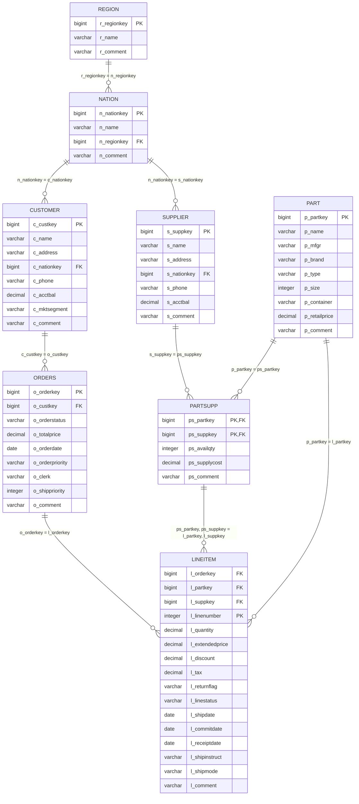

# BẢN ĐẶC TẢ KỸ THUẬT CHUYỂN ĐỔI: TPC-DS SANG TPC-H BENCHMARK
> **Mã tài liệu**: `SPEC-MIGRATE-TPCH-01`  
> **Dự án**: AI Agent Text-to-SQL Self-Service Analytics cho Dữ liệu Doanh nghiệp  
> **Trạng thái**: Đã phê duyệt (Approved - Sẵn sàng thực thi)  
> **Ngày lập**: 12/10/2026  
> **Chiến lược**: Clean Cut (Thay thế hoàn toàn 24 bảng TPC-DS bằng 8 bảng TPC-H)

---

## 1. BỐI CẢNH VÀ MỤC TIÊU CHUYỂN ĐỔI

### 1.1. Bối cảnh & Vấn đề tồn tại với TPC-DS (24 Bảng)
Trong quá trình thử nghiệm thực tế với bộ dữ liệu **TPC-DS (24 bảng)**, hệ thống AI Agent gặp phải các hạn chế nghiêm trọng:
1. **Quá tải ngữ cảnh (Context Window Bloat)**: Lược đồ 24 bảng với hơn 420 cột làm tăng kích thước prompt cho `SchemaRetriever` và `SQLGenerator`, dẫn đến việc LLM dễ bị ảo giác (hallucination) hoặc chọn nhầm các bảng trùng lặp chức năng giữa 3 kênh bán hàng (`store_sales`, `web_sales`, `catalog_sales`) và 3 kênh hoàn trả (`store_returns`, `web_returns`, `catalog_returns`).
2. **Quy tắc ngày tháng qua Surrogate Key quá phức tạp**: TPC-DS không lưu trường `DATE` trực tiếp trong bảng Fact mà sử dụng khóa thay thế (`ss_sold_date_sk`, `ws_sold_date_sk`...) liên kết với `date_dim.d_date_sk`. LLM thường xuyên quên JOIN bảng `date_dim` hoặc JOIN sai khóa, khiến câu truy vấn thất bại.
3. **Khó khăn trong thẩm định & nghiệm thu**: Việc kiểm chứng số liệu thực tế trên 24 bảng đòi hỏi kiến thức chuyên sâu về mô hình Snowflake phức tạp, gây trở ngại lớn cho hội đồng đánh giá và người dùng thử nghiệm khi đối chiếu kết quả.

### 1.2. Mục tiêu khi chuyển về TPC-H (8 Bảng)
1. **Mô hình chuỗi cung ứng chuẩn quốc tế, tinh gọn (8 bảng)**: Bao gồm `region`, `nation`, `supplier`, `customer`, `part`, `partsupp`, `orders`, `lineitem`. Phản ánh trực quan quy trình nghiệp vụ: Đặt hàng, Giao hàng, Tồn kho, Nhà cung cấp và Khách hàng theo khu vực địa lý.
2. **Cú pháp ngày tháng tự nhiên**: Dùng trực tiếp kiểu `DATE` (`o_orderdate`, `l_shipdate`, `l_commitdate`, `l_receiptdate`) mà không cần bảng thứ nguyên ngày trung gian.
3. **Nâng cao tỷ lệ truy vấn hợp lệ & chính xác**: Đặt mục tiêu Valid SQL Rate (VSR) $\ge 95\%$ và Execution Accuracy (EX) $\ge 82\%$ trên tập 50 câu hỏi benchmark tiếng Việt.
4. **Tập trung vào kiến trúc phân tích nâng cao (v4.0)**: Giữ trọn vẹn năng lực phân tích đa bước (Analysis Planner, Hypothesis Testing, Evidence Store) và chốt chặn an toàn (AST Sanitizer, RBAC, Cost Guard) nhưng áp dụng trên một lược đồ dễ kiểm chứng.

---

## 2. CÁC QUYẾT ĐỊNH THIẾT KẾ ĐÃ THỐNG NHẤT

Dựa trên kết quả phỏng vấn kỹ thuật (`/grill-me`), các quyết định nền tảng đã được thông qua như sau:

| Quyết định | Nội dung thống nhất | Rationale kỹ thuật |
| :--- | :--- | :--- |
| **Chiến lược chuyển đổi** | **Clean Cut (Thay thế hoàn toàn)** | Loại bỏ dứt điểm các thành phần TPC-DS; không giữ chế độ Dual-Schema để tránh mã nguồn bị phân mảnh và tăng chi phí bảo trì. |
| **Quy mô dữ liệu (Scale Factor)** | **SF = 0.1 cho Demo/Server** (~100MB) **SF = 0.01 cho Unit Tests** (~12MB) | SF=0.1 sinh ra ~600,000 dòng `lineitem`, ~150,000 dòng `orders`, dữ liệu đủ lớn để vẽ biểu đồ phân tích đa dạng; SF=0.01 đảm bảo test suite chạy dưới 2 giây. |
| **Bảo mật & RBAC** | **2 vai trò: Analyst & Admin** | `Analyst`: Che mờ PII (`c_phone`, `c_address`, `s_phone`, `s_address`) và số dư tài khoản (`c_acctbal`). `Admin`: Toàn quyền xem nguyên bản. Cả hai role đều chịu kiểm duyệt AST (`SELECT` only, chống DDL/DML). |
| **Bộ Benchmark Evals** | **50 câu hỏi tiếng Việt TPC-H** | 40 câu Text-to-SQL phân cấp từ Dễ $\to$ Khó + 10 câu kịch bản phân tích kinh doanh đa bước cho Analytics Subagent v4.0. |
| **Frontend UI** | **Đồng bộ hóa 100% kèm Test Suite** | Catalog 8 bảng chia 4 nhóm trực quan; cập nhật Prompt Presets chuỗi cung ứng; toàn bộ unit test frontend pass 100%. |
| **Tài liệu dự án** | **Đồng bộ toàn bộ tài liệu** | Cập nhật `AGENTS.md`, `DATABASE_SCHEMA.md`, `README.md`, `PRD.md`, `TOM_TAT_DO_AN.md`. |

---

## 3. LƯỢC ĐỒ DỮ LIỆU TPC-H (8 BẢNG) & TẦNG CHỈ SỐ NGHIỆP VỤ

### 3.1. Danh mục 8 Bảng & Khóa liên kết (ERD)

### 3.2. Bảng Phân Nhóm 4 Khối Nghiệp Vụ Trên Giao Diện (Catalog Categories)
1. **Giao dịch & Đơn hàng (Transactions & Orders)**:
   - `orders`: Quản lý trạng thái, ngày đặt hàng, tổng giá trị, độ ưu tiên đơn hàng.
   - `lineitem`: Chi tiết từng mặt hàng trong đơn, số lượng, giá bán, chiết khấu, ngày giao nhận.
2. **Sản phẩm & Tồn kho (Products & Inventory)**:
   - `part`: Danh mục linh kiện, thương hiệu, loại vật liệu, kích cỡ, giá bán lẻ.
   - `partsupp`: Quan hệ cung ứng linh kiện, số lượng hàng tồn kho có sẵn, chi phí cung cấp.
3. **Đối tác & Khách hàng (Partners & Customers)**:
   - `customer`: Thông tin khách hàng, phân khúc thị trường (`c_mktsegment`), số dư tài khoản.
   - `supplier`: Nhà cung ứng hàng hóa, địa chỉ liên hệ, số dư công nợ.
4. **Khu vực Địa lý (Geography)**:
   - `nation`: 25 quốc gia thành viên chuẩn hóa.
   - `region`: 5 châu lục / khu vực kinh tế lớn (`AFRICA`, `AMERICA`, `ASIA`, `EUROPE`, `MIDDLE EAST`).

### 3.3. Các Thước Đo Nghiệp Vụ Chuẩn (dbt Semantic Metrics Layer)
- **Doanh thu niêm yết (Gross Sales Volume)**: `SUM(l_extendedprice)`
- **Doanh thu thuần (Net Revenue)**: `SUM(l_extendedprice * (1 - l_discount))`
- **Tổng tiền chiết khấu (Total Discount Amount)**: `SUM(l_extendedprice * l_discount)`
- **Tổng thuế thu được (Total Tax Collected)**: `SUM(l_extendedprice * (1 - l_discount) * l_tax)`
- **Giá trị tồn kho (Inventory Value)**: `SUM(ps_availqty * ps_supplycost)`
- **Tỷ lệ trễ hạn giao hàng (Late Delivery Rate)**: `COUNT(CASE WHEN l_receiptdate > l_commitdate THEN 1 END) * 100.0 / COUNT(*)`

---

## 4. DANH MỤC THAY ĐỔI TỆP TIN TOÀN DỰ ÁN (FILE MANIFEST)

| Phân hệ | Đường dẫn tệp tin | Hành động | Nội dung thay đổi chi tiết |
| :--- | :--- | :--- | :--- |
| **Data & Config** | `src/config.py` | Chỉnh sửa | Đổi `DUCKDB_PATH` trỏ về `data/tpch.duckdb`. Đổi `WAREHOUSE_TABLES` sang 8 bảng TPC-H. |
| | `src/utils/tpch_seeder.py` | Giữ & Cải tiến | Đặt mặc định `scale_factor = 0.1` cho server runtime; lưu DB vào `data/tpch.duckdb`. |
| | `src/utils/tpcds_seeder.py` | **Xóa bỏ** | Loại bỏ hoàn toàn seeder TPC-DS cũ. |
| **Semantic Layer** | `src/utils/schema_context.py` | Chỉnh sửa | Đặt `TPCH_TABLE_SCHEMAS`, `TPCH_JOIN_RELATIONSHIPS`, `TPCH_SEMANTIC_METRICS` làm schema mặc định. Xóa toàn bộ DDL TPC-DS 24 bảng. |
| | `src/utils/table_keywords.py` | Chỉnh sửa | Cập nhật từ điển ánh xạ từ khóa tiếng Việt về 8 bảng TPC-H. |
| | `src/utils/categorical_search.py`| Chỉnh sửa | Lập chỉ mục các giá trị danh mục TPC-H (`c_mktsegment`, `p_type`, `p_brand`, `o_orderstatus`, `o_orderpriority`, `l_shipmode`, `r_name`, `n_name`). |
| | `src/models/rbac.py` | Chỉnh sửa | Định nghĩa danh sách cột PII TPC-H: `c_name`, `c_address`, `c_phone`, `s_address`, `s_phone`, `c_acctbal`. |
| | `src/utils/rbac_enforcer.py` | Chỉnh sửa | Cập nhật logic mask/redact theo cột nhạy cảm TPC-H. |
| **Prompts & Agents** | `src/agents/prompts/sql_generator_prompt.py` | Chỉnh sửa | Đổi few-shot examples sang TPC-H; hướng dẫn cú pháp ngày tự nhiên (`o_orderdate`), doanh thu thuần `l_extendedprice * (1 - l_discount)`. |
| | `src/agents/prompts/schema_retriever_prompt.py` | Chỉnh sửa | Cập nhật hướng dẫn tìm kiếm trên 8 bảng TPC-H. |
| | `src/agents/prompts/preflight_prompt.py` | Chỉnh sửa | Cập nhật ngữ cảnh nghiệp vụ chuỗi cung ứng TPC-H. |
| | `src/agents/prompts/analytics_planner_prompt.py`| Chỉnh sửa | Hướng dẫn phân rã bài toán phân tích chuỗi cung ứng TPC-H (nhà cung cấp, tồn kho, biên lợi nhuận đơn hàng). |
| | `src/agents/prompts/synthesizer_prompt.py` | Chỉnh sửa | Cập nhật ngữ cảnh diễn giải số liệu chuỗi cung ứng. |
| **Evals Suite** | `evals/datasets/benchmark_vi.json` | Cập nhật | Nạp 50 câu hỏi tiếng Việt TPC-H có ground-truth SQL (40 câu đơn/trung bình/khó + 10 câu phân tích đa bước). |
| | `evals/benchmark_runner.py` | Chỉnh sửa | Cấu hình runner kết nối tới `data/tpch.duckdb` với 8 bảng TPC-H. |
| **Frontend UI** | `src/frontend/data/tpchCatalog.ts` | **Tạo mới** | Tạo danh bạ 8 bảng TPC-H phân theo 4 nhóm, có mô tả chi tiết tiếng Việt và kiểu dữ liệu từng cột. |
| | `src/frontend/data/tpcdsCatalog.ts`| **Xóa bỏ** | Xóa danh bạ 24 bảng TPC-DS cũ. |
| | `src/frontend/components/chat/PromptPresets.tsx`| Chỉnh sửa | Thay đổi các câu hỏi mẫu gợi ý thành các câu hỏi chuỗi cung ứng TPC-H thực tế. |
| | `src/frontend/app/(app)/data-sources/page.tsx` | Chỉnh sửa | Cập nhật thông số thống kê Data Sources hiển thị 8 bảng TPC-H. |
| | `src/frontend/components/sources/DataSourceCard.tsx`| Chỉnh sửa | Đổi badge và nhãn hiển thị sang TPC-H Benchmark. |
| | `src/frontend/locales/vi.ts` & `en.ts` | Chỉnh sửa | Cập nhật chuỗi i18n phản ánh 8 bảng TPC-H. |
| | `src/frontend/data/__tests__/catalog.test.ts` | Chỉnh sửa | Cập nhật test kiểm tra cấu trúc 8 bảng `tpchCatalog`. |
| | `src/frontend/components/chat/__tests__/PromptPresets.test.tsx`| Chỉnh sửa | Cập nhật test kiểm tra danh sách preset TPC-H. |
| | `src/frontend/app/(app)/data-sources/__tests__/data-sources-integration.test.tsx`| Chỉnh sửa | Cập nhật test tích hợp Data Sources 8 bảng. |
| **Tài liệu & Test** | `AGENTS.md` | Chỉnh sửa | Thay "3 Quy tắc vàng TPC-DS" thành "3 Quy tắc vàng TPC-H". |
| | `docs/DATABASE_SCHEMA.md` | Chỉnh sửa | Cập nhật từ điển dữ liệu chính thức 8 bảng TPC-H. |
| | `README.md` | Chỉnh sửa | Cập nhật thông tin đồ án về TPC-H Benchmark. |
| | `docs/PRD.md` | Chỉnh sửa | Cập nhật đặc tả yêu cầu nghiệp vụ chuỗi cung ứng TPC-H. |
| | `docs/TOM_TAT_DO_AN.md` | Chỉnh sửa | Cập nhật tóm tắt đồ án chuyển sang 8 bảng TPC-H. |
| | `tests/utils/test_tpcds_seeder.py`| **Xóa bỏ** | Xóa test seeder TPC-DS cũ. |
| | `tests/utils/test_tpch_seeder.py` | Giữ & Cập nhật | Kiểm tra sinh DB TPC-H ở cả SF=0.01 và SF=0.1. |
| | `tests/utils/test_schema_context.py`| Chỉnh sửa | Đảm bảo test 8 bảng TPC-H pass. |
| | `tests/utils/test_categorical_search.py`| Chỉnh sửa | Đảm bảo test tìm kiếm thực thể TPC-H pass. |
| | `tests/utils/test_rbac_enforcer.py`| Chỉnh sửa | Đảm bảo test che mờ PII TPC-H pass. |

---

## 5. KẾ HOẠCH TRIỂN KHAI THEO 5 GIAI ĐOẠN

```mermaid
gantt
    title Kế hoạch Triển khai Chuyển đổi TPC-H
    dateFormat  X
    axisFormat %s
    section Giai đoạn 1: Core Data & Semantic Layer
    Seeder DuckDB & Config (SF=0.1)        :active, p1_1, 0, 1
    Schema Context & Keywords & Categorical:p1_2, 1, 2
    RBAC & AST Rules                       :p1_3, 2, 3
    section Giai đoạn 2: Prompts & Agents
    SQL Generator & Schema Retriever Prompts:p2_1, 3, 4
    Analytics Subagent & Synthesizer Prompts:p2_2, 4, 5
    section Giai đoạn 3: Evals Suite
    50 Câu hỏi Tiếng Việt & Benchmark Runner:p3_1, 5, 6
    section Giai đoạn 4: Frontend Workspace
    tpchCatalog & Prompt Presets           :p4_1, 6, 7
    Đồng bộ Data Sources Page & Test Suites :p4_2, 7, 8
    section Giai đoạn 5: Docs & Acceptance
    Đồng bộ AGENTS.md, Schema & Báo cáo     :p5_1, 8, 9
    Kiểm thử Toàn diện & Nghiệm thu         :p5_2, 9, 10
```

### Chi tiết các bước thực hiện:

#### Bước 1: Khởi tạo Cơ sở dữ liệu & Cấu hình (Warehouse & Config)
- Thực thi `seed_tpch_data(db_path="data/tpch.duckdb", scale_factor=0.1)` tạo file DuckDB sẵn sàng cho ứng dụng.
- Cập nhật `src/config.py` và dọn dẹp các import liên quan đến TPC-DS.
- Xóa bỏ `src/utils/tpcds_seeder.py` và `tests/utils/test_tpcds_seeder.py`.
- Chạy kiểm tra: `pytest tests/utils/test_tpch_seeder.py`.

#### Bước 2: Tinh gọn Semantic Layer & Tri thức Ngữ nghĩa
- Chỉnh sửa `src/utils/schema_context.py` giữ duy nhất 8 bảng TPC-H với DDL rõ ràng, chú thích tiếng Việt cho từng cột, danh mục JOIN và Semantic Metrics.
- Chỉnh sửa `src/utils/table_keywords.py` ánh xạ các từ khóa tự nhiên tiếng Việt về 8 bảng TPC-H.
- Chỉnh sửa `src/utils/categorical_search.py` lập chỉ mục các phân khúc, loại linh kiện, phương thức giao hàng, trạng thái đơn hàng.
- Cập nhật chính sách PII trong `src/models/rbac.py` và `src/utils/rbac_enforcer.py`.
- Chạy kiểm tra: `pytest tests/utils/test_schema_context.py tests/utils/test_categorical_search.py tests/utils/test_rbac_enforcer.py`.

#### Bước 3: Cập nhật Hệ thống Prompt của AI Agent
- Chuyển toàn bộ các prompt trong `src/agents/prompts/` sang chuẩn TPC-H:
  - Bỏ yêu cầu join `date_dim`, sử dụng `o_orderdate`, `l_shipdate`.
  - Bỏ các bảng `store_sales`, `web_sales`, thay bằng `orders` và `lineitem`.
  - Công thức tính doanh thu: `l_extendedprice * (1 - l_discount)`.
- Chạy kiểm tra test agents: `pytest tests/agents/`.

#### Bước 4: Nạp Bộ Benchmark 50 Câu hỏi & Runner Evals
- Khôi phục và chuẩn hóa file `evals/datasets/benchmark_vi.json` với 50 câu hỏi TPC-H có phân loại độ khó (`EASY`, `MEDIUM`, `HARD`) và loại truy vấn.
- Kiểm tra tính hợp lệ của toàn bộ ground-truth SQL bằng cách chạy thử trực tiếp trên `data/tpch.duckdb`.
- Đảm bảo `python -m evals.benchmark_runner` sẵn sàng thực thi đo kiểm.

#### Bước 5: Cập nhật Frontend UI & Đồng bộ Test Suites
- Tạo `src/frontend/data/tpchCatalog.ts` (8 bảng, 4 nhóm: Đơn hàng, Linh kiện, Đối tác, Địa lý) và xóa `tpcdsCatalog.ts`.
- Cập nhật các component: `PromptPresets.tsx`, `data-sources/page.tsx`, `DataSourceCard.tsx`.
- Cập nhật các file test frontend: `catalog.test.ts`, `PromptPresets.test.tsx`, `data-sources-integration.test.tsx`.
- Chạy kiểm tra: `npm --prefix src/frontend run test` đảm bảo 100% tests pass.

#### Bước 6: Cập nhật Tài liệu & Nghiệm thu Hệ thống
- Cập nhật `AGENTS.md` (3 Quy tắc vàng TPC-H: Cột ngày tự nhiên, Doanh thu thuần, Bảo vệ PII khách hàng).
- Cập nhật `docs/DATABASE_SCHEMA.md`, `README.md`, `docs/PRD.md`, `docs/TOM_TAT_DO_AN.md`.
- Chạy kiểm tra chất lượng mã nguồn: `ruff check .`.
- Thực hiện nghiệm thu 1 luồng truy vấn End-to-End từ Frontend đến Backend.

---

## 6. TIÊU CHÍ NGHIỆM THU (ACCEPTANCE CRITERIA)

| Tiêu chí | Ngưỡng đạt yêu cầu | Phương pháp kiểm chứng |
| :--- | :--- | :--- |
| **Tính toàn vẹn Database** | Đủ 8 bảng TPC-H với `nation` (25 dòng), `region` (5 dòng), dữ liệu `orders` & `lineitem` $\ge 0$. | `test_tpch_seeder.py` pass. |
| **An toàn Cú pháp & RBAC** | 100% lệnh DDL/DML bị từ chối; Analyst không thấy PII thô (`c_phone`, `c_address`, `s_phone`). | `test_ast_sanitizer.py`, `test_rbac_enforcer.py` pass. |
| **Backend Unit Tests** | Toàn bộ unit tests liên quan đến utils, agents, api đều pass. | `pytest tests/` pass. |
| **Frontend UI & Tests** | Màn hình Data Sources hiển thị đúng 8 bảng TPC-H; Chat Presets hoạt động; tests pass. | `npm --prefix src/frontend run test` pass. |
| **Code Hygiene** | Không còn tham chiếu TPC-DS mâu thuẫn trong code chính; linting sạch sẽ. | `ruff check .` không báo lỗi. |
| **Tài liệu Báo cáo** | Thống nhất 100% thuật ngữ và lược đồ TPC-H trong toàn bộ file tài liệu. | Đọc soát file tài liệu trong `docs/`. |
